# WWII Trivia Bank

279 questions · 73 picture questions. Equipment: 146. History: 133.

Each question has four options, one correct answer, an explanation for every choice, and clickable sources shown after a player answers. Stable IDs can be used to sample questions without repeats. Shuffle choices independently if needed. Picture questions use an `Image` field with a local asset and non-spoiling alt text, plus an `Image credit` and, where applicable, an `Image license` link shown after answering. See [image provenance](./assets/ART-SOURCES.md).

Retained equipment IDs: WWII-E12, WWII-E15, WWII-E59, WWII-033, WWII-034, WWII-035, WWII-036, WWII-055, WWII-152, WWII-153, WWII-154, WWII-155, WWII-156, WWII-158, WWII-159, WWII-160, WWII-161, WWII-162, WWII-163, WWII-164, WWII-165, WWII-166, WWII-167, WWII-207, WWII-209, WWII-210, WWII-211, WWII-212, WWII-213, WWII-214, WWII-215, WWII-216, WWII-218, WWII-219, WWII-225, WWII-226, WWII-242, WWII-243, WWII-245, WWII-248. All other retained IDs are history. The retained original entries are unchanged.

## Easy

### WWII-E01 — On which date did Germany invade Poland?

**Topic:** Europe timeline

- A. June 6, 1944
- B. December 7, 1941
- C. September 3, 1939
- D. September 1, 1939

**Correct answer:** D

- **A · Incorrect:** That is the date of the Allied landings in Normandy.
- **B · Incorrect:** That is the date of the Japanese attack on Pearl Harbor.
- **C · Incorrect:** Britain and France declared war on Germany on September 3, two days after the invasion.
- **D · Correct:** German troops invaded Poland on September 1, 1939, opening the war in Europe.

**Source:** [U.S. Holocaust Memorial Museum — WWII key dates](https://encyclopedia.ushmm.org/content/en/article/world-war-ii-key-dates)

### WWII-E02 — Which two countries declared war on Germany on September 3, 1939?

**Topic:** Europe timeline

- A. Britain and France
- B. Italy and Japan
- C. The United States and the Soviet Union
- D. Poland and Belgium

**Correct answer:** A

- **A · Correct:** Britain and France declared war two days after Germany invaded Poland.
- **B · Incorrect:** Italy and Japan were Germany’s partners, not its enemies, in September 1939.
- **C · Incorrect:** Neither power was at war with Germany on that date.
- **D · Incorrect:** Poland was the country being invaded, and Belgium was still neutral.

**Source:** [U.S. Holocaust Memorial Museum — WWII key dates](https://encyclopedia.ushmm.org/content/en/article/world-war-ii-key-dates)

### WWII-E03 — Who was the dictator of Italy and Hitler’s main European ally?

**Topic:** Command and leadership

- A. Francisco Franco
- B. Hideki Tojo
- C. Benito Mussolini
- D. Joseph Stalin

**Correct answer:** C

- **A · Incorrect:** Franco ruled Spain, which stayed out of the war as a belligerent.
- **B · Incorrect:** Tojo was a wartime prime minister of Japan.
- **C · Correct:** Mussolini led Fascist Italy and took it into the war on Germany’s side.
- **D · Incorrect:** Stalin led the Soviet Union, which Germany invaded in 1941.

**Source:** [Encyclopaedia Britannica — Benito Mussolini](https://www.britannica.com/biography/Benito-Mussolini)

### WWII-E04 — Which country signed an armistice with Germany in June 1940?

**Topic:** Europe timeline

- A. Britain
- B. France
- C. Spain
- D. Sweden

**Correct answer:** B

- **A · Incorrect:** Britain stayed in the war after France’s defeat.
- **B · Correct:** France signed an armistice on June 22, 1940, and a collaborationist government was then based at Vichy.
- **C · Incorrect:** Spain did not enter the war as a belligerent.
- **D · Incorrect:** Sweden remained neutral.

**Source:** [U.S. Holocaust Memorial Museum — WWII key dates](https://encyclopedia.ushmm.org/content/en/article/world-war-ii-key-dates)

### WWII-E05 — Which country did Germany invade on June 22, 1941?

**Topic:** Europe timeline

- A. The Soviet Union
- B. Britain
- C. The United States
- D. Poland

**Correct answer:** A

- **A · Correct:** Germany launched its invasion of the Soviet Union on June 22, 1941.
- **B · Incorrect:** Germany never launched a seaborne invasion of Britain.
- **C · Incorrect:** The United States was not the target of that invasion.
- **D · Incorrect:** Germany had invaded Poland in September 1939.

**Source:** [U.S. Holocaust Memorial Museum — WWII key dates](https://encyclopedia.ushmm.org/content/en/article/world-war-ii-key-dates)

### WWII-E06 — In which battle did a surrounded German army surrender in early 1943?

**Topic:** Europe timeline

- A. Leningrad
- B. Moscow
- C. Kursk
- D. Stalingrad

**Correct answer:** D

- **A · Incorrect:** Leningrad endured a long siege rather than this surrender.
- **B · Incorrect:** The Soviet defense of Moscow turned the Germans back in the winter of 1941–42.
- **C · Incorrect:** The Battle of Kursk was fought later, in the summer of 1943.
- **D · Correct:** The German army trapped at Stalingrad surrendered by February 2, 1943.

**Source:** [Encyclopaedia Britannica — Battle of Stalingrad](https://www.britannica.com/event/Battle-of-Stalingrad)

### WWII-E07 — Which country attacked Pearl Harbor on December 7, 1941?

**Topic:** War in Asia and the Pacific

- A. Germany
- B. Italy
- C. Japan
- D. The Soviet Union

**Correct answer:** C

- **A · Incorrect:** Germany declared war on the United States four days later.
- **B · Incorrect:** Italy also declared war on the United States on December 11.
- **C · Correct:** Japanese aircraft attacked the U.S. Pacific Fleet base at Pearl Harbor.
- **D · Incorrect:** The Soviet Union was not at war with the United States.

**Source:** [U.S. Holocaust Memorial Museum — WWII key dates](https://encyclopedia.ushmm.org/content/en/article/world-war-ii-key-dates)

### WWII-E08 — On which date did Allied armies land in Normandy?

**Topic:** Europe timeline

- A. May 8, 1945
- B. June 6, 1944
- C. September 1, 1939
- D. December 7, 1941

**Correct answer:** B

- **A · Incorrect:** That date is associated with Germany’s surrender in 1945.
- **B · Correct:** Allied forces landed on the Normandy beaches on June 6, 1944.
- **C · Incorrect:** That is the date Germany invaded Poland.
- **D · Incorrect:** That is the date of the Pearl Harbor attack.

**Source:** [Encyclopaedia Britannica — Normandy Invasion](https://www.britannica.com/event/Normandy-Invasion)

### WWII-E09 — In which year did Roosevelt, Churchill, and Stalin meet at Yalta?

**Topic:** Diplomacy

- A. 1945
- B. 1942
- C. 1943
- D. 1941

**Correct answer:** A

- **A · Correct:** The three leaders met at Yalta in February 1945.
- **B · Incorrect:** The Yalta meeting came in the last year of the war, not in 1942.
- **C · Incorrect:** Their first meeting together was at Tehran in 1943.
- **D · Incorrect:** The United States had only just entered the war in December 1941.

**Source:** [Encyclopaedia Britannica — Yalta Conference](https://www.britannica.com/event/Yalta-Conference)

### WWII-E11 — Which naval battle in June 1942 was a major American victory over Japan?

**Topic:** War at sea

- A. Pearl Harbor
- B. Midway
- C. Leyte Gulf
- D. The Atlantic

**Correct answer:** B

- **A · Incorrect:** Pearl Harbor, in December 1941, was a Japanese attack on the U.S. fleet.
- **B · Correct:** The United States defeated a Japanese carrier force at Midway in June 1942.
- **C · Incorrect:** Leyte Gulf was fought in October 1944.
- **D · Incorrect:** The Battle of the Atlantic was the long campaign against U-boats, not this June 1942 carrier battle.

**Source:** [Encyclopaedia Britannica — Battle of Midway](https://www.britannica.com/event/Battle-of-Midway)

### WWII-E12 — On which ship was Japan’s formal surrender signed in 1945?

**Topic:** War at sea

- A. USS Arizona
- B. HMS Hood
- C. USS Missouri
- D. USS Enterprise

**Correct answer:** C

- **A · Incorrect:** Arizona was sunk at Pearl Harbor in 1941.
- **B · Incorrect:** Hood was sunk by Bismarck in May 1941.
- **C · Correct:** Japanese envoys signed the surrender on the USS Missouri in Tokyo Bay on September 2, 1945.
- **D · Incorrect:** Enterprise was a famous U.S. carrier, not the site of the signing.

**Source:** [U.S. National Archives — Surrender of Japan](https://www.archives.gov/milestone-documents/surrender-of-japan)

### WWII-E13 — In which city did Anne Frank and her family hide from the Nazis?

**Topic:** Occupation and resistance

- A. Amsterdam
- B. Berlin
- C. Paris
- D. Warsaw

**Correct answer:** A

- **A · Correct:** The Frank family hid in a secret annex in Amsterdam.
- **B · Incorrect:** The family had left Germany after the Nazis took power.
- **C · Incorrect:** They were not hiding in Paris.
- **D · Incorrect:** Warsaw was the site of the ghetto uprising, not the Frank family’s hiding place.

**Source:** [U.S. Holocaust Memorial Museum — Anne Frank biography](https://encyclopedia.ushmm.org/content/en/article/anne-frank-biography)

### WWII-E14 — Which country’s forces liberated Auschwitz in January 1945?

**Topic:** Occupation and resistance

- A. The United States
- B. Britain
- C. France
- D. The Soviet Union

**Correct answer:** D

- **A · Incorrect:** American troops liberated camps farther west, including Buchenwald and Dachau.
- **B · Incorrect:** British troops liberated Bergen-Belsen in April 1945.
- **C · Incorrect:** French forces were not the army that entered Auschwitz.
- **D · Correct:** Soviet troops liberated Auschwitz on January 27, 1945.

**Source:** [U.S. Holocaust Memorial Museum — Auschwitz](https://encyclopedia.ushmm.org/content/en/article/auschwitz)

### WWII-E15 — Which U.S. battleship was sunk at Pearl Harbor and remains a memorial there?

**Topic:** War at sea

- A. USS Missouri
- B. USS Arizona
- C. USS Texas
- D. USS Iowa

**Correct answer:** B

- **A · Incorrect:** Missouri was the site of Japan’s surrender in 1945.
- **B · Correct:** Arizona exploded and sank on December 7, 1941, and the wreck is a memorial.
- **C · Incorrect:** Texas was a U.S. battleship that was not sunk at Pearl Harbor.
- **D · Incorrect:** Iowa was not the battleship lost on Battleship Row that day.

**Source:** [Encyclopaedia Britannica — Pearl Harbor attack](https://www.britannica.com/event/Pearl-Harbor-attack)

### WWII-E16 — What is the common name of Germany’s December 1944 offensive in the Ardennes?

**Topic:** Europe timeline

- A. The Battle of Kursk
- B. The Battle of Britain
- C. The Battle of the Bulge
- D. The Battle of Midway

**Correct answer:** C

- **A · Incorrect:** Kursk was a 1943 battle in the Soviet Union.
- **B · Incorrect:** The Battle of Britain was fought in the air over Britain in 1940.
- **C · Correct:** The Ardennes offensive that began in December 1944 is known as the Battle of the Bulge.
- **D · Incorrect:** Midway was a 1942 naval battle in the Pacific.

**Source:** [Encyclopaedia Britannica — Battle of the Bulge](https://www.britannica.com/event/Battle-of-the-Bulge)

### WWII-E17 — In which month of 1945 did Germany surrender?

**Topic:** Chronology

- A. May
- B. August
- C. September
- D. March

**Correct answer:** A

- **A · Correct:** Germany’s unconditional surrender became official on May 8, 1945.
- **B · Incorrect:** August 1945 was the month of the atomic bombings and Japan’s decision to surrender.
- **C · Incorrect:** Japan’s formal surrender was signed in September 1945.
- **D · Incorrect:** Allied armies were still advancing into Germany in March 1945.

**Source:** [U.S. Holocaust Memorial Museum — liberation of Nazi camps](https://encyclopedia.ushmm.org/content/en/article/liberation-of-nazi-camps)

### WWII-E18 — In which month of 1945 was Japan’s formal surrender signed?

**Topic:** Chronology

- A. May
- B. June
- C. August
- D. September

**Correct answer:** D

- **A · Incorrect:** Germany surrendered in May 1945.
- **B · Incorrect:** The United Nations Charter was signed in June 1945.
- **C · Incorrect:** Japan announced that it would surrender in August; the formal signing came the next month.
- **D · Correct:** The surrender was signed aboard the USS Missouri on September 2, 1945.

**Source:** [U.S. National Archives — Surrender of Japan](https://www.archives.gov/milestone-documents/surrender-of-japan)

### WWII-E19 — Who was the American general in command of the Allied invasion of Normandy?

**Topic:** Command and leadership

- A. George Patton
- B. Dwight D. Eisenhower
- C. Douglas MacArthur
- D. Bernard Montgomery

**Correct answer:** B

- **A · Incorrect:** Patton commanded the U.S. Third Army in the campaign after the landings.
- **B · Correct:** Eisenhower was Supreme Commander of the Allied Expeditionary Force for the Normandy invasion.
- **C · Incorrect:** MacArthur commanded in the Southwest Pacific.
- **D · Incorrect:** Montgomery commanded the ground forces under Eisenhower for the invasion.

**Source:** [Encyclopaedia Britannica — Dwight D. Eisenhower](https://www.britannica.com/biography/Dwight-D-Eisenhower)

### WWII-E20 — Which German commander was known as the Desert Fox?

**Topic:** Command and leadership

- A. Erwin Rommel
- B. Heinrich Himmler
- C. Hermann Göring
- D. Adolf Hitler

**Correct answer:** A

- **A · Correct:** Rommel earned the nickname Desert Fox while commanding German forces in North Africa.
- **B · Incorrect:** Himmler led the SS, not the Afrika Korps.
- **C · Incorrect:** Göring commanded the Luftwaffe.
- **D · Incorrect:** Hitler was Germany’s dictator, not the general called the Desert Fox.

**Source:** [Encyclopaedia Britannica — Erwin Rommel](https://www.britannica.com/biography/Erwin-Rommel)

### WWII-E21 — Who led the Soviet Union throughout World War II?

**Topic:** Command and leadership

- A. Joseph Stalin
- B. Vladimir Lenin
- C. Leon Trotsky
- D. Nikita Khrushchev

**Correct answer:** A

- **A · Correct:** Stalin was the Soviet leader from the 1920s through the war and until his death in 1953.
- **B · Incorrect:** Lenin died in 1924, long before the war.
- **C · Incorrect:** Trotsky was exiled and was not the wartime leader.
- **D · Incorrect:** Khrushchev became the Soviet leader after Stalin’s death.

**Source:** [Encyclopaedia Britannica — Joseph Stalin](https://www.britannica.com/biography/Joseph-Stalin)

### WWII-E22 — Which country passed the Lend-Lease Act to supply weapons to Allies such as Britain?

**Topic:** Wartime diplomacy

- A. Germany
- B. The Soviet Union
- C. Japan
- D. The United States

**Correct answer:** D

- **A · Incorrect:** Germany was the power those supplies were meant to help defeat.
- **B · Incorrect:** The Soviet Union received Lend-Lease aid; it did not pass the act.
- **C · Incorrect:** Japan was an Axis power.
- **D · Correct:** Congress passed the Lend-Lease Act on March 11, 1941, letting the United States send war supplies to nations whose defense it deemed vital.

**Source:** [U.S. National Archives — Lend-Lease Act](https://www.archives.gov/milestone-documents/lend-lease-act)

### WWII-E23 — On which continent did Allied troops land in French Morocco and Algeria in November 1942?

**Topic:** Operations and geography

- A. Europe
- B. Africa
- C. Asia
- D. Australia

**Correct answer:** B

- **A · Incorrect:** Those November 1942 landings were not in Europe.
- **B · Correct:** The landings in Morocco and Algeria opened the Allied campaign in French North Africa.
- **C · Incorrect:** Morocco and Algeria are in Africa, not Asia.
- **D · Incorrect:** Australia was a base in the Pacific war, not the site of these landings.

**Source:** [Encyclopaedia Britannica — World War II](https://www.britannica.com/event/World-War-II)

### WWII-E26 — From which French port were hundreds of thousands of Allied troops evacuated in 1940?

**Topic:** Europe timeline

- A. Marseille
- B. Cherbourg
- C. Le Havre
- D. Dunkirk

**Correct answer:** D

- **A · Incorrect:** Marseille, on the Mediterranean, was not the 1940 evacuation port.
- **B · Incorrect:** Cherbourg was a later Allied objective in the Normandy campaign.
- **C · Incorrect:** Le Havre was not the port of the great 1940 evacuation.
- **D · Correct:** British and Allied troops were evacuated from Dunkirk in late May and early June 1940.

**Source:** [Encyclopaedia Britannica — Dunkirk evacuation](https://www.britannica.com/event/Dunkirk-evacuation)

### WWII-E27 — Which country did Germany invade on April 9, 1940, the same day it invaded Denmark?

**Topic:** Europe timeline

- A. Sweden
- B. Norway
- C. Finland
- D. Belgium

**Correct answer:** B

- **A · Incorrect:** Sweden was not invaded.
- **B · Correct:** Germany invaded Norway and Denmark on April 9, 1940.
- **C · Incorrect:** Finland was not the country attacked that day.
- **D · Incorrect:** Germany invaded Belgium the following month.

**Source:** [U.S. Holocaust Memorial Museum — WWII key dates](https://encyclopedia.ushmm.org/content/en/article/world-war-ii-key-dates)

### WWII-E30 — Which capital did American bombers strike in the Doolittle Raid of April 1942?

**Topic:** War in Asia and the Pacific

- A. Berlin
- B. Rome
- C. London
- D. Tokyo

**Correct answer:** D

- **A · Incorrect:** Berlin was bombed by Allied air forces in Europe, not by the Doolittle Raid.
- **B · Incorrect:** Rome was not the target of that raid.
- **C · Incorrect:** London was bombed by Germany during the Blitz.
- **D · Correct:** On April 18, 1942, Doolittle’s bombers struck Tokyo and other Japanese cities.

**Source:** [Encyclopaedia Britannica — James H. Doolittle](https://www.britannica.com/biography/James-H-Doolittle)

### WWII-E36 — Who was Britain’s prime minister during D-Day and the victory over Germany?

**Topic:** Command and leadership

- A. Winston Churchill
- B. Neville Chamberlain
- C. Franklin D. Roosevelt
- D. Charles de Gaulle

**Correct answer:** A

- **A · Correct:** Churchill was prime minister from May 1940 until July 1945, covering D-Day and Germany’s surrender.
- **B · Incorrect:** Chamberlain was prime minister at the start of the war and resigned in May 1940.
- **C · Incorrect:** Roosevelt was president of the United States.
- **D · Incorrect:** De Gaulle led the Free French, not the British government.

**Source:** [Encyclopaedia Britannica — Winston Churchill](https://www.britannica.com/biography/Winston-Churchill)

### WWII-E37 — In August 1939, Germany signed a nonaggression pact with which country?

**Topic:** Wartime diplomacy

- A. Britain
- B. France
- C. The Soviet Union
- D. The United States

**Correct answer:** C

- **A · Incorrect:** Britain went to war with Germany two weeks later.
- **B · Incorrect:** France also declared war on Germany in September 1939.
- **C · Correct:** Germany and the Soviet Union signed a nonaggression pact on August 23, 1939.
- **D · Incorrect:** The United States was not a party to that pact.

**Source:** [U.S. Holocaust Memorial Museum — German-Soviet Pact](https://encyclopedia.ushmm.org/content/en/article/german-soviet-pact)

### WWII-E38 — Which country surrendered to the Allies in May 1945?

**Topic:** Europe timeline

- A. Japan
- B. Italy
- C. France
- D. Germany

**Correct answer:** D

- **A · Incorrect:** Japan surrendered later, in August and September 1945.
- **B · Incorrect:** Italy had signed an armistice with the Allies in September 1943.
- **C · Incorrect:** France had been liberated and was with the Allies by May 1945.
- **D · Correct:** Germany surrendered unconditionally in May 1945, ending the war in Europe.

**Source:** [U.S. National Archives — German surrender](https://www.archives.gov/milestone-documents/surrender-of-germany)

### WWII-E39 — Which country dropped atomic bombs on Hiroshima and Nagasaki in August 1945?

**Topic:** War in Asia and the Pacific

- A. Britain
- B. The United States
- C. The Soviet Union
- D. China

**Correct answer:** B

- **A · Incorrect:** Britain was an ally but did not drop the atomic bombs.
- **B · Correct:** The United States bombed Hiroshima on August 6 and Nagasaki on August 9, 1945.
- **C · Incorrect:** The Soviet Union entered the war against Japan in August 1945 but did not drop those bombs.
- **D · Incorrect:** China was at war with Japan and did not have atomic bombs.

**Source:** [Encyclopaedia Britannica — World War II](https://www.britannica.com/event/World-War-II)

### WWII-E40 — Which country had been fighting a full-scale war with Japan since 1937?

**Topic:** War in Asia and the Pacific

- A. China
- B. Australia
- C. India
- D. The United States

**Correct answer:** A

- **A · Correct:** Full-scale war between China and Japan began in July 1937.
- **B · Incorrect:** Australia entered the war against Japan with the wider Pacific war in 1941.
- **C · Incorrect:** Indian forces fought Japan later, as part of the British Empire’s war.
- **D · Incorrect:** The United States was attacked by Japan in December 1941.

**Source:** [Encyclopaedia Britannica — Second Sino-Japanese War](https://www.britannica.com/event/Second-Sino-Japanese-War)

### WWII-E41 — Germany, Italy, and Japan were the main members of which alliance?

**Topic:** Europe timeline

- A. The Allies
- B. The League of Nations
- C. The Axis
- D. The United Nations

**Correct answer:** C

- **A · Incorrect:** The Allies were the countries fighting the Axis.
- **B · Incorrect:** The League of Nations was the earlier peace organization, not this wartime alliance.
- **C · Correct:** Germany, Italy, and Japan were the principal Axis powers.
- **D · Incorrect:** The United Nations was the name used by the Allies and, later, the postwar organization.

**Source:** [Encyclopaedia Britannica — World War II](https://www.britannica.com/event/World-War-II)

### WWII-E42 — Which U.S. president met Churchill and Stalin at Yalta in February 1945?

**Topic:** Diplomacy

- A. Harry Truman
- B. Herbert Hoover
- C. Dwight D. Eisenhower
- D. Franklin D. Roosevelt

**Correct answer:** D

- **A · Incorrect:** Truman became president after Roosevelt died in April 1945 and met Stalin at Potsdam.
- **B · Incorrect:** Hoover had been president from 1929 to 1933.
- **C · Incorrect:** Eisenhower was the Allied commander in Europe, not the U.S. president.
- **D · Correct:** Roosevelt represented the United States at Yalta in February 1945.

**Source:** [Encyclopaedia Britannica — Yalta Conference](https://www.britannica.com/event/Yalta-Conference)

### WWII-E45 — General Douglas MacArthur returned in 1944 to which country?

**Topic:** War in Asia and the Pacific

- A. Japan
- B. China
- C. Australia
- D. The Philippines

**Correct answer:** D

- **A · Incorrect:** MacArthur accepted Japan’s surrender in 1945; the 1944 return was not to Japan.
- **B · Incorrect:** He was not returning to China in that famous landing.
- **C · Incorrect:** Australia had been his base after he left the Philippines in 1942.
- **D · Correct:** MacArthur landed in the Philippines, on Leyte, in October 1944.

**Source:** [Encyclopaedia Britannica — Douglas MacArthur](https://www.britannica.com/biography/Douglas-MacArthur)

### WWII-E50 — Sicily, which the Allies invaded in July 1943, is part of which country?

**Topic:** Europe timeline

- A. Greece
- B. France
- C. Italy
- D. Spain

**Correct answer:** C

- **A · Incorrect:** Greece is across the Mediterranean from Sicily.
- **B · Incorrect:** The Allies invaded southern France in August 1944.
- **C · Correct:** Sicily is an Italian island, and the Allies invaded it in July 1943 before landing on mainland Italy.
- **D · Incorrect:** Spain stayed out of the war.

**Source:** [Encyclopaedia Britannica — World War II](https://www.britannica.com/event/World-War-II)

### WWII-E51 — Admiral Isoroku Yamamoto, who planned the Pearl Harbor attack, served which country?

**Topic:** Command and leadership

- A. Japan
- B. Germany
- C. The United States
- D. Britain

**Correct answer:** A

- **A · Correct:** Yamamoto was a Japanese admiral and planned the attack on Pearl Harbor.
- **B · Incorrect:** Germany’s navy did not carry out the Pearl Harbor attack.
- **C · Incorrect:** The United States was the country attacked at Pearl Harbor.
- **D · Incorrect:** Britain’s navy fought Germany and, later, Japan, but Yamamoto was not British.

**Source:** [Encyclopaedia Britannica — Yamamoto Isoroku](https://www.britannica.com/biography/Yamamoto-Isoroku)

### WWII-E56 — What is the common name for the Allied victory over Germany on May 8, 1945?

**Topic:** Europe timeline

- A. D-Day
- B. The Blitz
- C. Pearl Harbor
- D. V-E Day

**Correct answer:** D

- **A · Incorrect:** D-Day is June 6, 1944, the landing in Normandy.
- **B · Incorrect:** The Blitz was the German bombing of Britain in 1940–41.
- **C · Incorrect:** Pearl Harbor was Japan’s attack on December 7, 1941.
- **D · Correct:** May 8, 1945, when Germany’s surrender became official, is celebrated as V-E Day.

**Source:** [Encyclopaedia Britannica — World War II](https://www.britannica.com/event/World-War-II)

### WWII-E59 — Which country used the B-17 Flying Fortress to bomb Germany?

**Topic:** Aircraft and vehicles

- A. Germany
- B. Japan
- C. The United States
- D. Italy

**Correct answer:** C

- **A · Incorrect:** Germany was the target of the American bombing campaign.
- **B · Incorrect:** Japan did not fly the B-17 against Germany.
- **C · Correct:** The U.S. Army Air Forces used the B-17 Flying Fortress in the bombing of Germany.
- **D · Incorrect:** Italy was an Axis power and did not operate the Flying Fortress.

**Source:** [Encyclopaedia Britannica — World War II](https://www.britannica.com/event/World-War-II)

### WWII-E61 — Who was the dictator of Germany during World War II?

**Topic:** Command and leadership

- A. Benito Mussolini
- B. Adolf Hitler
- C. Hideki Tojo
- D. Francisco Franco

**Correct answer:** B

- **A · Incorrect:** Mussolini was the dictator of Italy.
- **B · Correct:** Hitler was Germany’s dictator and led it throughout the war until his death in 1945.
- **C · Incorrect:** Tojo was a wartime prime minister of Japan.
- **D · Incorrect:** Franco was the ruler of Spain.

**Source:** [U.S. Holocaust Memorial Museum — Adolf Hitler](https://encyclopedia.ushmm.org/content/en/article/adolf-hitler)

## Medium

### WWII-033 — What U.S. carrier was lost at Coral Sea?

**Topic:** War at sea

- A. USS Wasp
- B. USS Hornet
- C. USS Yorktown
- D. USS Lexington

**Correct answer:** D

- **A · Incorrect:** It was sunk by a submarine near the Solomons in September 1942.
- **B · Incorrect:** It was lost off the Santa Cruz Islands.
- **C · Incorrect:** It was damaged there but survived until Midway.
- **D · Correct:** It was scuttled after severe damage.

**Source:** [Naval History and Heritage Command — 1942](https://www.history.navy.mil/browse-by-topic/wars-conflicts-and-operations/world-war-ii/1942.html)

### WWII-034 — Which American carrier was damaged at Coral Sea and then lost at Midway?

**Topic:** War at sea

- A. USS Enterprise
- B. USS Lexington
- C. USS Yorktown
- D. USS Hornet

**Correct answer:** C

- **A · Incorrect:** It survived Midway and the war.
- **B · Incorrect:** It did not survive Coral Sea.
- **C · Correct:** It was repaired quickly enough to join the Midway force.
- **D · Incorrect:** It survived Midway but was lost later in 1942.

**Source:** [Naval History and Heritage Command — Midway, interrogation of Japanese officials](https://www.history.navy.mil/content/history/nhhc/research/library/online-reading-room/title-list-alphabetically/b/battle-of-midway-interrogation-of-japanese-officials.html)

### WWII-035 — Which U.S. carrier launched the Doolittle Raid aircraft?

**Topic:** War at sea

- A. USS Yorktown
- B. USS Enterprise
- C. USS Hornet
- D. USS Lexington

**Correct answer:** C

- **A · Incorrect:** It was operating separately in the Pacific.
- **B · Incorrect:** It escorted the operation and provided fighter protection.
- **C · Correct:** Its flight deck launched the Army B-25s.
- **D · Incorrect:** It was not part of the raiding task force.

**Source:** [Naval History and Heritage Command — 1942](https://www.history.navy.mil/browse-by-topic/wars-conflicts-and-operations/world-war-ii/1942.html)

### WWII-036 — What aircraft type flew the Doolittle Raid?

**Topic:** War at sea

- A. SBD Dauntless
- B. B-25 Mitchell
- C. B-26 Marauder
- D. B-17 Flying Fortress

**Correct answer:** B

- **A · Incorrect:** It was a Navy carrier dive bomber.
- **B · Correct:** Army B-25 twin-engine bombers took off from Hornet.
- **C · Incorrect:** This was another U.S. medium bomber, but was not chosen for the raid.
- **D · Incorrect:** This heavy bomber was not used for the carrier launch.

**Source:** [Naval History and Heritage Command — 1942](https://www.history.navy.mil/browse-by-topic/wars-conflicts-and-operations/world-war-ii/1942.html)

### WWII-055 — Which Japanese carrier was carrying Admiral Nagumo’s flag at the Pearl Harbor attack?

**Topic:** War at sea

- A. Shōkaku
- B. Hiryū
- C. Akagi
- D. Kaga

**Correct answer:** C

- **A · Incorrect:** It took part in the attack as a carrier of the Fifth Carrier Division.
- **B · Incorrect:** It was another carrier in the raid but was not the flagship.
- **C · Correct:** Nagumo commanded the carrier strike force from Akagi.
- **D · Incorrect:** It joined the strike, but Nagumo’s flag was aboard Akagi.

**Source:** [Naval History and Heritage Command — Pearl Harbor](https://www.history.navy.mil/browse-by-topic/wars-conflicts-and-operations/world-war-ii/1941/pearl-harbor.html)

## Hard

### WWII-152 — Which was the British fighter whose Mk IID variant carried two 40 mm cannon for ground attack?

**Topic:** Aircraft and vehicles

- A. de Havilland Mosquito
- B. Hawker Hurricane
- C. Supermarine Spitfire
- D. Hawker Typhoon

**Correct answer:** B

- **A · Incorrect:** A predominantly wooden design used for bombing, reconnaissance, and fighter roles.
- **B · Correct:** Hawker’s earlier single-engine monoplane fighter, adapted to several roles.
- **C · Incorrect:** Supermarine’s single-engine fighter with its characteristic elliptical planform.
- **D · Incorrect:** A large single-engine Hawker fighter extensively used for tactical ground attack.

**Source:** [RAF Museum — Second World War aircraft](https://assets.rafmuseum.org.uk/app/uploads/2025/12/03140527/SWW_planes_pupil_sheet_2025.pdf)

### WWII-153 — Which was the Hawker fighter flown in large numbers for rocket attacks during the Normandy campaign?

**Topic:** Aircraft and vehicles

- A. Supermarine Spitfire
- B. Hawker Typhoon
- C. de Havilland Mosquito
- D. Hawker Hurricane

**Correct answer:** B

- **A · Incorrect:** Supermarine’s single-engine fighter with its characteristic elliptical planform.
- **B · Correct:** A large single-engine Hawker fighter extensively used for tactical ground attack.
- **C · Incorrect:** A predominantly wooden design used for bombing, reconnaissance, and fighter roles.
- **D · Incorrect:** Hawker’s earlier single-engine monoplane fighter, adapted to several roles.

**Source:** [RAF Museum — Second World War aircraft](https://assets.rafmuseum.org.uk/app/uploads/2025/12/03140527/SWW_planes_pupil_sheet_2025.pdf)

### WWII-154 — Which was the RAF heavy bomber developed from the twin-engine Avro Manchester?

**Topic:** Aircraft and vehicles

- A. Hawker Typhoon
- B. Handley Page Halifax
- C. Avro Lancaster
- D. de Havilland Mosquito

**Correct answer:** C

- **A · Incorrect:** A large single-engine Hawker fighter extensively used for tactical ground attack.
- **B · Incorrect:** A four-engine Handley Page design that served alongside the Lancaster.
- **C · Correct:** A four-engine Avro heavy bomber, distinct from other RAF bomber designs.
- **D · Incorrect:** A predominantly wooden design used for bombing, reconnaissance, and fighter roles.

**Source:** [RAF Museum — Second World War aircraft](https://assets.rafmuseum.org.uk/app/uploads/2025/12/03140527/SWW_planes_pupil_sheet_2025.pdf)

### WWII-155 — Which was the four-engine British heavy bomber built by Handley Page during the war?

**Topic:** Aircraft and vehicles

- A. Handley Page Halifax
- B. de Havilland Mosquito
- C. Vickers Wellington
- D. Avro Lancaster

**Correct answer:** A

- **A · Correct:** A four-engine Handley Page design that served alongside the Lancaster.
- **B · Incorrect:** A predominantly wooden design used for bombing, reconnaissance, and fighter roles.
- **C · Incorrect:** A Vickers design known for its lattice-like geodetic construction.
- **D · Incorrect:** A four-engine Avro heavy bomber, distinct from other RAF bomber designs.

**Source:** [RAF Museum — Second World War aircraft](https://assets.rafmuseum.org.uk/app/uploads/2025/12/03140527/SWW_planes_pupil_sheet_2025.pdf)

### WWII-156 — Which was the Consolidated heavy bomber with twin tail fins and a high-aspect-ratio Davis wing?

**Topic:** Aircraft and vehicles

- A. B-29 Superfortress
- B. B-24 Liberator
- C. B-17 Flying Fortress
- D. P-38 Lightning

**Correct answer:** B

- **A · Incorrect:** The B-29 operated against Japan from bases including the Marianas.
- **B · Correct:** Consolidated’s four-engine bomber with a twin-fin tail.
- **C · Incorrect:** A Boeing heavy bomber used extensively in European daylight raids.
- **D · Incorrect:** Lockheed’s twin-engine fighter with a central pilot nacelle.

**Source:** [National Museum of the U.S. Air Force — WWII aircraft fact sheets](https://www.nationalmuseum.af.mil/Visit/Museum-Exhibits/WWII-Gallery/)

### WWII-158 — Which was the Republic fighter nicknamed the Jug?

**Topic:** Aircraft and vehicles

- A. B-29 Superfortress
- B. P-51 Mustang
- C. P-47 Thunderbolt
- D. P-38 Lightning

**Correct answer:** C

- **A · Incorrect:** The B-29 operated against Japan from bases including the Marianas.
- **B · Incorrect:** North American’s long-range fighter, with Merlin power on several wartime variants.
- **C · Correct:** Republic’s large radial-engine fighter, widely used for ground attack.
- **D · Incorrect:** Lockheed’s twin-engine fighter with a central pilot nacelle.

**Source:** [National Museum of the U.S. Air Force — WWII aircraft fact sheets](https://www.nationalmuseum.af.mil/Visit/Museum-Exhibits/WWII-Gallery/)

### WWII-159 — Which was the North American fighter whose B and C variants used a Packard-built Merlin?

**Topic:** Aircraft and vehicles

- A. P-47 Thunderbolt
- B. P-51 Mustang
- C. P-38 Lightning
- D. P-40 Warhawk

**Correct answer:** B

- **A · Incorrect:** Republic’s large radial-engine fighter, widely used for ground attack.
- **B · Correct:** North American’s long-range fighter, with Merlin power on several wartime variants.
- **C · Incorrect:** Lockheed’s twin-engine fighter with a central pilot nacelle.
- **D · Incorrect:** Curtiss’s Allison-powered fighter flown by the Flying Tigers.

**Source:** [National Museum of the U.S. Air Force — WWII aircraft fact sheets](https://www.nationalmuseum.af.mil/Visit/Museum-Exhibits/WWII-Gallery/)

### WWII-160 — Which was the Douglas military transport derived from the DC-3 airliner?

**Topic:** Aircraft and vehicles

- A. B-26 Marauder
- B. P-40 Warhawk
- C. C-47 Skytrain
- D. P-51 Mustang

**Correct answer:** C

- **A · Incorrect:** A Martin medium bomber, separate from the North American B-25.
- **B · Incorrect:** Curtiss’s Allison-powered fighter flown by the Flying Tigers.
- **C · Correct:** Douglas’s twin-engine transport used for troop carrying and supply.
- **D · Incorrect:** North American’s long-range fighter, with Merlin power on several wartime variants.

**Source:** [National Museum of the U.S. Air Force — WWII aircraft fact sheets](https://www.nationalmuseum.af.mil/Visit/Museum-Exhibits/WWII-Gallery/)

### WWII-161 — Which was the Martin twin-engine medium bomber flown by the Ninth Air Force in Europe?

**Topic:** Aircraft and vehicles

- A. C-47 Skytrain
- B. P-51 Mustang
- C. P-40 Warhawk
- D. B-26 Marauder

**Correct answer:** D

- **A · Incorrect:** Douglas’s twin-engine transport used for troop carrying and supply.
- **B · Incorrect:** North American’s long-range fighter, with Merlin power on several wartime variants.
- **C · Incorrect:** Curtiss’s Allison-powered fighter flown by the Flying Tigers.
- **D · Correct:** A Martin medium bomber, separate from the North American B-25.

**Source:** [National Museum of the U.S. Air Force — WWII aircraft fact sheets](https://www.nationalmuseum.af.mil/Visit/Museum-Exhibits/WWII-Gallery/)

### WWII-162 — Which was the German heavy tank nicknamed King Tiger and armed with the 8.8 cm KwK 43?

**Topic:** Aircraft and vehicles

- A. Panther
- B. Tiger I
- C. Tiger II
- D. Panzer IV

**Correct answer:** C

- **A · Incorrect:** A German tank armed with the 7.5 cm KwK 42.
- **B · Incorrect:** An early German Tiger heavy tank; the Tiger II used a different 8.8 cm gun.
- **C · Correct:** A later German Tiger with sloped hull armor and the long 8.8 cm gun.
- **D · Incorrect:** A German Panzer design produced throughout the war, originally with a short 7.5 cm gun.

**Source:** [The Tank Museum — vehicle collection](https://tankmuseum.org/tank-nuts/tank-collection)

### WWII-163 — Which was the German tank officially designated Panzerkampfwagen V?

**Topic:** Aircraft and vehicles

- A. Panther
- B. Panzer IV
- C. Tiger II
- D. Tiger I

**Correct answer:** A

- **A · Correct:** A German tank armed with the 7.5 cm KwK 42.
- **B · Incorrect:** A German Panzer design produced throughout the war, originally with a short 7.5 cm gun.
- **C · Incorrect:** A later German Tiger with sloped hull armor and the long 8.8 cm gun.
- **D · Incorrect:** An early German Tiger heavy tank; the Tiger II used a different 8.8 cm gun.

**Source:** [The Tank Museum — vehicle collection](https://tankmuseum.org/tank-nuts/tank-collection)

### WWII-164 — Which was the U.S. medium tank whose British Firefly conversion mounted a 17-pounder?

**Topic:** Aircraft and vehicles

- A. Panther
- B. M4 Sherman
- C. Churchill
- D. Panzer IV

**Correct answer:** B

- **A · Incorrect:** A German tank armed with the 7.5 cm KwK 42.
- **B · Correct:** An American medium tank, some converted in British service for greater antitank firepower.
- **C · Incorrect:** A British infantry tank with tracks running high around its hull.
- **D · Incorrect:** A German Panzer design produced throughout the war, originally with a short 7.5 cm gun.

**Source:** [The Tank Museum — vehicle collection](https://tankmuseum.org/tank-nuts/tank-collection)

### WWII-165 — Which was the British infantry tank used as the basis for the Crocodile flamethrower variant?

**Topic:** Aircraft and vehicles

- A. Churchill
- B. Panzer IV
- C. M4 Sherman
- D. Matilda II

**Correct answer:** A

- **A · Correct:** A British infantry tank with tracks running high around its hull.
- **B · Incorrect:** A German Panzer design produced throughout the war, originally with a short 7.5 cm gun.
- **C · Incorrect:** An American medium tank, some converted in British service for greater antitank firepower.
- **D · Incorrect:** A British infantry tank used in early North African operations.

**Source:** [The Tank Museum — vehicle collection](https://tankmuseum.org/tank-nuts/tank-collection)

### WWII-166 — Which was the British cruiser tank powered by the Rolls-Royce Meteor engine and armed in its Mk IV form with a 75 mm gun?

**Topic:** Aircraft and vehicles

- A. Matilda II
- B. Cromwell
- C. Churchill
- D. Comet

**Correct answer:** B

- **A · Incorrect:** A British infantry tank used in early North African operations.
- **B · Correct:** A fast British cruiser distinct from the earlier Crusader and the later Comet.
- **C · Incorrect:** A British infantry tank with tracks running high around its hull.
- **D · Incorrect:** A late-war British cruiser tank that improved on the Cromwell.

**Source:** [The Tank Museum — vehicle collection](https://tankmuseum.org/tank-nuts/tank-collection)

### WWII-167 — Which was the British cruiser tank introduced late in the war with the 77 mm HV gun?

**Topic:** Aircraft and vehicles

- A. Comet
- B. T-34-85
- C. Cromwell
- D. Matilda II

**Correct answer:** A

- **A · Correct:** A late-war British cruiser tank that improved on the Cromwell.
- **B · Incorrect:** A development of the T-34 with a larger turret and more powerful armament.
- **C · Incorrect:** A fast British cruiser distinct from the earlier Crusader and the later Comet.
- **D · Incorrect:** A British infantry tank used in early North African operations.

**Source:** [The Tank Museum — vehicle collection](https://tankmuseum.org/tank-nuts/tank-collection)

## WWII Expert

### WWII-207 — Which was the Japanese carrier commissioned in 1928 as a conversion of a Tosa-class battleship hull?

**Topic:** Warships

- A. Akagi
- B. Sōryū
- C. Hiryū
- D. Kaga

**Correct answer:** D

- **A · Incorrect:** Japanese fleet carrier, lost at Midway; Nagumo flew his flag aboard it.
- **B · Incorrect:** Japanese fleet carrier with a starboard island, lost at Midway.
- **C · Incorrect:** Japanese fleet carrier, lost at Midway after launching the counterstrikes.
- **D · Correct:** Japanese fleet carrier, lost at Midway.

**Source:** [Naval History and Heritage Command — 1942](https://www.history.navy.mil/browse-by-topic/wars-conflicts-and-operations/world-war-ii/1942.html)

### WWII-209 — Which was the Japanese carrier whose dive bombers and torpedo aircraft struck Yorktown at Midway?

**Topic:** Warships

- A. Kaga
- B. Hiryū
- C. Shōhō
- D. Sōryū

**Correct answer:** B

- **A · Incorrect:** Japanese fleet carrier, lost at Midway.
- **B · Correct:** Japanese fleet carrier, lost at Midway after launching the counterstrikes.
- **C · Incorrect:** Japanese light carrier lost in May 1942.
- **D · Incorrect:** Japanese fleet carrier with a starboard island, lost at Midway.

**Source:** [Naval History and Heritage Command — Midway, interrogation of Japanese officials](https://www.history.navy.mil/content/history/nhhc/research/library/online-reading-room/title-list-alphabetically/b/battle-of-midway-interrogation-of-japanese-officials.html)

### WWII-210 — Which was the Japanese light carrier sunk at Coral Sea?

**Topic:** Warships

- A. Sōryū
- B. Hiryū
- C. Shōhō
- D. Shōkaku

**Correct answer:** C

- **A · Incorrect:** Japanese fleet carrier with a starboard island, lost at Midway.
- **B · Incorrect:** Japanese fleet carrier, lost at Midway after launching the counterstrikes.
- **C · Correct:** Japanese light carrier lost in May 1942.
- **D · Incorrect:** Japanese fleet carrier, sunk at the Philippine Sea.

**Source:** [Naval History and Heritage Command — 1942](https://www.history.navy.mil/browse-by-topic/wars-conflicts-and-operations/world-war-ii/1942.html)

### WWII-211 — Which was the Japanese carrier damaged by dive bombers at Coral Sea and later sunk by USS Cavalla?

**Topic:** Warships

- A. Hiryū
- B. Zuikaku
- C. Shōkaku
- D. Shōhō

**Correct answer:** C

- **A · Incorrect:** Japanese fleet carrier, lost at Midway after launching the counterstrikes.
- **B · Incorrect:** Japanese fleet carrier, sunk during Leyte Gulf.
- **C · Correct:** Japanese fleet carrier, sunk at the Philippine Sea.
- **D · Incorrect:** Japanese light carrier lost in May 1942.

**Source:** [Naval History and Heritage Command — 1942](https://www.history.navy.mil/browse-by-topic/wars-conflicts-and-operations/world-war-ii/1942.html)

### WWII-212 — Which was the Japanese veteran of Pearl Harbor lost at Cape Engaño?

**Topic:** Warships

- A. Shōhō
- B. Zuikaku
- C. Shōkaku
- D. Ryūjō

**Correct answer:** B

- **A · Incorrect:** Japanese light carrier lost in May 1942.
- **B · Correct:** Japanese fleet carrier, sunk during Leyte Gulf.
- **C · Incorrect:** Japanese fleet carrier, sunk at the Philippine Sea.
- **D · Incorrect:** Japanese light carrier lost off the Solomons in August 1942.

**Source:** [Naval History and Heritage Command — 1944](https://www.history.navy.mil/browse-by-topic/wars-conflicts-and-operations/world-war-ii/1944.html)

### WWII-213 — Which was the Japanese light carrier sunk at the Battle of the Eastern Solomons?

**Topic:** Warships

- A. Shōkaku
- B. Ryūjō
- C. Taihō
- D. Zuikaku

**Correct answer:** B

- **A · Incorrect:** Japanese fleet carrier, sunk at the Philippine Sea.
- **B · Correct:** Japanese light carrier lost off the Solomons in August 1942.
- **C · Incorrect:** Japanese fleet carrier, sunk after being torpedoed by USS Albacore.
- **D · Incorrect:** Japanese fleet carrier, sunk during Leyte Gulf.

**Source:** [Naval History and Heritage Command — 1942](https://www.history.navy.mil/browse-by-topic/wars-conflicts-and-operations/world-war-ii/1942.html)

### WWII-214 — Which was the Japanese armored-deck carrier that served as Ozawa’s flagship at the Philippine Sea?

**Topic:** Warships

- A. Taihō
- B. Ryūjō
- C. Hiyō
- D. Zuikaku

**Correct answer:** A

- **A · Correct:** Japanese fleet carrier, sunk after being torpedoed by USS Albacore.
- **B · Incorrect:** Japanese light carrier lost off the Solomons in August 1942.
- **C · Incorrect:** Japanese carrier converted from an ocean liner, sunk in June 1944.
- **D · Incorrect:** Japanese fleet carrier, sunk during Leyte Gulf.

**Source:** [Naval History and Heritage Command — 1944](https://www.history.navy.mil/browse-by-topic/wars-conflicts-and-operations/world-war-ii/1944.html)

### WWII-215 — Which was the Japanese carrier lost during the evening U.S. air strike at the Philippine Sea?

**Topic:** Warships

- A. Hiyō
- B. Ryūjō
- C. Taihō
- D. USS Enterprise

**Correct answer:** A

- **A · Correct:** Japanese carrier converted from an ocean liner, sunk in June 1944.
- **B · Incorrect:** Japanese light carrier lost off the Solomons in August 1942.
- **C · Incorrect:** Japanese fleet carrier, sunk after being torpedoed by USS Albacore.
- **D · Incorrect:** U.S. carrier, served at Midway and survived the war.

**Source:** [Naval History and Heritage Command — 1944](https://www.history.navy.mil/browse-by-topic/wars-conflicts-and-operations/world-war-ii/1944.html)

### WWII-216 — Which was the American carrier nicknamed the Big E?

**Topic:** Warships

- A. USS Enterprise
- B. USS Saratoga
- C. Hiyō
- D. Taihō

**Correct answer:** A

- **A · Correct:** U.S. carrier, served at Midway and survived the war.
- **B · Incorrect:** U.S. carrier, served at the Eastern Solomons.
- **C · Incorrect:** Japanese carrier converted from an ocean liner, sunk in June 1944.
- **D · Incorrect:** Japanese fleet carrier, sunk after being torpedoed by USS Albacore.

**Source:** [Naval History and Heritage Command — 1942](https://www.history.navy.mil/browse-by-topic/wars-conflicts-and-operations/world-war-ii/1942.html)

### WWII-218 — Which was the U.S. carrier sunk by Japanese submarine I-19 in September 1942?

**Topic:** Warships

- A. USS Saratoga
- B. USS Hornet (CV-8)
- C. USS Wasp (CV-7)
- D. USS Enterprise

**Correct answer:** C

- **A · Incorrect:** U.S. carrier, served at the Eastern Solomons.
- **B · Incorrect:** U.S. carrier, launched the Doolittle Raid and fought at Midway.
- **C · Correct:** U.S. carrier, lost near the Solomons.
- **D · Incorrect:** U.S. carrier, served at Midway and survived the war.

**Source:** [Naval History and Heritage Command — 1942](https://www.history.navy.mil/browse-by-topic/wars-conflicts-and-operations/world-war-ii/1942.html)

### WWII-219 — Which was the U.S. carrier abandoned and sunk after the Battle of the Santa Cruz Islands?

**Topic:** Warships

- A. USS Hornet (CV-8)
- B. USS Princeton (CVL-23)
- C. USS Wasp (CV-7)
- D. USS Saratoga

**Correct answer:** A

- **A · Correct:** U.S. carrier, launched the Doolittle Raid and fought at Midway.
- **B · Incorrect:** U.S. light carrier, fatally damaged by a Japanese bomb in October 1944.
- **C · Incorrect:** U.S. carrier, lost near the Solomons.
- **D · Incorrect:** U.S. carrier, served at the Eastern Solomons.

**Source:** [Naval History and Heritage Command — 1942](https://www.history.navy.mil/browse-by-topic/wars-conflicts-and-operations/world-war-ii/1942.html)

### WWII-225 — Which was the Japanese battleship sunk by U.S. carrier aircraft in the Sibuyan Sea?

**Topic:** Warships

- A. Musashi
- B. USS Johnston
- C. USS Samuel B. Roberts
- D. Yamato

**Correct answer:** A

- **A · Correct:** Yamato-class battleship, sunk during Leyte Gulf.
- **B · Incorrect:** Fletcher-class destroyer, lost at Samar.
- **C · Incorrect:** John C. Butler-class destroyer escort, lost at Samar.
- **D · Incorrect:** Yamato-class battleship, lost en route toward Okinawa.

**Source:** [Naval History and Heritage Command — 1944](https://www.history.navy.mil/browse-by-topic/wars-conflicts-and-operations/world-war-ii/1944.html)

### WWII-226 — Which was the Japanese battleship sunk during Operation Ten-Go in April 1945?

**Topic:** Warships

- A. USS Samuel B. Roberts
- B. Yamato
- C. Musashi
- D. Kirishima

**Correct answer:** B

- **A · Incorrect:** John C. Butler-class destroyer escort, lost at Samar.
- **B · Correct:** Yamato-class battleship, lost en route toward Okinawa.
- **C · Incorrect:** Yamato-class battleship, sunk during Leyte Gulf.
- **D · Incorrect:** Japanese Kongō-class battleship, lost in November 1942.

**Source:** [Naval History and Heritage Command — 1945](https://www.history.navy.mil/browse-by-topic/wars-conflicts-and-operations/world-war-ii/1945.html)

### WWII-242 — Which was the twin-engine wooden British aircraft nicknamed the Wooden Wonder?

**Topic:** Aircraft and vehicles

- A. Hawker Hurricane
- B. Avro Lancaster
- C. Hawker Typhoon
- D. de Havilland Mosquito

**Correct answer:** D

- **A · Incorrect:** Hawker’s earlier single-engine monoplane fighter, adapted to several roles.
- **B · Incorrect:** A four-engine Avro heavy bomber, distinct from other RAF bomber designs.
- **C · Incorrect:** A large single-engine Hawker fighter extensively used for tactical ground attack.
- **D · Correct:** A predominantly wooden design used for bombing, reconnaissance, and fighter roles.

**Source:** [RAF Museum — Second World War aircraft](https://assets.rafmuseum.org.uk/app/uploads/2025/12/03140527/SWW_planes_pupil_sheet_2025.pdf)

### WWII-243 — Which was the British twin-engine bomber associated with Barnes Wallis’s geodetic airframe structure?

**Topic:** Aircraft and vehicles

- A. Avro Lancaster
- B. Vickers Wellington
- C. de Havilland Mosquito
- D. Handley Page Halifax

**Correct answer:** B

- **A · Incorrect:** A four-engine Avro heavy bomber, distinct from other RAF bomber designs.
- **B · Correct:** A Vickers design known for its lattice-like geodetic construction.
- **C · Incorrect:** A predominantly wooden design used for bombing, reconnaissance, and fighter roles.
- **D · Incorrect:** A four-engine Handley Page design that served alongside the Lancaster.

**Source:** [RAF Museum — Second World War aircraft](https://assets.rafmuseum.org.uk/app/uploads/2025/12/03140527/SWW_planes_pupil_sheet_2025.pdf)

### WWII-245 — Which was the Lockheed fighter built around twin booms and two engines?

**Topic:** Aircraft and vehicles

- A. B-29 Superfortress
- B. P-47 Thunderbolt
- C. P-38 Lightning
- D. B-24 Liberator

**Correct answer:** C

- **A · Incorrect:** The B-29 operated against Japan from bases including the Marianas.
- **B · Incorrect:** Republic’s large radial-engine fighter, widely used for ground attack.
- **C · Correct:** Lockheed’s twin-engine fighter with a central pilot nacelle.
- **D · Incorrect:** Consolidated’s four-engine bomber with a twin-fin tail.

**Source:** [National Museum of the U.S. Air Force — WWII aircraft fact sheets](https://www.nationalmuseum.af.mil/Visit/Museum-Exhibits/WWII-Gallery/)

### WWII-248 — Which was the German tank whose Ausf. F2 introduced a long 7.5 cm gun on that model?

**Topic:** Aircraft and vehicles

- A. Panther
- B. M4 Sherman
- C. Panzer IV
- D. Tiger II

**Correct answer:** C

- **A · Incorrect:** A German tank armed with the 7.5 cm KwK 42.
- **B · Incorrect:** An American medium tank, some converted in British service for greater antitank firepower.
- **C · Correct:** A German Panzer design produced throughout the war, originally with a short 7.5 cm gun.
- **D · Incorrect:** A later German Tiger with sloped hull armor and the long 8.8 cm gun.

**Source:** [The Tank Museum — vehicle collection](https://tankmuseum.org/tank-nuts/tank-collection)

## New Questions

### WWII-N001 — Which WWII aircraft model is pictured?

**Topic:** Equipment — Aircraft

**Image:** 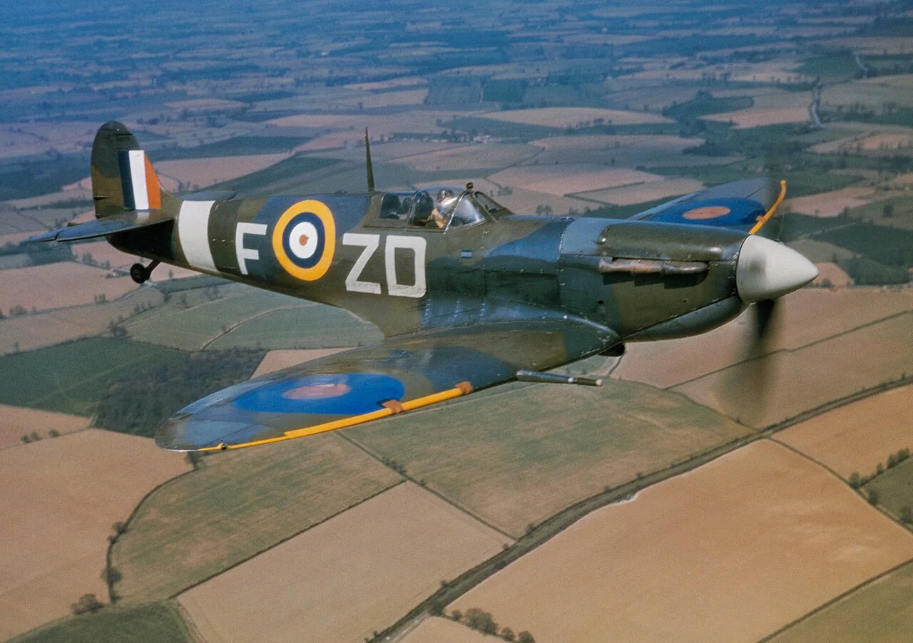

**Image credit:** [RAF photograph; UK Crown public domain](https://commons.wikimedia.org/wiki/File:Spitfire_VB_222_Sqn_RAF_in_flight_1942.jpg)

- A. Lockheed P-38 Lightning
- B. North American P-51 Mustang
- C. Messerschmitt Bf 109
- D. Supermarine Spitfire

**Correct answer:** D

- **A · Incorrect:** Lockheed P-38 Lightning is an American twin-engine fighter with twin tail booms; the photographed aircraft is the Supermarine Spitfire.
- **B · Incorrect:** North American P-51 Mustang is an American single-engine fighter used for long-range escort; the photographed aircraft is the Supermarine Spitfire.
- **C · Incorrect:** Messerschmitt Bf 109 is a German single-engine fighter; the photographed aircraft is the Supermarine Spitfire.
- **D · Correct:** The photograph shows a Spitfire Mk VB, identifiable by its elliptical wing.

**Source:** [Imperial War Museums — photograph identification](https://www.iwm.org.uk/collections/item/object/205126548)

### WWII-N002 — Which WWII aircraft model is pictured?

**Topic:** Equipment — Aircraft

**Image:** 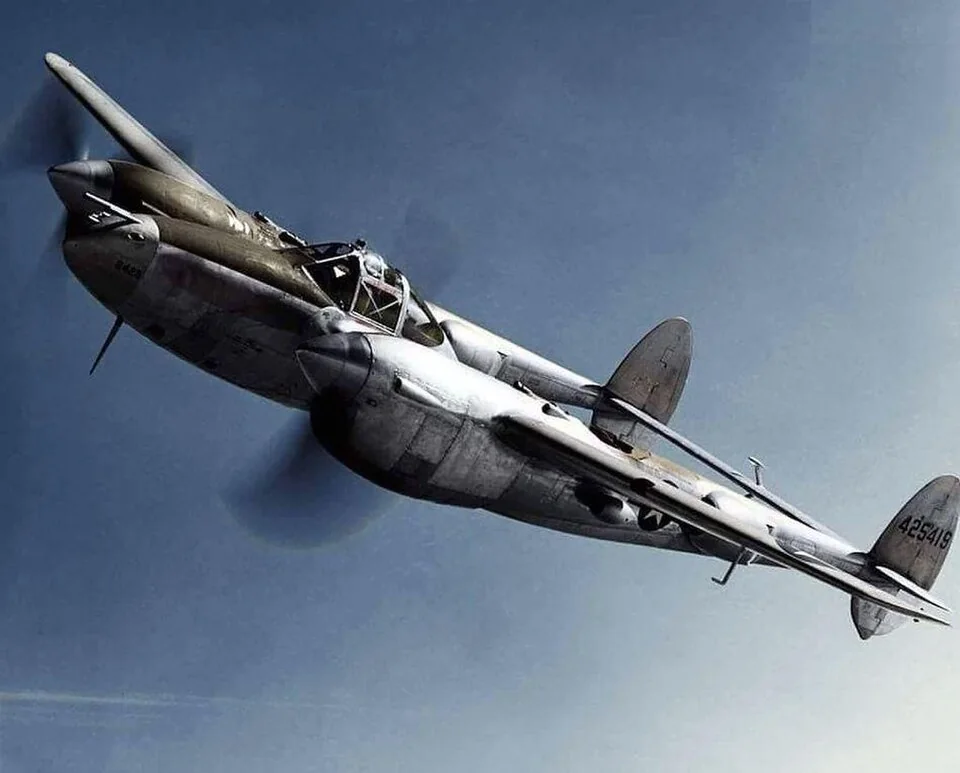

**Image credit:** [U.S. Army Air Forces photograph; public domain in the United States](https://commons.wikimedia.org/wiki/File:Lockheed_P-38L-5_Lightning_in_flight.jpg)

- A. Supermarine Spitfire
- B. Republic P-47 Thunderbolt
- C. Lockheed P-38 Lightning
- D. North American P-51 Mustang

**Correct answer:** C

- **A · Incorrect:** Supermarine Spitfire is a British fighter with an elliptical wing; the photographed aircraft is the Lockheed P-38 Lightning.
- **B · Incorrect:** Republic P-47 Thunderbolt is an American fighter with a large radial engine; the photographed aircraft is the Lockheed P-38 Lightning.
- **C · Correct:** The photograph shows a P-38 Lightning, with two engines and twin tail booms.
- **D · Incorrect:** North American P-51 Mustang is an American single-engine fighter used for long-range escort; the photographed aircraft is the Lockheed P-38 Lightning.

**Source:** [Smithsonian National Air and Space Museum — P-38](https://airandspace.si.edu/collection-objects/lockheed-p-38j-10-lo-lightning/nasm_A19600295000)

### WWII-N003 — Which WWII aircraft model is pictured?

**Topic:** Equipment — Aircraft

**Image:** 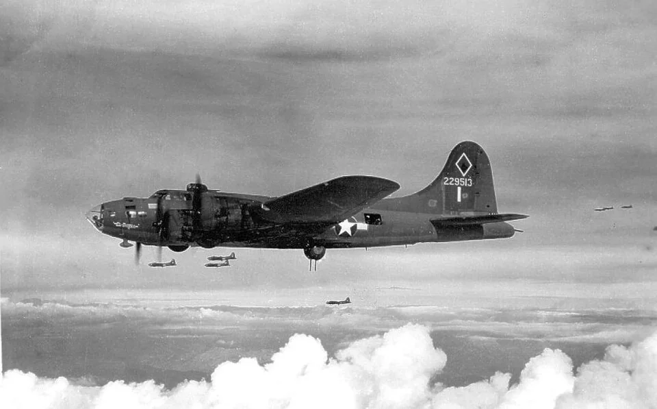

**Image credit:** [U.S. Army Air Forces photograph; public domain in the United States](https://commons.wikimedia.org/wiki/File:Boeing_B-17F_42-29513_in_flight%2C_1943.jpg)

- A. North American B-25 Mitchell
- B. Boeing B-17 Flying Fortress
- C. Boeing B-29 Superfortress
- D. Avro Lancaster

**Correct answer:** B

- **A · Incorrect:** North American B-25 Mitchell is an American twin-engine medium bomber; the photographed aircraft is the Boeing B-17 Flying Fortress.
- **B · Correct:** The photograph shows a B-17F Flying Fortress.
- **C · Incorrect:** Boeing B-29 Superfortress is an American four-engine heavy bomber with a pressurized fuselage; the photographed aircraft is the Boeing B-17 Flying Fortress.
- **D · Incorrect:** Avro Lancaster is a British four-engine heavy bomber with twin tail fins; the photographed aircraft is the Boeing B-17 Flying Fortress.

**Source:** [Smithsonian National Air and Space Museum — B-17](https://airandspace.si.edu/collection-archive/swoose-odyssey-b-17-collection/sova-nasm-1994-0024)

### WWII-N004 — Which WWII aircraft model is pictured?

**Topic:** Equipment — Aircraft

**Image:** 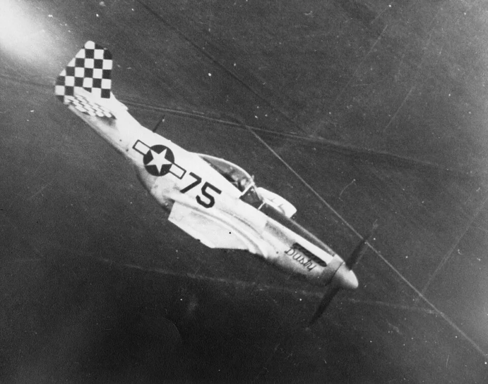

**Image credit:** [U.S. Army Air Forces photograph; public domain in the United States](https://commons.wikimedia.org/wiki/File:P-51D_Mustang_nicknamed_%22Dusty%22_of_the_325th_Fighter_Group%2C_15th_Air_Force_in_flight.jpg)

- A. North American P-51 Mustang
- B. Supermarine Spitfire
- C. Republic P-47 Thunderbolt
- D. Mitsubishi A6M Zero

**Correct answer:** A

- **A · Correct:** The photograph shows a P-51D Mustang nicknamed Dusty.
- **B · Incorrect:** Supermarine Spitfire is a British fighter with an elliptical wing; the photographed aircraft is the North American P-51 Mustang.
- **C · Incorrect:** Republic P-47 Thunderbolt is an American fighter with a large radial engine; the photographed aircraft is the North American P-51 Mustang.
- **D · Incorrect:** Mitsubishi A6M Zero is a Japanese naval fighter; the photographed aircraft is the North American P-51 Mustang.

**Source:** [Smithsonian National Air and Space Museum — WWII in the air](https://airandspace.si.edu/air-and-space-quarterly/fall-2022/world-war-ii-air)

### WWII-N005 — Which WWII aircraft model is shown in the foreground?

**Topic:** Equipment — Aircraft

**Image:** 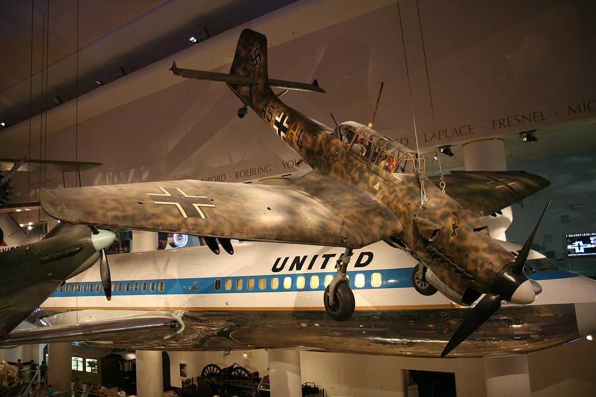

**Image credit:** [0x6adb015 photograph; public-domain dedication](https://commons.wikimedia.org/wiki/File:Ju87ChicagoMuseumOfScienceAndIndustry2010.jpg)

- A. Messerschmitt Bf 109
- B. Supermarine Spitfire
- C. Vought F4U Corsair
- D. Junkers Ju 87 Stuka

**Correct answer:** D

- **A · Incorrect:** Messerschmitt Bf 109 is a German single-engine fighter; the photographed aircraft is the Junkers Ju 87 Stuka.
- **B · Incorrect:** Supermarine Spitfire is a British fighter with an elliptical wing; the photographed aircraft is the Junkers Ju 87 Stuka.
- **C · Incorrect:** Vought F4U Corsair is an American naval fighter with an inverted gull wing; the photographed aircraft is the Junkers Ju 87 Stuka.
- **D · Correct:** The foreground aircraft is a museum-displayed Ju 87 Stuka dive bomber.

**Source:** [Royal Air Force Museum — Ju 87](https://www.rafmuseum.org.uk/our-collection/supporting-research/archive-exhibitions/ju-87d/)

### WWII-N006 — Which WWII aircraft model is pictured?

**Topic:** Equipment — Aircraft

**Image:** 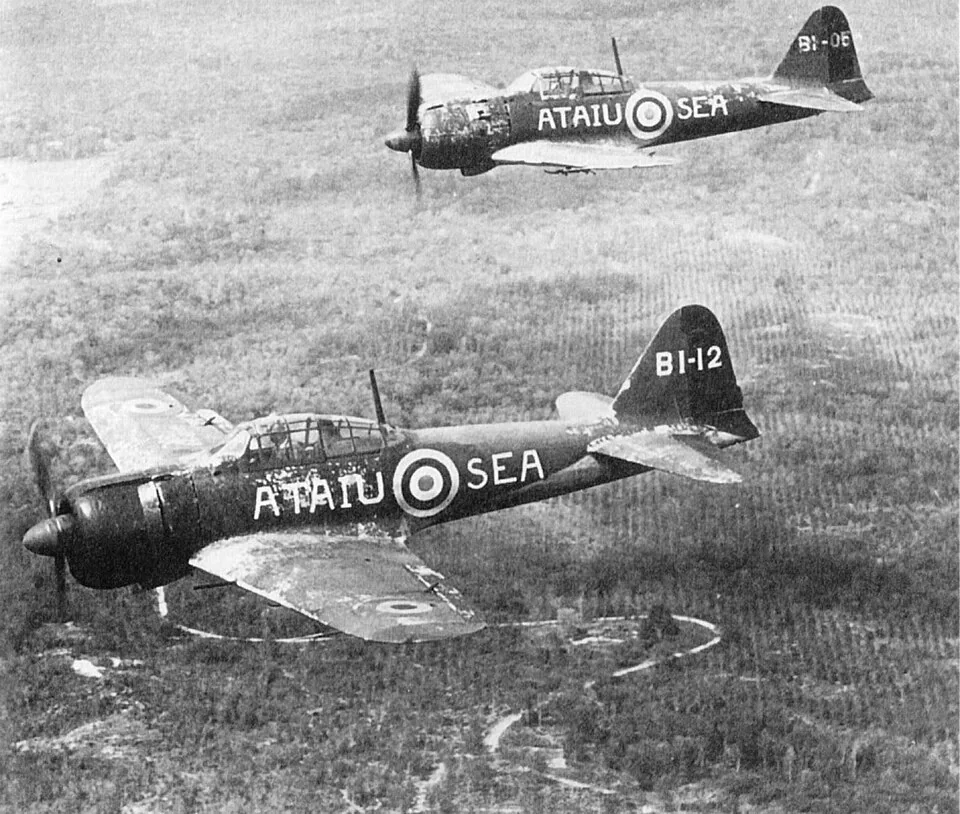

**Image credit:** [Sergeant Breeze, RAF photograph; UK Crown public domain](https://commons.wikimedia.org/wiki/File:A6M_Zeros_over_Malaya.jpg)

- A. Vought F4U Corsair
- B. Republic P-47 Thunderbolt
- C. Mitsubishi A6M Zero
- D. Grumman F4F Wildcat

**Correct answer:** C

- **A · Incorrect:** Vought F4U Corsair is an American naval fighter with an inverted gull wing; the photographed aircraft is the Mitsubishi A6M Zero.
- **B · Incorrect:** Republic P-47 Thunderbolt is an American fighter with a large radial engine; the photographed aircraft is the Mitsubishi A6M Zero.
- **C · Correct:** The aircraft are Mitsubishi A6M Zeros photographed during Allied evaluation; their British roundels do not indicate wartime Japanese markings.
- **D · Incorrect:** Grumman F4F Wildcat is an American naval fighter; the photographed aircraft is the Mitsubishi A6M Zero.

**Source:** [Smithsonian National Air and Space Museum — A6M Zero](https://airandspace.si.edu/stories/editorial/mitsubishi-a6m-zero-fighter)

### WWII-N007 — Which WWII aircraft model is pictured?

**Topic:** Equipment — Aircraft

**Image:** 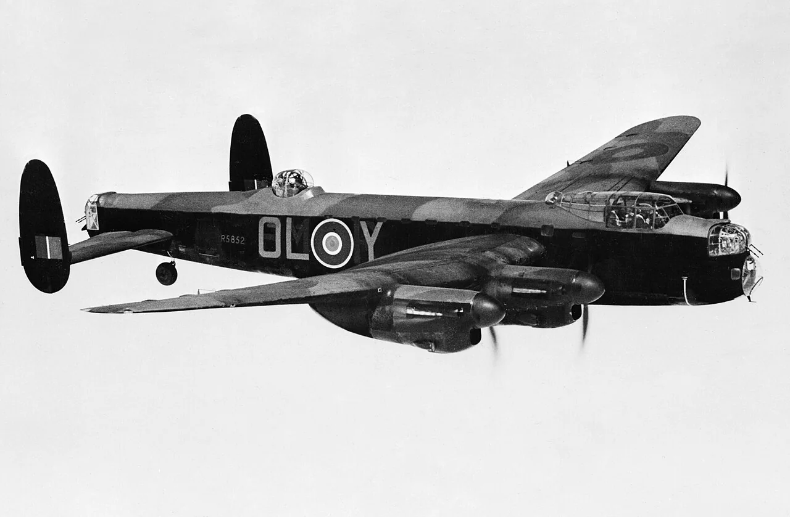

**Image credit:** [Flying Officer B. J. Daventry, RAF photograph; UK Crown public domain](https://commons.wikimedia.org/wiki/File:Avro_Lancaster_Mk_I_of_No._83_Squadron%2C_based_at_Scampton_in_Lincolnshire%2C_June_1942._CH6071.jpg)

- A. North American B-25 Mitchell
- B. Avro Lancaster
- C. Boeing B-17 Flying Fortress
- D. Boeing B-29 Superfortress

**Correct answer:** B

- **A · Incorrect:** North American B-25 Mitchell is an American twin-engine medium bomber; the photographed aircraft is the Avro Lancaster.
- **B · Correct:** The aircraft is an Avro Lancaster Mk I, a British four-engine bomber.
- **C · Incorrect:** Boeing B-17 Flying Fortress is an American four-engine heavy bomber; the photographed aircraft is the Avro Lancaster.
- **D · Incorrect:** Boeing B-29 Superfortress is an American four-engine heavy bomber with a pressurized fuselage; the photographed aircraft is the Avro Lancaster.

**Source:** [Imperial War Museums — photograph identification](https://www.iwm.org.uk/collections/item/object/205126933)

### WWII-N008 — Which WWII aircraft model is pictured?

**Topic:** Equipment — Aircraft

**Image:** 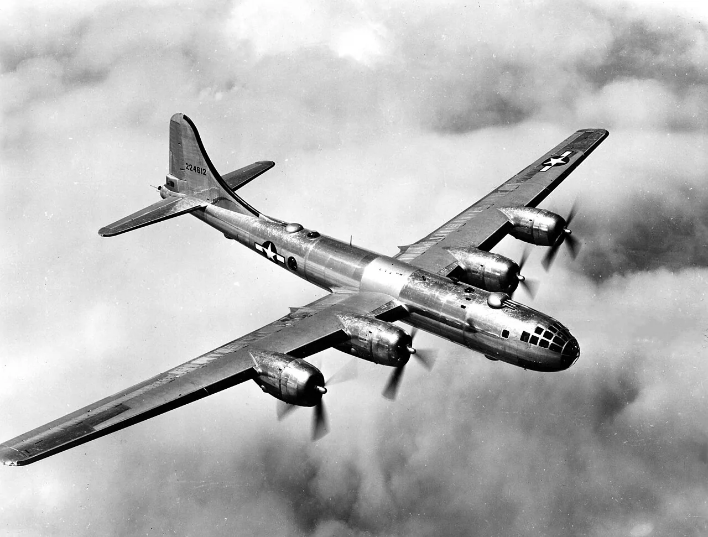

**Image credit:** [U.S. Air Force photograph; public domain in the United States](https://commons.wikimedia.org/wiki/File:B-29_in_flight.jpg)

- A. Boeing B-29 Superfortress
- B. Boeing B-17 Flying Fortress
- C. Avro Lancaster
- D. Consolidated B-24 Liberator

**Correct answer:** A

- **A · Correct:** The photograph shows a B-29 Superfortress; the image source does not establish a consistent variant.
- **B · Incorrect:** Boeing B-17 Flying Fortress is an American four-engine heavy bomber; the photographed aircraft is the Boeing B-29 Superfortress.
- **C · Incorrect:** Avro Lancaster is a British four-engine heavy bomber with twin tail fins; the photographed aircraft is the Boeing B-29 Superfortress.
- **D · Incorrect:** Consolidated B-24 Liberator is an American four-engine bomber with twin tail fins; the photographed aircraft is the Boeing B-29 Superfortress.

**Source:** [Smithsonian National Air and Space Museum — B-29](https://airandspace.si.edu/exhibitions/world-war-ii-aviation-uh)

### WWII-N009 — Which WWII aircraft model is pictured?

**Topic:** Equipment — Aircraft

**Image:** 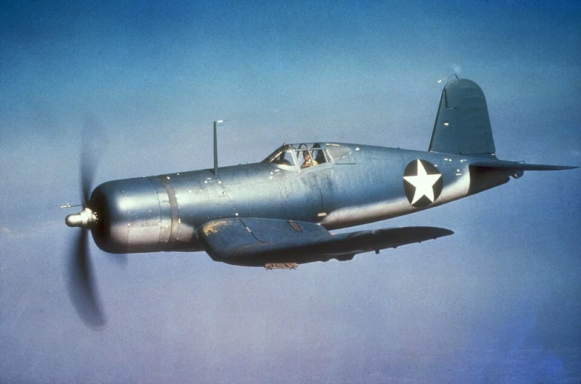

**Image credit:** [U.S. Navy photograph; public domain in the United States](https://commons.wikimedia.org/wiki/File:F4U-1_Corsair_in_flight_c1942.jpg)

- A. Grumman F4F Wildcat
- B. Mitsubishi A6M Zero
- C. North American P-51 Mustang
- D. Vought F4U Corsair

**Correct answer:** D

- **A · Incorrect:** Grumman F4F Wildcat is an American naval fighter; the photographed aircraft is the Vought F4U Corsair.
- **B · Incorrect:** Mitsubishi A6M Zero is a Japanese naval fighter; the photographed aircraft is the Vought F4U Corsair.
- **C · Incorrect:** North American P-51 Mustang is an American single-engine fighter used for long-range escort; the photographed aircraft is the Vought F4U Corsair.
- **D · Correct:** The image shows an F4U Corsair, recognizable by its inverted gull wing.

**Source:** [Smithsonian National Air and Space Museum — Corsair](https://airandspace.si.edu/collection-objects/vought-f4u-1d-corsair/nasm_A19610124000)

### WWII-N010 — Which WWII aircraft model is pictured?

**Topic:** Equipment — Aircraft

**Image:** 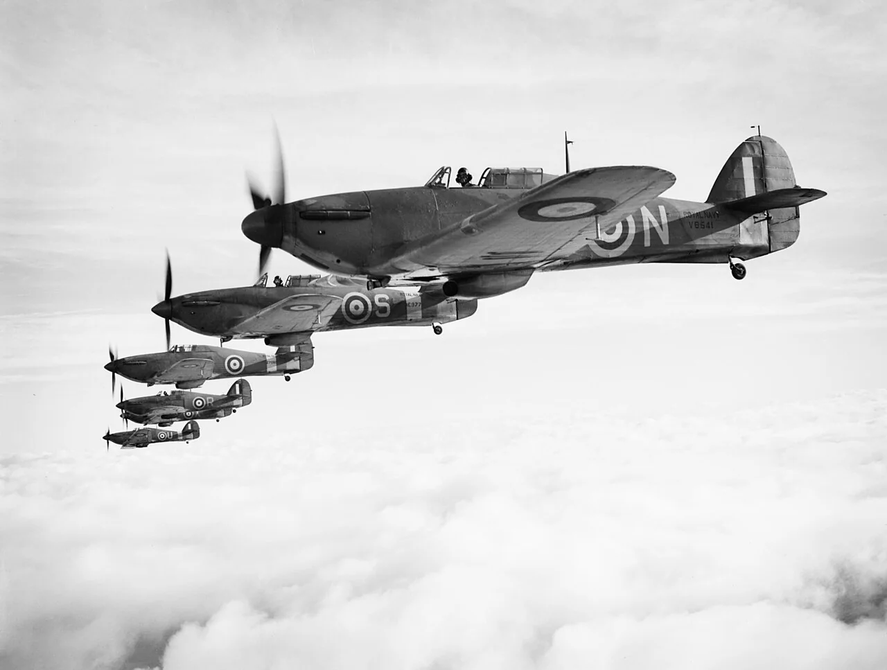

**Image credit:** [Lieutenant L. C. Priest, Royal Navy photograph; UK Crown public domain](https://commons.wikimedia.org/wiki/File:Hawker_Sea_Hurricanes.jpg)

- A. Mitsubishi A6M Zero
- B. Grumman F4F Wildcat
- C. Hawker Sea Hurricane
- D. Supermarine Spitfire

**Correct answer:** C

- **A · Incorrect:** Mitsubishi A6M Zero is a Japanese naval fighter; the photographed aircraft is the Hawker Sea Hurricane.
- **B · Incorrect:** Grumman F4F Wildcat is an American naval fighter; the photographed aircraft is the Hawker Sea Hurricane.
- **C · Correct:** The formation consists of Hawker Sea Hurricanes, naval variants of the Hurricane.
- **D · Incorrect:** Supermarine Spitfire is a British fighter with an elliptical wing; the photographed aircraft is the Hawker Sea Hurricane.

**Source:** [Imperial War Museums — Sea Hurricane](https://www.iwm.org.uk/collections/item/object/205186991)

### WWII-N011 — Which WWII aircraft model is pictured?

**Topic:** Equipment — Aircraft

**Image:** 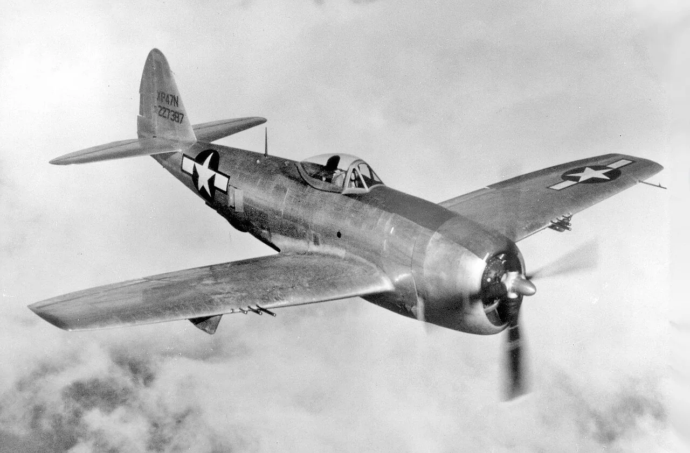

**Image credit:** [U.S. Air Force photograph; public domain in the United States](https://commons.wikimedia.org/wiki/File:Republic_P-47N_Thunderbolt_in_flight_%28cropped%29.jpg)

- A. Mitsubishi A6M Zero
- B. Republic P-47 Thunderbolt
- C. North American P-51 Mustang
- D. Supermarine Spitfire

**Correct answer:** B

- **A · Incorrect:** Mitsubishi A6M Zero is a Japanese naval fighter; the photographed aircraft is the Republic P-47 Thunderbolt.
- **B · Correct:** The photograph shows a P-47 Thunderbolt, a U.S. fighter with a large radial engine.
- **C · Incorrect:** North American P-51 Mustang is an American single-engine fighter used for long-range escort; the photographed aircraft is the Republic P-47 Thunderbolt.
- **D · Incorrect:** Supermarine Spitfire is a British fighter with an elliptical wing; the photographed aircraft is the Republic P-47 Thunderbolt.

**Source:** [National Museum of the U.S. Air Force — P-47](https://www.nationalmuseum.af.mil/Visit/Museum-Exhibits/Fact-Sheets/Display/Article/858869/AFmuseum/republic-p-47/)

### WWII-N012 — Which British service flew Spitfires and Hurricanes against Germany in the Battle of Britain?

**Topic:** Equipment — Aircraft

- A. Royal Air Force
- B. Royal Navy
- C. British Army
- D. Merchant Navy

**Correct answer:** A

- **A · Correct:** The RAF flew both fighters against the Luftwaffe.
- **B · Incorrect:** The Royal Navy fought at sea; the RAF flew these fighters in the battle.
- **C · Incorrect:** The army fought on land; the RAF flew the Spitfires and Hurricanes.
- **D · Incorrect:** Merchant ships carried supplies; the RAF flew these aircraft.

**Source:** [Imperial War Museums — Battle of Britain aircraft](https://www.iwm.org.uk/history/second-world-war/battle-of-britain/iconic-aircraft)

### WWII-N013 — What shape is especially associated with the classic Spitfire wing?

**Topic:** Equipment — Aircraft

- A. Square
- B. Circular
- C. Triangular
- D. Elliptical

**Correct answer:** D

- **A · Incorrect:** The classic Spitfire wing was elliptical, not square.
- **B · Incorrect:** The wing was elliptical, rather than a complete circle.
- **C · Incorrect:** The classic Spitfire wing was elliptical, not triangular.
- **D · Correct:** The Spitfire’s distinctive wing was elliptical, reducing drag.

**Source:** [Smithsonian National Air and Space Museum — Spitfire](https://airandspace.si.edu/collection-objects/supermarine-spitfire-hf-mk-viic/nasm_A19600331000)

### WWII-N014 — What was the Junkers Ju 87 dive bomber commonly called?

**Topic:** Equipment — Aircraft

- A. Hurricane
- B. Flying Pencil
- C. Stuka
- D. Spitfire

**Correct answer:** C

- **A · Incorrect:** The Hurricane was a British fighter, not the German Ju 87.
- **B · Incorrect:** Flying Pencil was the nickname of the Dornier Do 17 bomber.
- **C · Correct:** The Ju 87 was called the Stuka, from the German term for dive bomber.
- **D · Incorrect:** The Spitfire was a British fighter, not the German Ju 87.

**Source:** [Imperial War Museums — Battle of Britain aircraft](https://www.iwm.org.uk/history/second-world-war/battle-of-britain/iconic-aircraft)

### WWII-N015 — What did C-47 transport aircraft carry into Normandy on D-Day?

**Topic:** Equipment — Aircraft

- A. Railway trains
- B. Paratroopers
- C. Battleships
- D. Submarines

**Correct answer:** B

- **A · Incorrect:** C-47s carried paratroopers, not railway trains.
- **B · Correct:** C-47 transports carried airborne soldiers for parachute landings.
- **C · Incorrect:** Battleships sailed by sea; C-47s carried airborne soldiers.
- **D · Incorrect:** Submarines traveled by sea, not inside C-47s.

**Source:** [Smithsonian National Air and Space Museum — C-47 and D-Day](https://airandspace.si.edu/stories/editorial/d-day-and-douglas-c-47)

### WWII-N016 — What was the nickname of the Boeing B-17 bomber?

**Topic:** Equipment — Aircraft

- A. Flying Fortress
- B. Superfortress
- C. Mustang
- D. Lightning

**Correct answer:** A

- **A · Correct:** The Boeing B-17 bomber was called the Flying Fortress.
- **B · Incorrect:** Superfortress was the nickname of the B-29 bomber, not the Boeing B-17 bomber.
- **C · Incorrect:** Mustang was the nickname of the P-51 fighter, not the Boeing B-17 bomber.
- **D · Incorrect:** Lightning was the nickname of the P-38 fighter, not the Boeing B-17 bomber.

**Source:** [National WWII Museum — B-17](https://www.nationalww2museum.org/war/articles/boeing-b-17-flying-fortress)

### WWII-N017 — What was the nickname of the North American P-51 fighter?

**Topic:** Equipment — Aircraft

- A. Superfortress
- B. Mustang
- C. Lightning
- D. Flying Fortress

**Correct answer:** B

- **A · Incorrect:** Superfortress was the nickname of the B-29 bomber, not the North American P-51 fighter.
- **B · Correct:** The North American P-51 fighter was called the Mustang.
- **C · Incorrect:** Lightning was the nickname of the P-38 fighter, not the North American P-51 fighter.
- **D · Incorrect:** Flying Fortress was the nickname of the B-17 bomber, not the North American P-51 fighter.

**Source:** [Smithsonian National Air and Space Museum — P-51](https://airandspace.si.edu/collection-objects/north-american-p-51d-mustang/nasm_A19600300000)

### WWII-N018 — What was the nickname of the Lockheed P-38 fighter?

**Topic:** Equipment — Aircraft

- A. Mustang
- B. Lightning
- C. Flying Fortress
- D. Superfortress

**Correct answer:** B

- **A · Incorrect:** Mustang was the nickname of the P-51 fighter, not the Lockheed P-38 fighter.
- **B · Correct:** The Lockheed P-38 fighter was called the Lightning.
- **C · Incorrect:** Flying Fortress was the nickname of the B-17 bomber, not the Lockheed P-38 fighter.
- **D · Incorrect:** Superfortress was the nickname of the B-29 bomber, not the Lockheed P-38 fighter.

**Source:** [Smithsonian National Air and Space Museum — P-38](https://airandspace.si.edu/collection-objects/lockheed-p-38j-10-lo-lightning/nasm_A19600295000)

### WWII-N019 — What was the nickname of the Boeing B-29 bomber?

**Topic:** Equipment — Aircraft

- A. Lightning
- B. Flying Fortress
- C. Superfortress
- D. Mustang

**Correct answer:** C

- **A · Incorrect:** Lightning was the nickname of the P-38 fighter, not the Boeing B-29 bomber.
- **B · Incorrect:** Flying Fortress was the nickname of the B-17 bomber, not the Boeing B-29 bomber.
- **C · Correct:** The Boeing B-29 bomber was called the Superfortress.
- **D · Incorrect:** Mustang was the nickname of the P-51 fighter, not the Boeing B-29 bomber.

**Source:** [Smithsonian National Air and Space Museum — B-29](https://airandspace.si.edu/exhibitions/world-war-ii-aviation-uh)

### WWII-N020 — What kind of aircraft was the American B-17 Flying Fortress?

**Topic:** Equipment — Aircraft

- A. A bomber
- B. A fighter
- C. A troop glider
- D. A flying boat

**Correct answer:** A

- **A · Correct:** The four-engine B-17 was a long-range bomber.
- **B · Incorrect:** The B-17 was a bomber; fighters had a different primary role.
- **C · Incorrect:** The B-17 had four engines and was a bomber, not a glider.
- **D · Incorrect:** The B-17 was a land-based bomber, not a flying boat.

**Source:** [Smithsonian National Air and Space Museum — B-17](https://airandspace.si.edu/air-and-space-quarterly/winter-2023/set-checked)

### WWII-N021 — Which Japanese naval fighter was known as the Zero?

**Topic:** Equipment — Aircraft

- A. Supermarine Spitfire
- B. Hawker Hurricane
- C. North American P-51
- D. Mitsubishi A6M

**Correct answer:** D

- **A · Incorrect:** The Spitfire was a British fighter, not the Japanese A6M.
- **B · Incorrect:** The Hurricane was a British fighter, not the Japanese A6M.
- **C · Incorrect:** The P-51 was an American fighter, not the Japanese A6M.
- **D · Correct:** The A6M was the Mitsubishi Zero fighter used by Japan’s navy.

**Source:** [Smithsonian National Air and Space Museum — Zero fighter](https://airandspace.si.edu/stories/editorial/mitsubishi-a6m-zero-fighter); [Imperial War Museums — British fighters](https://www.iwm.org.uk/history/second-world-war/battle-of-britain/iconic-aircraft); [Smithsonian — P-51](https://airandspace.si.edu/air-and-space-quarterly/fall-2022/world-war-ii-air)

### WWII-N022 — What was an important job of the American P-51 Mustang in Europe?

**Topic:** Equipment — Aircraft

- A. Operating as a submarine
- B. Building airfields
- C. Escorting bombers
- D. Carrying tanks ashore

**Correct answer:** C

- **A · Incorrect:** The P-51 was an aircraft, not a submarine.
- **B · Incorrect:** The P-51 was flown as a fighter; it did not build airfields.
- **C · Correct:** The P-51 became a long-range escort fighter for U.S. forces in Europe.
- **D · Incorrect:** Landing craft brought tanks ashore; the P-51 was a fighter.

**Source:** [Smithsonian National Air and Space Museum — P-51](https://airandspace.si.edu/air-and-space-quarterly/fall-2022/world-war-ii-air)

### WWII-N023 — What was the name of the atomic bomb dropped on Hiroshima?

**Topic:** Equipment — Weapons

- A. Buzz Bomb
- B. Little Boy
- C. Fat Man
- D. Flying Dustbin

**Correct answer:** B

- **A · Incorrect:** Buzz Bomb: the popular nickname of the V-1 flying bomb; it is not the answer described.
- **B · Correct:** The uranium bomb dropped on Hiroshima was called Little Boy.
- **C · Incorrect:** Fat Man: the atomic bomb dropped on Nagasaki; it is not the answer described.
- **D · Incorrect:** Flying Dustbin: the nickname of a British demolition projectile; it is not the answer described.

**Source:** [Smithsonian National Air and Space Museum — Flight of the Enola Gay](https://airandspace.si.edu/stories/editorial/flight-enola-gay)

### WWII-N024 — What type of aircraft was the B-25 Mitchell?

**Topic:** Equipment — Aircraft

- A. A medium bomber
- B. A single-engine fighter
- C. A flying boat
- D. A military glider

**Correct answer:** A

- **A · Correct:** The B-25 Mitchell was a twin-engine medium bomber.
- **B · Incorrect:** A single-engine fighter was designed to fight other aircraft; the B-25 was a twin-engine bomber.
- **C · Incorrect:** A flying boat is designed to operate on water; the B-25 was a land-based bomber.
- **D · Incorrect:** A military glider has no engine of its own; the B-25 had two engines.

**Source:** [Smithsonian National Air and Space Museum — B-25 Mitchell](https://airandspace.si.edu/collection-objects/north-american-b-25j-20-nc-tb-25n-mitchell-quotcarol-jeanquot/nasm_A19860003000)

### WWII-N025 — Which WWII tank model is in the foreground?

**Topic:** Equipment — Tanks

**Image:** 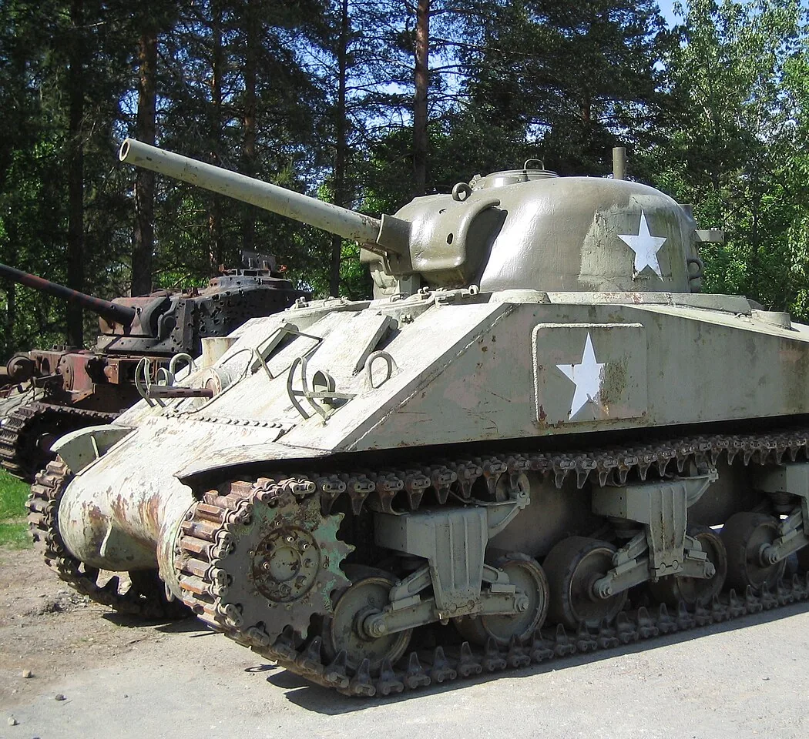

**Image credit:** [Pitkäkaula; CC BY-SA 3.0, cropped and converted](https://commons.wikimedia.org/wiki/File:M4_Sherman_Parola_tank_museum.jpg)

**Image license:** [CC BY-SA 3.0](https://creativecommons.org/licenses/by-sa/3.0/)

- A. M4 Sherman
- B. Tiger I
- C. Churchill
- D. Type 95 Ha-Go

**Correct answer:** A

- **A · Correct:** The M4 Sherman was an American medium tank widely used by the Allies.
- **B · Incorrect:** The Tiger I was a much heavier German tank with a boxier hull.
- **C · Incorrect:** The British Churchill was an infantry tank with tracks running around the sides of its long hull.
- **D · Incorrect:** The Japanese Ha-Go was a smaller light tank with a narrow turret.

**Source:** [The Tank Museum — M4 Sherman](https://tankmuseum.org/tank-nuts/tank-collection/m4-sherman)

### WWII-N026 — Which WWII tank model is pictured?

**Topic:** Equipment — Tanks

**Image:** 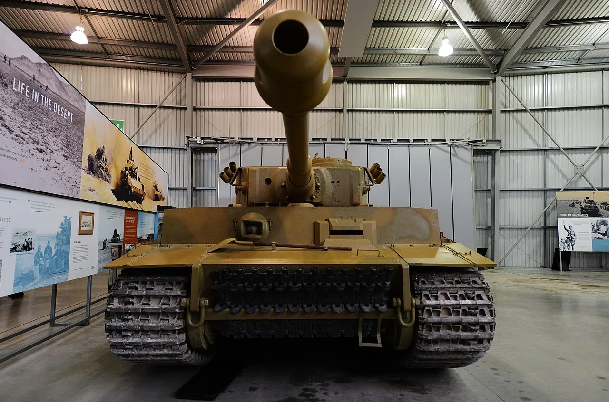

**Image credit:** [Michael Garlick; CC BY-SA 4.0, resized and converted](https://commons.wikimedia.org/wiki/File:Bovington_Tank_Museum_German_Tiger_tank.JPG)

**Image license:** [CC BY-SA 4.0](https://creativecommons.org/licenses/by-sa/4.0/)

- A. M3 Stuart
- B. Tiger I
- C. T-34
- D. Matilda II

**Correct answer:** B

- **A · Incorrect:** The Stuart was an American light tank, much smaller than this vehicle.
- **B · Correct:** The German Tiger I was a heavy tank with an 88 mm gun and a broad, box-shaped hull.
- **C · Incorrect:** The Soviet T-34 was a medium tank known for its sloped armor.
- **D · Incorrect:** The Matilda II was a British infantry tank with armored side skirts over its suspension.

**Source:** [The Tank Museum — Tiger I](https://tankmuseum.org/tank-nuts/tank-collection/tiger-i)

### WWII-N027 — Which WWII tank model is pictured?

**Topic:** Equipment — Tanks

**Image:** 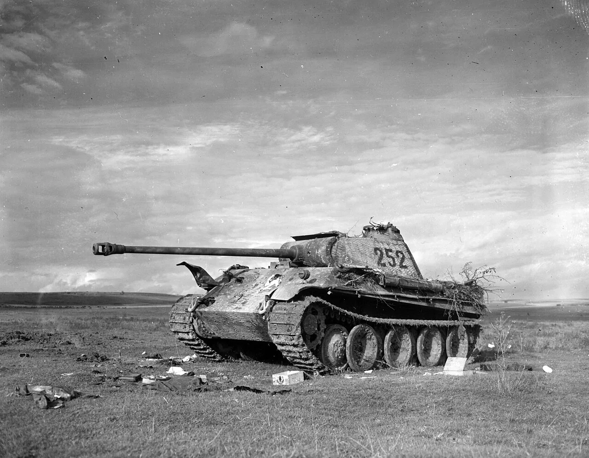

**Image credit:** [U.S. Army Signal Corps; U.S. federal government public domain, resized and converted](https://commons.wikimedia.org/wiki/File:Abandoned_German_Panzer_V_Panther_tank_in_France,_14_October_1944_%28111-SC-329852%29.jpg)

- A. M3 Lee
- B. Churchill
- C. Panther
- D. Type 95 Ha-Go

**Correct answer:** C

- **A · Incorrect:** The American M3 Lee carried its main gun in a mount on the hull.
- **B · Incorrect:** The Churchill was a British infantry tank with tracks extending around its hull.
- **C · Correct:** The German Panther was a medium tank with a long 75 mm gun and sloping frontal armor.
- **D · Incorrect:** The Ha-Go was a much smaller Japanese light tank.

**Source:** [The Tank Museum — Panther](https://tankmuseum.org/tank-nuts/tank-collection/panther)

### WWII-N028 — Which WWII tank model is pictured?

**Topic:** Equipment — Tanks

**Image:** 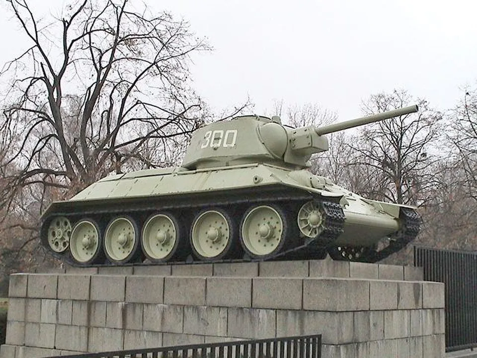

**Image credit:** [Pedro Plassen Lopes; CC BY 2.0, resized and converted](https://commons.wikimedia.org/wiki/File:T-34_Model_1943_tank_at_the_Soviet_Cenotaph_in_Berlin-Tiergarten.jpg)

**Image license:** [CC BY 2.0](https://creativecommons.org/licenses/by/2.0/)

- A. Matilda II
- B. Panzer IV
- C. M3 Lee
- D. T-34

**Correct answer:** D

- **A · Incorrect:** The British Matilda II had small road wheels mostly hidden behind side armor.
- **B · Incorrect:** The German Panzer IV was a medium tank with a differently shaped hull and suspension.
- **C · Incorrect:** The American M3 Lee had a prominent hull-mounted main gun.
- **D · Correct:** The Soviet T-34 was a medium tank with sloping armor and large road wheels.

**Source:** [The Tank Museum — T-34/76](https://tankmuseum.org/tank-nuts/tank-collection/t-34-76)

### WWII-N029 — Which WWII tank model is pictured?

**Topic:** Equipment — Tanks

**Image:** 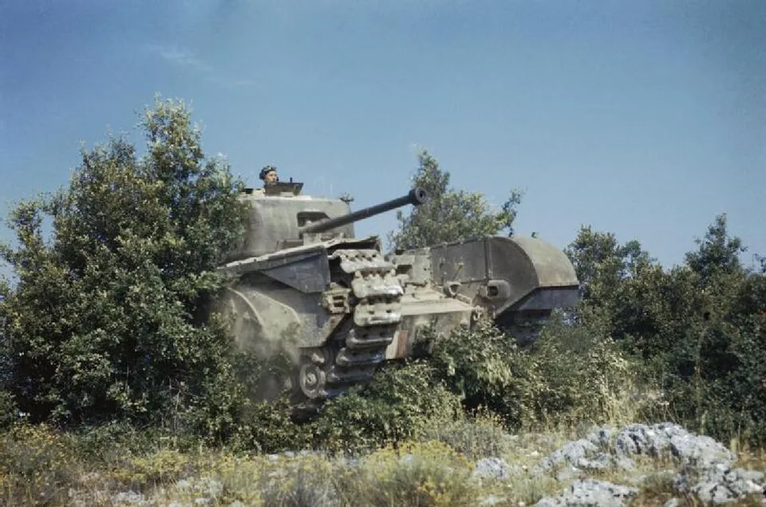

**Image credit:** [Captain Tanner, War Office; UK Crown public domain, resized and converted](https://commons.wikimedia.org/wiki/File:Churchill_tank_Italy_July_1944_IWM_TR_2025.jpg)

- A. T-34
- B. Churchill
- C. M3 Stuart
- D. Tiger I

**Correct answer:** B

- **A · Incorrect:** The Soviet T-34 was a medium tank with large exposed road wheels.
- **B · Correct:** The British Churchill was an infantry tank with tracks that ran around the long hull.
- **C · Incorrect:** The American Stuart was a much smaller light tank.
- **D · Incorrect:** The German Tiger I was a heavy tank with a broad, boxy hull and 88 mm gun.

**Source:** [The Tank Museum — Churchill](https://tankmuseum.org/tank-nuts/tank-collection/churchill-iv)

### WWII-N030 — Which WWII tank model is pictured?

**Topic:** Equipment — Tanks

**Image:** 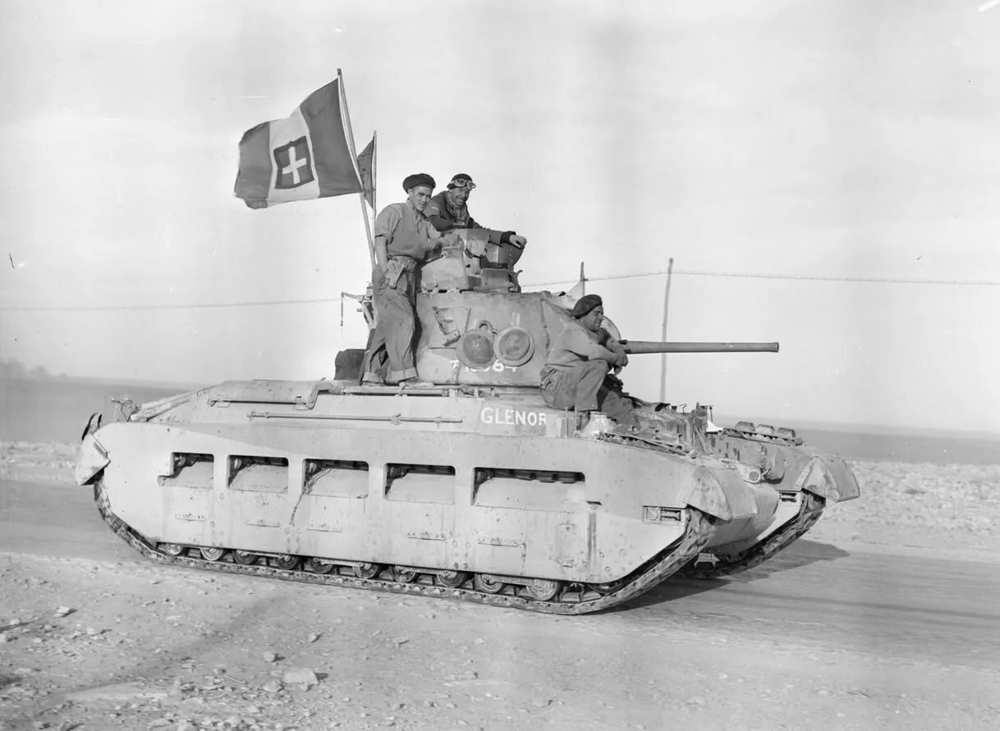

**Image credit:** [No. 1 Army Film and Photographic Unit; UK Crown public domain, converted](https://commons.wikimedia.org/wiki/File:MatildaII.jpg)

- A. Panther
- B. M4 Sherman
- C. Matilda II
- D. IS-2

**Correct answer:** C

- **A · Incorrect:** The Panther was a German medium tank with a long gun and sloped frontal armor.
- **B · Incorrect:** The Sherman was an American medium tank, without the Matilda's deep side skirts.
- **C · Correct:** The Matilda II was a heavily armored British infantry tank; this one was photographed near Tobruk.
- **D · Incorrect:** The IS-2 was a Soviet heavy tank armed with a much larger 122 mm gun.

**Source:** [Imperial War Museums — photograph E 1772](https://www.iwm.org.uk/collections/item/object/205203470)

### WWII-N031 — Which WWII tank family is pictured?

**Topic:** Equipment — Tanks

**Image:** 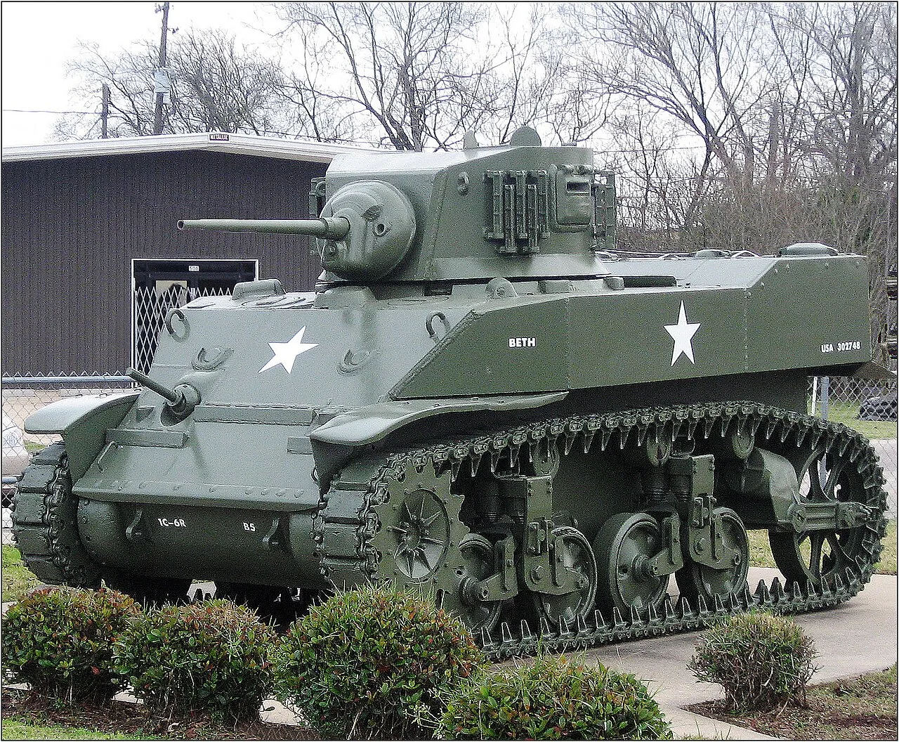

**Image credit:** [Jim Evans; CC BY-SA 4.0, resized and converted](https://commons.wikimedia.org/wiki/File:M3_Stuart_Tank_--_South_Houston,_Texas.jpg)

**Image license:** [CC BY-SA 4.0](https://creativecommons.org/licenses/by-sa/4.0/)

- A. Stuart
- B. Churchill
- C. Panther
- D. IS-2

**Correct answer:** A

- **A · Correct:** The Stuart was an American light-tank family that included the M3 and M5.
- **B · Incorrect:** The Churchill was a larger British infantry tank with a long, track-framed hull.
- **C · Incorrect:** The Panther was a German medium tank with sloping armor and a long 75 mm gun.
- **D · Incorrect:** The IS-2 was a Soviet heavy tank with a large turret and 122 mm gun.

**Source:** [The Tank Museum — M3A1 Stuart and M5A1](https://tankmuseum.org/tank-nuts/tank-collection/m3a1-stuart)

### WWII-N032 — Which WWII tank model is in the foreground?

**Topic:** Equipment — Tanks

**Image:** 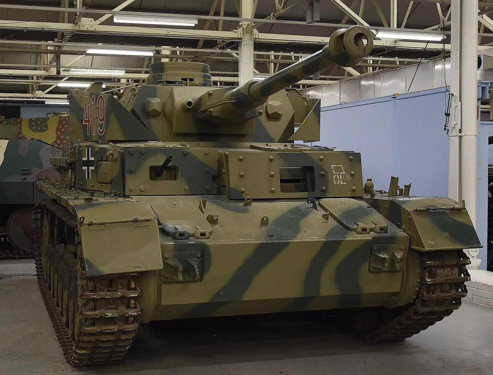

**Image credit:** [Paul Hermans; CC BY-SA 4.0, resized and converted](https://commons.wikimedia.org/wiki/File:Panzer_IV_-_Tank_Museum_Bovington.JPG)

**Image license:** [CC BY-SA 4.0](https://creativecommons.org/licenses/by-sa/4.0/)

- A. M3 Lee
- B. Matilda II
- C. T-34
- D. Panzer IV

**Correct answer:** D

- **A · Incorrect:** The M3 Lee was an American medium tank with its main gun mounted in the hull.
- **B · Incorrect:** The Matilda II was a British infantry tank with deep side skirts.
- **C · Incorrect:** The T-34 was a Soviet medium tank with large road wheels and sloping armor.
- **D · Correct:** The Panzer IV was a German medium tank; this museum example has an upgraded long 75 mm gun.

**Source:** [The Tank Museum — Panzer IV](https://tankmuseum.org/tank-nuts/tank-collection/panzer-iv)

### WWII-N033 — Which WWII tank model is in the foreground?

**Topic:** Equipment — Tanks

**Image:** 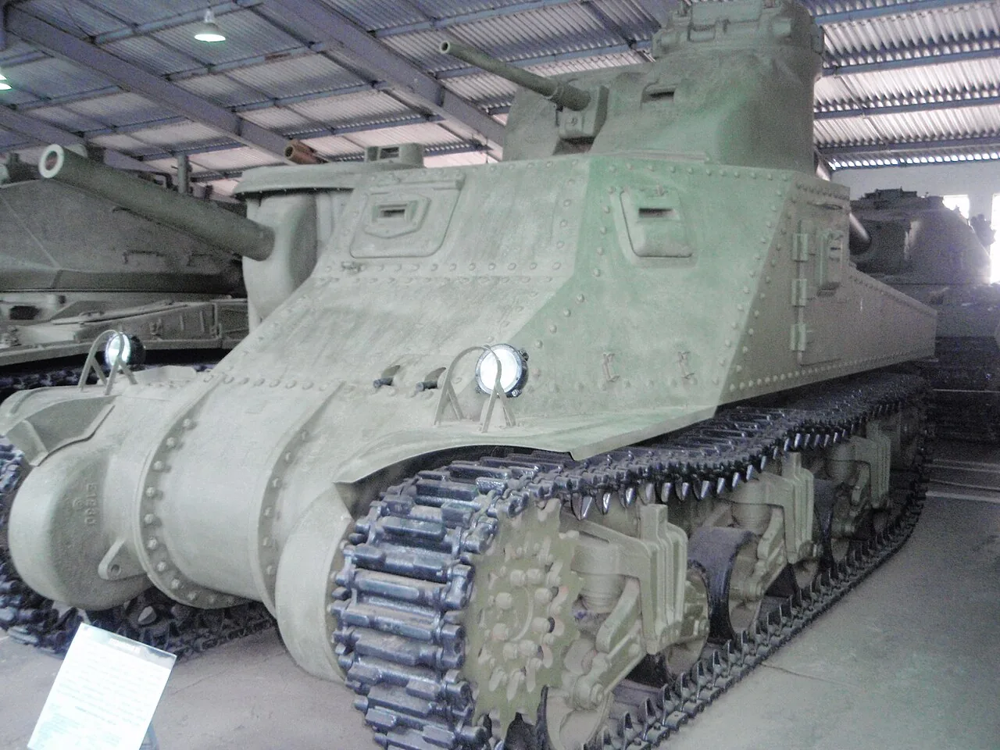

**Image credit:** [Галин Владимир Петрович; author-released public domain, resized and converted](https://commons.wikimedia.org/wiki/File:M3_Lee_in_the_Kubinka.jpg)

- A. Tiger I
- B. M3 Lee
- C. Type 95 Ha-Go
- D. T-34

**Correct answer:** B

- **A · Incorrect:** The German Tiger I was a heavy tank with its main gun in the turret.
- **B · Correct:** The American M3 Lee was a medium tank with a hull-mounted main gun and a smaller turret gun.
- **C · Incorrect:** The Japanese Ha-Go was a small light tank with a single main turret gun.
- **D · Incorrect:** The Soviet T-34 was a medium tank whose main gun was mounted in the turret.

**Source:** [The Tank Museum — M3 Lee in the Burma campaign](https://tankmuseum.org/article/vj-day-lest-we-forget)

### WWII-N034 — Which WWII tank model is in the foreground?

**Topic:** Equipment — Tanks

**Image:** 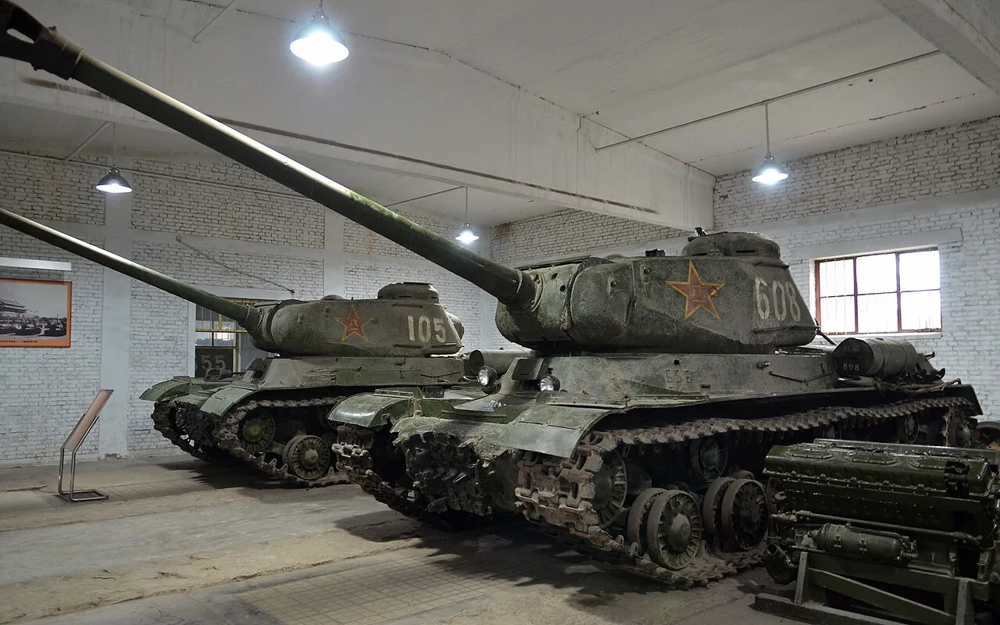

**Image credit:** [颐园新居; CC BY-SA 3.0, resized and converted](https://commons.wikimedia.org/wiki/File:IS-2_in_the_CPLA_Tank_Museum_20131004.JPG)

**Image license:** [CC BY-SA 3.0](https://creativecommons.org/licenses/by-sa/3.0/)

- A. M3 Stuart
- B. Matilda II
- C. IS-2
- D. Panzer IV

**Correct answer:** C

- **A · Incorrect:** The Stuart was an American light tank with a much smaller gun.
- **B · Incorrect:** The Matilda II was a British infantry tank with its suspension hidden by side skirts.
- **C · Correct:** The IS-2 was a Soviet heavy tank armed with a 122 mm gun.
- **D · Incorrect:** The Panzer IV was a German medium tank with a smaller 75 mm gun.

**Source:** [Tank Encyclopedia — Iosif Stalin II](https://tank-afv.com/ww2/ussr/IS-II.php)

### WWII-N035 — Which WWII tank model is in the foreground?

**Topic:** Equipment — Tanks

**Image:** 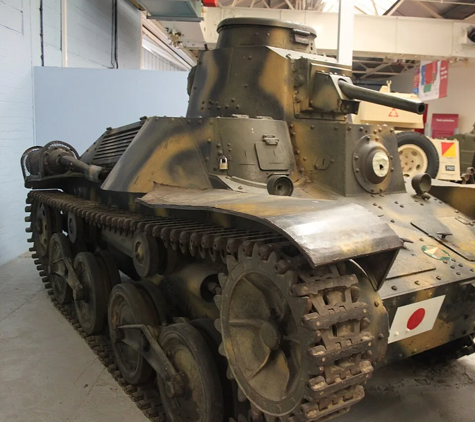

**Image credit:** [Rodw; CC BY-SA 4.0, cropped and converted](https://commons.wikimedia.org/wiki/File:Type_95_Ha-Go_Tank_at_the_Tank_Museum.JPG)

**Image license:** [CC BY-SA 4.0](https://creativecommons.org/licenses/by-sa/4.0/)

- A. Type 95 Ha-Go
- B. Churchill
- C. Tiger I
- D. M3 Lee

**Correct answer:** A

- **A · Correct:** The Type 95 Ha-Go was a Japanese light tank with a 37 mm gun.
- **B · Incorrect:** The Churchill was a much larger British infantry tank.
- **C · Incorrect:** The Tiger I was a German heavy tank with an 88 mm gun.
- **D · Incorrect:** The American M3 Lee was a medium tank with a hull-mounted main gun.

**Source:** [The Tank Museum — Type 95 Ha-Go](https://tankmuseum.org/tank-nuts/tank-collection/ha-go)

### WWII-N036 — What was the calibre of the German Tiger I tank’s main gun?

**Topic:** Equipment — Tanks

- A. 88 mm
- B. 75 mm
- C. 76.2 mm
- D. 105 mm

**Correct answer:** A

- **A · Correct:** The Tiger I carried an 88 mm main gun.
- **B · Incorrect:** Some Sherman tanks had 75 mm guns; the Tiger I’s main gun was 88 mm.
- **C · Incorrect:** The early Soviet T-34 had a 76.2 mm gun; the Tiger I’s was 88 mm.
- **D · Incorrect:** The Tiger I’s main gun was 88 mm, not 105 mm.

**Source:** [The Tank Museum — Tiger I](https://tankmuseum.org/tank-nuts/tank-collection/tiger-i/); [M4 Sherman](https://tankmuseum.org/tank-nuts/tank-collection/m4-sherman/); [T-34/76](https://tankmuseum.org/tank-nuts/tank-collection/t-34-76/)

### WWII-N037 — Why did the Allies use inflatable dummy tanks before D-Day?

**Topic:** Equipment — Tanks

- A. To carry real tank crews into battle
- B. To clear sea mines underwater
- C. To deliver food by parachute
- D. To deceive German observers

**Correct answer:** D

- **A · Incorrect:** They were decoys, not working tanks carrying crews into combat.
- **B · Incorrect:** They were deception devices on land, not mine-clearing submarines.
- **C · Incorrect:** Their purpose was to look like real tanks and mislead observers.
- **D · Correct:** Inflatable tanks helped disguise Allied preparations and mislead German reconnaissance.

**Source:** [Imperial War Museums — D-Day deception](https://www.iwm.org.uk/history/second-world-war/d-day/parachuting-dummies-and-inflatable-tanks)

### WWII-N038 — Which small four-wheel-drive vehicle could be used to deliver supplies during WWII?

**Topic:** Equipment — Vehicles

- A. The T-34
- B. The M4 Sherman
- C. The Willys Jeep
- D. The Tiger I

**Correct answer:** C

- **A · Incorrect:** The T-34 was a tracked Soviet tank, not the small wheeled Jeep.
- **B · Incorrect:** The Sherman was a tracked tank; the Jeep was the small 4x4.
- **C · Correct:** The Jeep was a versatile 4x4; this Red Cross example delivered supplies.
- **D · Incorrect:** The Tiger was a heavy German tank, not a small four-wheel-drive Jeep.

**Source:** [Imperial War Museums — Willys MB Jeep](https://www.iwm.org.uk/collections/item/object/70000118); [WWII tanks](https://www.iwm.org.uk/history/second-world-war/north-africa-campaign/the-vital-role-of-tanks-in-the-second-world-war)

### WWII-N039 — What was one purpose of the rear door on the American M3 half-track?

**Topic:** Equipment — Vehicles

- A. Loading the main tank gun
- B. Letting soldiers enter and leave
- C. Steering the front wheels
- D. Cooling the engine

**Correct answer:** B

- **A · Incorrect:** The M3 was a personnel carrier; the rear door gave troops access.
- **B · Correct:** The rear door made it easier for troops to get in and out.
- **C · Incorrect:** The rear door provided entry and exit, rather than steering.
- **D · Incorrect:** The rear door gave the passengers access to the vehicle.

**Source:** [The National WWII Museum — M3 half-track](https://www.nationalww2museum.org/visit/museum-campus/us-freedom-pavilion/vehicles-war/white-m3-half-track)

### WWII-N040 — Why did the M3 half-track have lightly armoured sides?

**Topic:** Equipment — Vehicles

- A. To protect occupants from shell fragments
- B. To make it float like a landing craft
- C. To increase the power of its engine
- D. To increase its cargo space

**Correct answer:** A

- **A · Correct:** The armour helped protect its passengers from fragments.
- **B · Incorrect:** The armoured sides provided protection; the M3 was a ground vehicle.
- **C · Incorrect:** The sides protected occupants; they were not the engine.
- **D · Incorrect:** The light armour was intended to protect occupants against fragments.

**Source:** [The National WWII Museum — M3 half-track](https://www.nationalww2museum.org/visit/museum-campus/us-freedom-pavilion/vehicles-war/white-m3-half-track)

### WWII-N041 — Which broad type of WWII mine is pictured?

**Topic:** Equipment — Mines

**Image:** 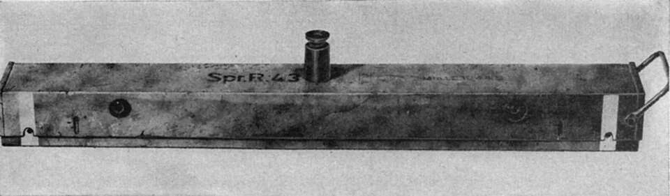

**Image credit:** [U.S. Government; public domain in the United States](https://commons.wikimedia.org/wiki/File:German_-_Riegelmine_43.jpg)

- A. A naval mine
- B. An anti-personnel land mine
- C. An anti-tank land mine
- D. A depth charge

**Correct answer:** C

- **A · Incorrect:** The pictured object is a German land mine, not a mine associated with naval warfare.
- **B · Incorrect:** The pictured Riegelmine 43 is identified in the wartime reference as an anti-tank mine, not an anti-personnel mine.
- **C · Correct:** The long metal mine is a German Riegelmine 43, an anti-tank land mine.
- **D · Incorrect:** A depth charge is an anti-submarine weapon, unlike this land-based mine.

**Source:** [U.S. War Department — Handbook on German Military Forces, TM-E 30-451 (1943)](https://archive.org/details/TM-E30-451)

### WWII-N042 — What broad category fits the two large circular metal objects at the front of this display?

**Topic:** Equipment — Mines

**Image:** 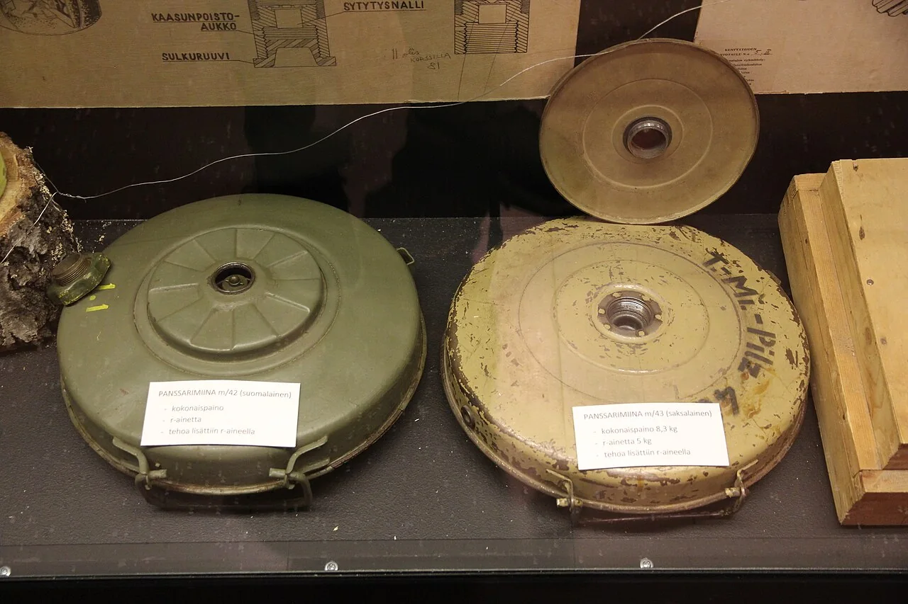

**Image credit:** [MKFI; released to the public domain worldwide](https://commons.wikimedia.org/wiki/File:Tellermines_RUK-museo.JPG)

- A. Naval mines
- B. Anti-personnel land mines
- C. Depth charges
- D. Anti-tank land mines

**Correct answer:** D

- **A · Incorrect:** The two displayed items are land weapons, not naval mines.
- **B · Incorrect:** The museum display identifies these circular examples as vehicle-class anti-tank mines.
- **C · Incorrect:** Depth charges are a separate category of anti-submarine weapon; these are land mines.
- **D · Correct:** Both circular objects are identified as anti-tank mines: the left is Finnish and the right is German.

**Source:** [Smithsonian National Museum of American History — German “Tellermine” Anti-Tank Mine](https://americanhistory.si.edu/collections/nmah_407167)

### WWII-N043 — What kind of WWII weapon is the small round object near the center of this archival photograph?

**Topic:** Equipment — Mines

**Image:** 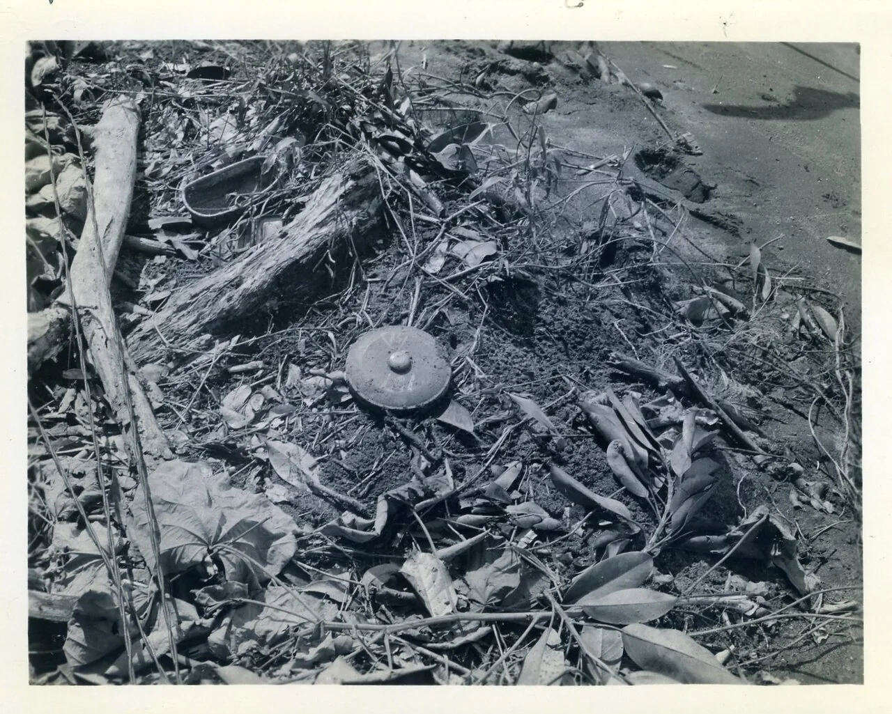

**Image credit:** [Archives Branch, U.S. Marine Corps History Division; CC BY 2.0; resized and converted to WebP](https://commons.wikimedia.org/wiki/File:Japanese_land_mine,_11_November_1943.jpg)
**Image license:** [CC BY 2.0](https://creativecommons.org/licenses/by/2.0/)

- A. A land mine
- B. A naval mine
- C. An aircraft bomb
- D. A depth charge

**Correct answer:** A

- **A · Correct:** The Marine Corps History Division identifies the pictured Japanese object as a land mine in its 1943 photograph record.
- **B · Incorrect:** The archive identifies an object on land, not a naval mine.
- **C · Incorrect:** The pictured object is identified as a mine, not an aircraft-delivered bomb.
- **D · Incorrect:** A depth charge is an anti-submarine weapon; the archive identifies this as a land mine.

**Source:** [U.S. Marine Corps History Division Archives — Japanese land mine photograph (11 November 1943)](https://www.flickr.com/photos/60868061@N04/47994580143/)

### WWII-N044 — What broad category of mine is represented by the green square metal object?

**Topic:** Equipment — Mines

**Image:** 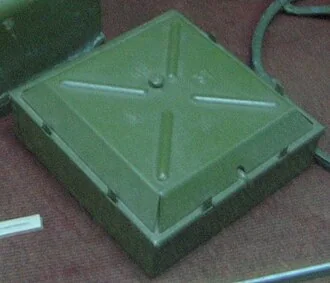

**Image credit:** [Cmapm; CC BY 3.0; resized and converted to WebP](https://commons.wikimedia.org/wiki/File:Soviet_TM-35_mine_at_the_Museum_on_Sapun_Mountain_in_Sevastopol.jpg)
**Image license:** [CC BY 3.0](https://creativecommons.org/licenses/by/3.0/)

- A. A naval mine
- B. An anti-personnel land mine
- C. An anti-tank land mine
- D. A depth charge

**Correct answer:** C

- **A · Incorrect:** The museum photograph identifies a Soviet land mine, not a sea mine.
- **B · Incorrect:** The pictured TM-35 is identified as an anti-tank type, not an anti-personnel type.
- **C · Correct:** The Soviet TM-35 shown here is an anti-tank land mine.
- **D · Incorrect:** A depth charge is a different kind of anti-submarine weapon, not the pictured land mine.

**Source:** [U.S. War Department — Handbook on U.S.S.R. Military Forces, Chapter VI: Fortifications (1946)](https://archive.org/details/tm-30-430-handbook-on-u.-s.-s.-r.-military-forces-1946)

### WWII-N045 — Which broad category describes the tan, pottery-like artifact on display?

**Topic:** Equipment — Mines

**Image:** 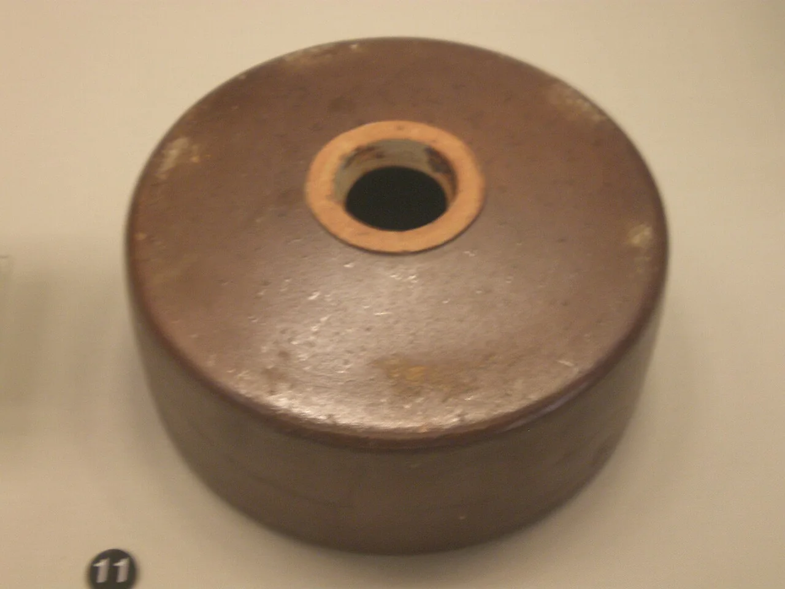

**Image credit:** [BrokenSphere; CC BY-SA 3.0; resized and converted to WebP](https://commons.wikimedia.org/wiki/File:WW_II_Japanese_terracotta_land_mine.JPG)
**Image license:** [CC BY-SA 3.0](https://creativecommons.org/licenses/by-sa/3.0/)

- A. A naval mine
- B. A depth charge
- C. An aircraft bomb
- D. A land mine

**Correct answer:** D

- **A · Incorrect:** The museum object is identified as a Japanese land mine, not a naval mine.
- **B · Incorrect:** A depth charge is a separate anti-submarine weapon, not the pictured land mine.
- **C · Incorrect:** The historical source identifies a land mine, not an aircraft bomb.
- **D · Correct:** The pottery-like Japanese artifact is a WWII land mine.

**Source:** [U.S. War Department — Intelligence Bulletin, Vol. III, No. 4 (December 1944), “New Pottery Land Mine Introduced on Leyte Island”](https://archive.org/details/1944-12IntelligenceBulletinVol03No04-nsia)

### WWII-N046 — What broad kind of mine is the large orange object shown here?

**Topic:** Equipment — Mines

**Image:** 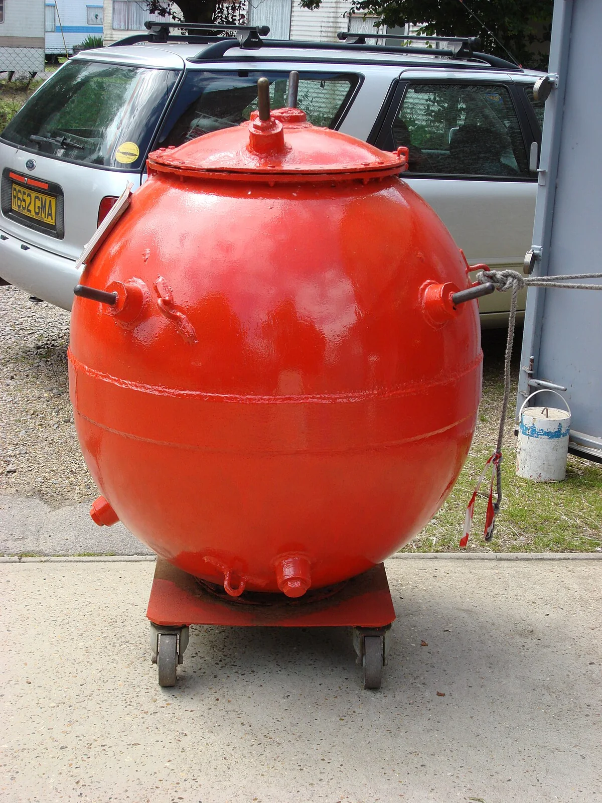

**Image credit:** [Oxyman; CC BY-SA 3.0; resized and converted to WebP](https://commons.wikimedia.org/wiki/File:British_Mk_14_Sea_Mine_2.jpg)
**Image license:** [CC BY-SA 3.0](https://creativecommons.org/licenses/by-sa/3.0/)

- A. A naval mine
- B. A depth charge
- C. A torpedo
- D. An anti-tank land mine

**Correct answer:** A

- **A · Correct:** The pictured British Mk 14 is a sea mine, a naval weapon used in WWII.
- **B · Incorrect:** A depth charge is a different anti-submarine weapon; this object is identified as a sea mine.
- **C · Incorrect:** A torpedo is a self-propelled underwater weapon, not the pictured mine.
- **D · Incorrect:** An anti-tank land mine is a land weapon; the photo identifies a British sea mine.

**Source:** [National Museum of the Royal New Zealand Navy — Defensive Minefields Hauraki Gulf WWII](https://navymuseum.co.nz/explore/by-themes/technology-and-weapons/defensive-minefields-hauraki-gulf-wwii/)

### WWII-N047 — What broad category of mine is displayed in this harbor-side photograph?

**Topic:** Equipment — Mines

**Image:** 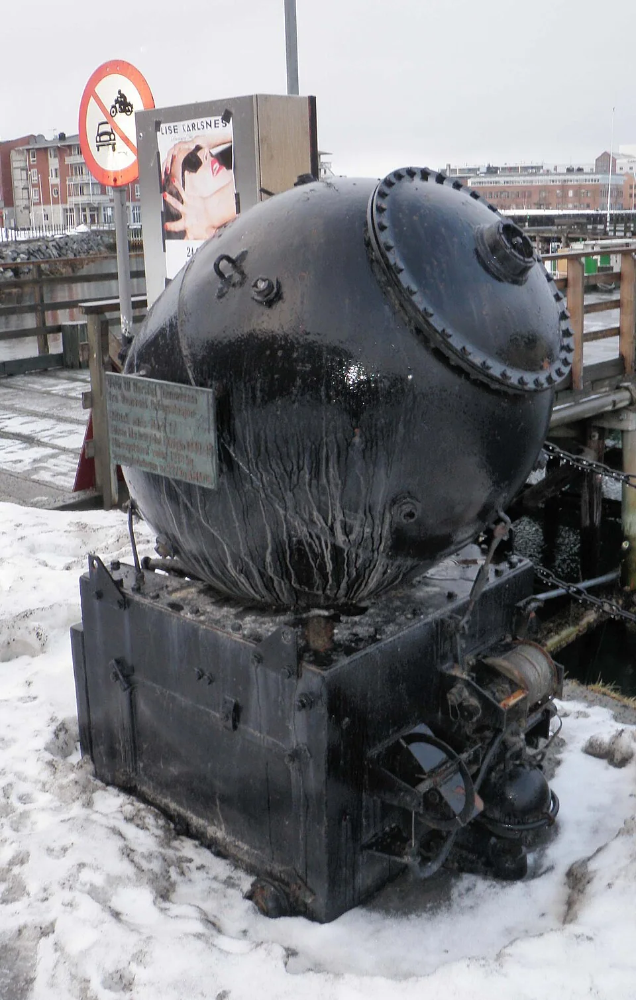

**Image credit:** [Manxruler; CC BY-SA 3.0; resized and converted to WebP](https://commons.wikimedia.org/wiki/File:British_Mark_17_naval_mine_on_display_in_Harstad.jpg)
**Image license:** [CC BY-SA 3.0](https://creativecommons.org/licenses/by-sa/3.0/)

- A. An anti-tank land mine
- B. A naval mine
- C. An anti-aircraft shell
- D. A depth charge

**Correct answer:** B

- **A · Incorrect:** The object is displayed as a British naval mine, not a land mine.
- **B · Correct:** The photograph identifies a British Mark 17 naval mine on display at Harstad.
- **C · Incorrect:** The photographed object is a mine, not an anti-aircraft shell.
- **D · Incorrect:** A depth charge is a separate anti-submarine weapon; this artifact is a naval mine.

**Source:** [Imperial War Museums — Sea Mine Mk XVII (MUN 4582)](https://www.iwm.org.uk/collections/item/object/30021858)

### WWII-N048 — What broad category best identifies the large rounded object at the soldier's feet in this 1945 archival photograph?

**Topic:** Equipment — Mines

**Image:** 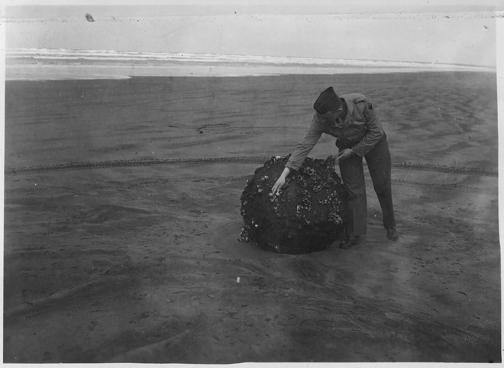

**Image credit:** [Photographer not identified; U.S. War Department record, public domain in the United States](https://commons.wikimedia.org/wiki/File:Japanese_buoyant_mine_which_drifted_from_Japanese_waters_to_Fort_Stevens_beach_between_Peter_Iredale_and_the_South..._-_NARA_-_299675.jpg)

- A. A land mine
- B. A naval mine
- C. An aircraft bomb
- D. A depth charge

**Correct answer:** B

- **A · Incorrect:** The archive describes a Japanese buoyant mine recovered on a beach, so it is a naval rather than a land mine.
- **B · Correct:** The National Archives identifies the pictured object as a Japanese buoyant mine in an April 1945 record.
- **C · Incorrect:** The archival record identifies a mine, not an aircraft bomb.
- **D · Incorrect:** A depth charge is a different anti-submarine weapon; this archival object is a buoyant naval mine.

**Source:** [U.S. National Archives — Japanese buoyant mine at Fort Stevens (record 299675)](https://catalog.archives.gov/id/299675)

### WWII-N049 — What broad category best identifies the large gray artifact on the wheeled stand?

**Topic:** Equipment — Mines

**Image:** 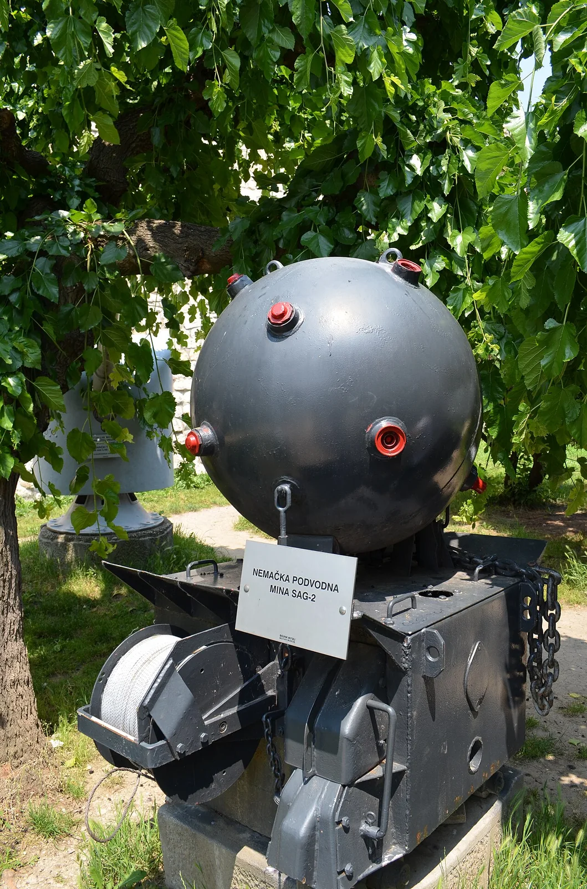

**Image credit:** [Boris Maric; CC BY-SA 4.0; resized and converted to WebP](https://commons.wikimedia.org/wiki/File:German_naval_mine_from_WW_II.jpg)
**Image license:** [CC BY-SA 4.0](https://creativecommons.org/licenses/by-sa/4.0/)

- A. A naval mine
- B. A depth charge
- C. An anti-tank land mine
- D. A torpedo

**Correct answer:** A

- **A · Correct:** The Belgrade museum photograph identifies the object as a German WWII naval mine.
- **B · Incorrect:** A depth charge is an anti-submarine weapon; this artifact is identified as a mine.
- **C · Incorrect:** An anti-tank mine is a land weapon; the photographed object is a naval mine.
- **D · Incorrect:** A torpedo is not the museum artifact pictured here.

**Source:** [Imperial War Museums — Second World War: German Naval Mines (HU 35869)](https://www.iwm.org.uk/collections/item/object/205087955)

### WWII-N050 — What is the red, rounded object shown beside the shore?

**Topic:** Equipment — Mines

**Image:** 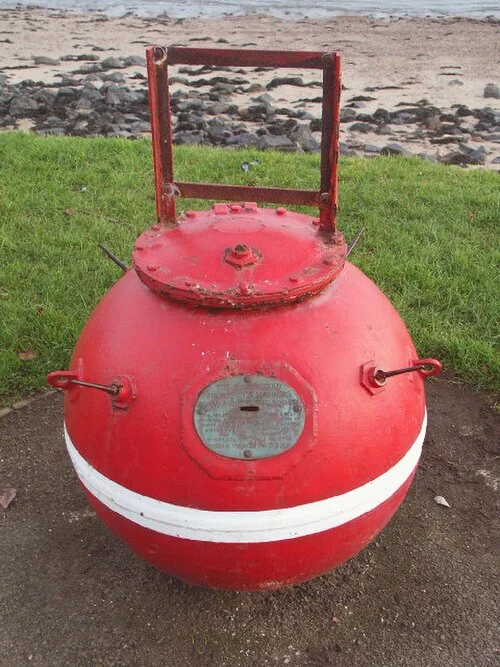

**Image credit:** [Simon Johnston; CC BY-SA 2.0; resized and converted to WebP](https://commons.wikimedia.org/wiki/File:WWII_Sea_Mine_-_geograph.org.uk_-_112941.jpg)
**Image license:** [CC BY-SA 2.0](https://creativecommons.org/licenses/by-sa/2.0/)

- A. A depth charge
- B. A naval mine
- C. A torpedo
- D. A land mine

**Correct answer:** B

- **A · Incorrect:** The source identifies the object as a WWII sea mine, not a depth charge.
- **B · Correct:** This is a WWII sea mine, a naval mine photographed on display.
- **C · Incorrect:** The pictured object is identified as a mine, not a torpedo.
- **D · Incorrect:** The source identifies a sea mine rather than a land mine.

**Source:** [U.S. Naval History and Heritage Command — Naval Mine Warfare](https://www.history.navy.mil/content/history/nhhc/browse-by-topic/exploration-and-innovation/naval-mine-warfare.html)

### WWII-N051 — Which broad category describes the pink, barrel-shaped object by the quay?

**Topic:** Equipment — Mines

**Image:** 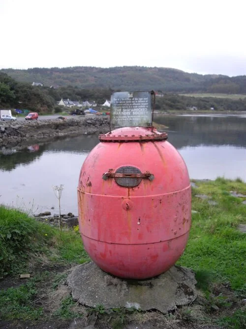

**Image credit:** [PAUL FARMER; CC BY-SA 2.0; resized and converted to WebP](https://commons.wikimedia.org/wiki/File:Old_WWII_Naval_Mine_at_Port_Crannaich_-_geograph.org.uk_-_1568683.jpg)
**Image license:** [CC BY-SA 2.0](https://creativecommons.org/licenses/by-sa/2.0/)

- A. A land mine
- B. A depth charge
- C. A naval mine
- D. An aircraft bomb

**Correct answer:** C

- **A · Incorrect:** The photograph identifies an old WWII naval mine, not a land mine.
- **B · Incorrect:** A depth charge is a different anti-submarine weapon; the pictured object is a mine.
- **C · Correct:** The quay-side artifact is identified as a WWII naval mine.
- **D · Incorrect:** The photographed artifact is a naval mine, not an aircraft bomb.

**Source:** [U.S. Naval History and Heritage Command — Naval Mine Warfare](https://www.history.navy.mil/content/history/nhhc/browse-by-topic/exploration-and-innovation/naval-mine-warfare.html)

### WWII-N052 — Which vehicle's rear ramp made it easier for troops to leave during a landing?

**Topic:** Equipment — Tanks and vehicles

- A. LVT4
- B. half-track
- C. jeep
- D. Crab

**Correct answer:** A

- **A · Correct:** The LVT4's rear ramp allowed troops to exit quickly.
- **B · Incorrect:** half-track: a vehicle with front wheels and rear tracks; it is not the answer described.
- **C · Incorrect:** jeep: a small military utility vehicle; it is not the answer described.
- **D · Incorrect:** Crab: a Sherman fitted with a mine-clearing flail; it is not the answer described.

**Source:** [National WWII Museum — LVT4 landing vehicle](https://www.nationalww2museum.org/visit/museum-campus-guide/us-freedom-pavilion/vehicles-war/lvt4-landing-vehicle)

### WWII-N053 — What did the Kangaroo help transport alongside tanks?

**Topic:** Equipment — Tanks and vehicles

- A. cavalry horses
- B. aircrew
- C. submarine crews
- D. infantry

**Correct answer:** D

- **A · Incorrect:** cavalry horses: animals ridden by mounted soldiers; it is not the answer described.
- **B · Incorrect:** aircrew: people who operate aircraft; it is not the answer described.
- **C · Incorrect:** submarine crews: people who operate submarines; it is not the answer described.
- **D · Correct:** Kangaroos carried infantry with increased mobility and protection.

**Source:** [Imperial War Museums — Tanks of D-Day](https://www.iwm.org.uk/history/second-world-war/d-day/funny-tanks-of-d-day)

### WWII-N054 — What does the “4x4” description of a Willys WWII jeep refer to?

**Topic:** Equipment — Vehicles

- A. Four gears and four passengers
- B. Four cylinders and four doors
- C. Four-wheel drive
- D. Four doors and four seats

**Correct answer:** C

- **A · Incorrect:** The 4x4 designation describes the vehicle’s four-wheel drive.
- **B · Incorrect:** The 4x4 designation refers to its drive, not its cylinders and doors.
- **C · Correct:** The Willys MB Jeep was a 4x4, a vehicle with drive to all four wheels.
- **D · Incorrect:** The 4x4 designation refers to the Jeep’s drive, not its doors and seats.

**Source:** [Imperial War Museums — Willys MB Jeep](https://www.iwm.org.uk/collections/item/object/70000118)

### WWII-N055 — Which Allied tank was modified into the more heavily armed Firefly?

**Topic:** Equipment — Tanks

- A. The Matilda
- B. The Sherman
- C. The Tiger
- D. The T-34

**Correct answer:** B

- **A · Incorrect:** The Firefly was a Sherman variant, not a Matilda.
- **B · Correct:** The Firefly was a Sherman fitted with a more powerful British 17-pounder gun.
- **C · Incorrect:** The Firefly was based on the American-designed Sherman, not the German Tiger.
- **D · Incorrect:** The Firefly was a Sherman variant, not a Soviet T-34.

**Source:** [The Tank Museum — M4 Sherman](https://tankmuseum.org/tank-nuts/tank-collection/m4-sherman/)

### WWII-N056 — Which of these WWII vehicles was the heaviest?

**Topic:** Equipment — Tanks

- A. Tiger I tank
- B. M4A2 Sherman DD tank
- C. T-34/76 tank
- D. M3 half-track

**Correct answer:** A

- **A · Correct:** The Tiger I weighed about 57 tonnes, heavier than the other vehicles listed.
- **B · Incorrect:** The Sherman DD weighed about 30 tonnes, much less than the Tiger I.
- **C · Incorrect:** The T-34/76 weighed about 26.5 tonnes, less than the Tiger I.
- **D · Incorrect:** The M3 half-track weighed about 17,650 pounds gross, far less than the Tiger I.

**Source:** [The Tank Museum — Tiger I](https://tankmuseum.org/tank-nuts/tank-collection/tiger-i/), [Sherman DD](https://tankmuseum.org/tank-nuts/tank-collection/m4-sherman/) and [T-34/76](https://tankmuseum.org/tank-nuts/tank-collection/t-34-76/); [The National WWII Museum — M3 half-track](https://www.nationalww2museum.org/visit/museum-campus/us-freedom-pavilion/vehicles-war/white-m3-half-track)

### WWII-N057 — What type of vessel was a German U-boat?

**Topic:** Equipment — Warships

- A. aircraft carrier
- B. battleship
- C. cargo ship
- D. submarine

**Correct answer:** D

- **A · Incorrect:** aircraft carrier: a warship with a flight deck; it is not the answer described.
- **B · Incorrect:** battleship: a heavily armed surface warship; it is not the answer described.
- **C · Incorrect:** cargo ship: a vessel designed to carry freight; it is not the answer described.
- **D · Correct:** U-boats were German submarines that attacked Allied shipping.

**Source:** [Imperial War Museums — Battle of the Atlantic](https://www.iwm.org.uk/history/second-world-war/battle-of-the-atlantic)

### WWII-N058 — What did Allied ships use to locate submerged U-boats in the Atlantic?

**Topic:** Equipment — Warships

- A. A compass
- B. A lighthouse
- C. Sonar, also called ASDIC
- D. A ship’s anchor

**Correct answer:** C

- **A · Incorrect:** A compass helps with direction; ASDIC was used to locate submerged U-boats.
- **B · Incorrect:** Lighthouses mark coastlines; ships used ASDIC to detect submerged U-boats.
- **C · Correct:** ASDIC used sound waves to locate submerged submarines.
- **D · Incorrect:** An anchor holds a ship in place; ASDIC was used to detect submarines.

**Source:** [Imperial War Museums — Battle of the Atlantic](https://www.iwm.org.uk/history/second-world-war/battle-of-the-atlantic)

### WWII-N059 — Which U.S. carrier earned 20 battle stars during World War II?

**Topic:** Equipment — Warships

- A. HMS Belfast
- B. USS Enterprise
- C. USS Missouri
- D. USS Arizona

**Correct answer:** B

- **A · Incorrect:** HMS Belfast: a British cruiser; it is not the answer described.
- **B · Correct:** USS Enterprise earned 20 World War II battle stars.
- **C · Incorrect:** USS Missouri: an American battleship; it is not the answer described.
- **D · Incorrect:** USS Arizona: an American battleship sunk at Pearl Harbor; it is not the answer described.

**Source:** [San Diego Air & Space Museum — USS Enterprise CV-6](https://sandiegoairandspace.org/collection/item/uss-enterprise-1941-1943-special-collection)

### WWII-N060 — Which country's navy operated USS Enterprise during World War II?

**Topic:** Equipment — Warships

- A. United States
- B. Japan
- C. Germany
- D. Italy

**Correct answer:** A

- **A · Correct:** Enterprise served in the U.S. Navy and fought across the Pacific.
- **B · Incorrect:** Japan: an Axis power with its own wartime navy; it is not the answer described.
- **C · Incorrect:** Germany: the Axis power that operated U-boats; it is not the answer described.
- **D · Incorrect:** Italy: an Axis power in the Mediterranean; it is not the answer described.

**Source:** [San Diego Air & Space Museum — USS Enterprise CV-6](https://sandiegoairandspace.org/collection/item/uss-enterprise-1941-1943-special-collection)

### WWII-N061 — What type of ship was a Liberty ship?

**Topic:** Equipment — Warships

- A. a German fighter
- B. a Japanese tank
- C. a British submarine
- D. a U.S. cargo vessel

**Correct answer:** D

- **A · Incorrect:** a German fighter: a military aircraft of Germany; it is not the answer described.
- **B · Incorrect:** a Japanese tank: an armoured vehicle of Japan; it is not the answer described.
- **C · Incorrect:** a British submarine: a Royal Navy vessel capable of submerging; it is not the answer described.
- **D · Correct:** American Liberty ships were emergency cargo vessels built to carry supplies.

**Source:** [National WWII Museum — Liberty ships](https://www.nationalww2museum.org/war/articles/women-of-the-j-a-jones-brunswick-shipyard)

### WWII-N062 — What was a principal wartime job of Liberty ships?

**Topic:** Equipment — Warships

- A. fighting on land
- B. delivering radio speeches
- C. carrying supplies
- D. bombing targets from the air

**Correct answer:** C

- **A · Incorrect:** fighting on land: a role performed by ground forces; it is not the answer described.
- **B · Incorrect:** delivering radio speeches: a communications activity rather than cargo transport; it is not the answer described.
- **C · Correct:** Liberty ships carried food, equipment, and other supplies for the Allies.
- **D · Incorrect:** bombing targets from the air: a role performed by aircraft; it is not the answer described.

**Source:** [National WWII Museum — Liberty ships](https://www.nationalww2museum.org/war/articles/women-of-the-j-a-jones-brunswick-shipyard)

### WWII-N063 — Which British warship supported the Gold and Juno beach landings with gunfire?

**Topic:** Equipment — Warships

- A. HMS Vimy
- B. HMS Belfast
- C. USS Arizona
- D. Yamato

**Correct answer:** B

- **A · Incorrect:** HMS Vimy: a British destroyer that escorted convoys; it is not the answer described.
- **B · Correct:** HMS Belfast supported British and Canadian assaults on Gold and Juno.
- **C · Incorrect:** USS Arizona: an American battleship sunk at Pearl Harbor; it is not the answer described.
- **D · Incorrect:** Yamato: a Japanese battleship; it is not the answer described.

**Source:** [Imperial War Museums — HMS Belfast and D-Day](https://www.iwm.org.uk/history/iwm/hms-belfast/d-day)

### WWII-N064 — What was the German Bismarck, sunk in the Atlantic in 1941?

**Topic:** Equipment — Warships

- A. A battleship
- B. A submarine
- C. An aircraft carrier
- D. A merchant convoy

**Correct answer:** A

- **A · Correct:** Bismarck was a German battleship sunk in May 1941.
- **B · Incorrect:** German U-boats were submarines; Bismarck was a surface battleship.
- **C · Incorrect:** Bismarck was a battleship, not an aircraft carrier.
- **D · Incorrect:** A convoy is a group of ships; Bismarck was one battleship.

**Source:** [Imperial War Museums — Atlantic key facts](https://www.iwm.org.uk/history/second-world-war/battle-of-the-atlantic/what-you-need-to-know)

### WWII-N065 — Which explosive weapon did escort ships use against submerged U-boats?

**Topic:** Equipment — Weapons

- A. a flotation screen
- B. a parachute
- C. a ration book
- D. a depth charge

**Correct answer:** D

- **A · Incorrect:** a flotation screen: a canvas screen that helped an amphibious tank float; it is not the answer described.
- **B · Incorrect:** a parachute: equipment used for descent from aircraft; it is not the answer described.
- **C · Incorrect:** a ration book: a document for controlling civilian supplies; it is not the answer described.
- **D · Correct:** Depth charges were used by escorts such as HMS Vimy against U-boats.

**Source:** [Imperial War Museums — HMS Vimy](https://www.iwm.org.uk/collections/item/object/205148151)

### WWII-N066 — Which underwater weapons did German U-boats carry to attack ships?

**Topic:** Equipment — Weapons

- A. life rafts
- B. anchors
- C. torpedoes
- D. propellers

**Correct answer:** C

- **A · Incorrect:** life rafts: emergency flotation equipment; it is not the answer described.
- **B · Incorrect:** anchors: devices used to hold ships in place; it is not the answer described.
- **C · Correct:** German U-boats carried torpedoes for attacking ships.
- **D · Incorrect:** propellers: devices that propel a vessel; it is not the answer described.

**Source:** [Imperial War Museums — Battle of the Atlantic](https://www.iwm.org.uk/history/second-world-war/battle-of-the-atlantic)

### WWII-N067 — What kind of warship was USS Missouri during World War II?

**Topic:** Equipment — Warships

- A. cargo ship
- B. battleship
- C. aircraft carrier
- D. submarine

**Correct answer:** B

- **A · Incorrect:** cargo ship: a vessel designed to carry freight; it is not the answer described.
- **B · Correct:** USS Missouri was an American battleship.
- **C · Incorrect:** aircraft carrier: a warship with a flight deck; it is not the answer described.
- **D · Incorrect:** submarine: a vessel able to travel underwater; it is not the answer described.

**Source:** [The National WWII Museum — Japanese surrender aboard USS Missouri](https://www.nationalww2museum.org/war/articles/japanese-surrender-tokyo-bay-september-2-1945)

### WWII-N068 — What kind of warship was USS Enterprise CV-6?

**Topic:** Equipment — Warships

- A. aircraft carrier
- B. battleship
- C. submarine
- D. cargo ship

**Correct answer:** A

- **A · Correct:** Enterprise was a U.S. aircraft carrier that operated aircraft from its deck.
- **B · Incorrect:** battleship: a heavily armed surface warship; it is not the answer described.
- **C · Incorrect:** submarine: a vessel able to travel underwater; it is not the answer described.
- **D · Incorrect:** cargo ship: a vessel designed to carry freight; it is not the answer described.

**Source:** [San Diego Air & Space Museum — USS Enterprise CV-6](https://sandiegoairandspace.org/collection/item/uss-enterprise-1941-1943-special-collection)

### WWII-N069 — Where did aircraft take off from a WWII aircraft carrier?

**Topic:** Equipment — Warships

- A. The hangar deck
- B. The engine room
- C. The bridge
- D. The flight deck

**Correct answer:** D

- **A · Incorrect:** Aircraft were moved from the hangar to the flight deck for takeoff.
- **B · Incorrect:** The engine room powered the ship; aircraft used the flight deck.
- **C · Incorrect:** The bridge was for navigating the ship; aircraft took off from the flight deck.
- **D · Correct:** Aircraft took off from the carrier’s flight deck.

**Source:** [Cradle of Aviation Museum — flight deck operations](https://www.cradleofaviation.org/history/history/world-war-two/air-power-at-sea/carrier-operations-flight-deck.html)

### WWII-N070 — Which country's battleship Yamato was sunk by U.S. aircraft in April 1945?

**Topic:** Equipment — Warships

- A. Germany
- B. Italy
- C. Japan
- D. United States

**Correct answer:** C

- **A · Incorrect:** Germany: the Axis power that operated U-boats; it is not the answer described.
- **B · Incorrect:** Italy: an Axis power in the Mediterranean; it is not the answer described.
- **C · Correct:** Yamato was a Japanese battleship sunk while heading toward Okinawa.
- **D · Incorrect:** United States: the Allied country that built USS Enterprise; it is not the answer described.

**Source:** [The National WWII Museum — Battle of Okinawa and Yamato](https://www.nationalww2museum.org/war/articles/operation-iceberg-battle-okinawa)

### WWII-N071 — In which attack was the battleship USS Arizona sunk?

**Topic:** Equipment — Warships

- A. The attack on Pearl Harbor
- B. The Doolittle Raid
- C. The D-Day landings
- D. The Battle of Midway

**Correct answer:** A

- **A · Correct:** Japanese bombs devastated Arizona during the attack on Pearl Harbor on December 7, 1941.
- **B · Incorrect:** Arizona sank at Pearl Harbor, not in the Doolittle Raid.
- **C · Incorrect:** Arizona sank in the Pearl Harbor attack, not during the Normandy landings.
- **D · Incorrect:** Arizona had already been sunk at Pearl Harbor before the Battle of Midway.

**Source:** [National Park Service — USS Arizona Memorial](https://www.nps.gov/places/uss-arizona-memorial.htm)

### WWII-N072 — What type of ship was USS Arizona when attacked at Pearl Harbor?

**Topic:** Equipment — Warships

- A. battleship
- B. aircraft carrier
- C. submarine
- D. cargo ship

**Correct answer:** A

- **A · Correct:** Arizona was a U.S. battleship sunk in the Japanese attack.
- **B · Incorrect:** aircraft carrier: a warship with a flight deck; it is not the answer described.
- **C · Incorrect:** submarine: a vessel able to travel underwater; it is not the answer described.
- **D · Incorrect:** cargo ship: a vessel designed to carry freight; it is not the answer described.

**Source:** [National Park Service — USS Arizona Memorial](https://www.nps.gov/places/uss-arizona-memorial.htm)

### WWII-N073 — Which WWII-era weapon is pictured?

**Topic:** Equipment — Weapons

**Image:** 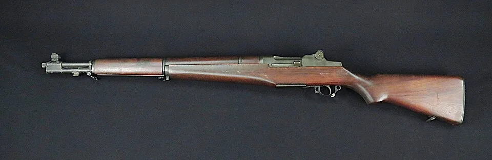

**Image credit:** [Smithsonian Institution; public domain in the United States](https://commons.wikimedia.org/wiki/File:Springfield_Armory_M1_Garand_Rifle-NMAH-AHB2015q026946.jpg)

- A. M1 Garand rifle
- B. Bren light machine gun
- C. Sten submachine gun
- D. 75 mm pack howitzer

**Correct answer:** A

- **A · Correct:** The Smithsonian identifies this rifle as an M1 Garand, made in 1940.
- **B · Incorrect:** The Bren is a light machine gun, not this wooden-stocked rifle.
- **C · Incorrect:** The Sten is a compact submachine gun with a distinctive side magazine.
- **D · Incorrect:** The 75 mm pack howitzer is a wheeled artillery piece.

**Source:** [Imperial War Museums — M1 Garand](https://www.iwm.org.uk/collections/item/object/30029352)

### WWII-N074 — Which WWII-era weapon is pictured?

**Topic:** Equipment — Weapons

**Image:** 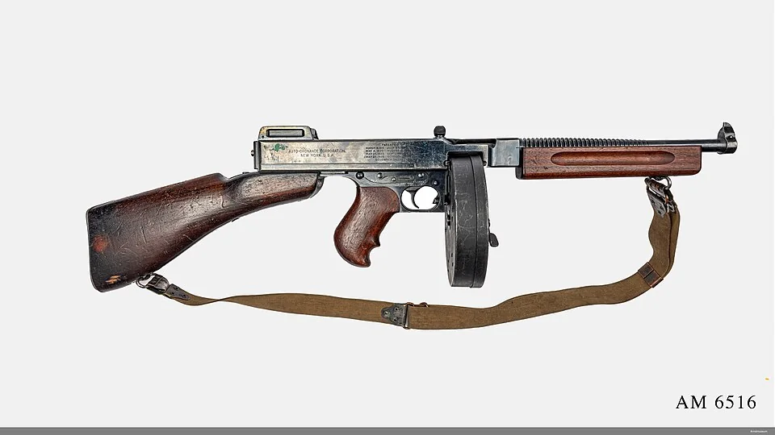

**Image credit:** [Swedish Army Museum; CC BY 4.0; resized and converted](https://commons.wikimedia.org/wiki/File:Thompson_SMG_M1928,_AM.006516,_01.jpg)

**Image license:** [CC BY 4.0](https://creativecommons.org/licenses/by/4.0/)

- A. Karabiner 98k rifle
- B. Thompson submachine gun
- C. 75 mm pack howitzer
- D. Bren light machine gun

**Correct answer:** B

- **A · Incorrect:** The Karabiner 98k is a German rifle, not this submachine gun.
- **B · Correct:** The Swedish Army Museum identifies its specimen as a Thompson M1928; Thompsons were also known as Tommy guns.
- **C · Incorrect:** The howitzer is a wheeled artillery piece, not a handheld firearm.
- **D · Incorrect:** The Bren is a light machine gun, usually pictured with a prominent top-mounted magazine.

**Source:** [Imperial War Museums — Thompson Model 1928A1](https://www.iwm.org.uk/collections/item/object/30033521)

### WWII-N075 — Which WWII-era weapon is pictured?

**Topic:** Equipment — Weapons

**Image:** 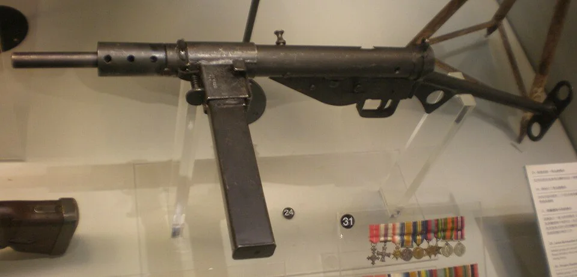

**Image credit:** [BrokenSphere; CC BY-SA 3.0; resized and converted](https://commons.wikimedia.org/wiki/File:Sten_Mk_II_HKMCD.JPG)

**Image license:** [CC BY-SA 3.0](https://creativecommons.org/licenses/by-sa/3.0/)

- A. M1 Garand rifle
- B. MG 42 machine gun
- C. Sten submachine gun
- D. 75 mm pack howitzer

**Correct answer:** C

- **A · Incorrect:** The M1 Garand is a long wooden-stocked American rifle.
- **B · Incorrect:** The MG 42 is a larger German machine gun, often displayed on a bipod.
- **C · Correct:** This museum exhibit is a Sten Mk II; the Sten was designed in Britain during the war.
- **D · Incorrect:** A pack howitzer is a much larger wheeled artillery piece.

**Source:** [Imperial War Museums — Sten Mk 2](https://www.iwm.org.uk/collections/item/object/30029395)

### WWII-N076 — Which WWII-era weapon is pictured?

**Topic:** Equipment — Weapons

**Image:** 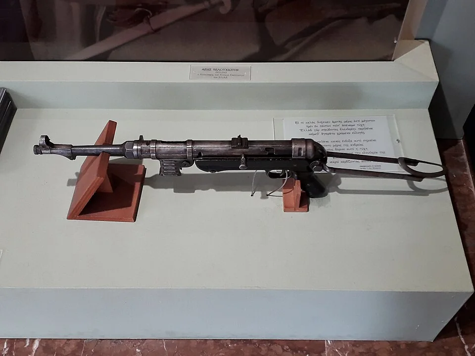

**Image credit:** [Catlemur; CC BY-SA 4.0; resized and converted](https://commons.wikimedia.org/wiki/File:MP40_Nikaia_Resistance_Museum.jpg)

**Image license:** [CC BY-SA 4.0](https://creativecommons.org/licenses/by-sa/4.0/)

- A. Lee-Enfield No. 4 rifle
- B. Bren light machine gun
- C. M1 Garand rifle
- D. MP 40 submachine gun

**Correct answer:** D

- **A · Incorrect:** The Lee-Enfield No. 4 is a wooden-stocked British rifle.
- **B · Incorrect:** The Bren is a light machine gun with a different overall shape.
- **C · Incorrect:** The M1 Garand is a long wooden-stocked American rifle.
- **D · Correct:** The museum photograph identifies the object as an MP 40, a German submachine gun produced during the war.

**Source:** [Imperial War Museums — MP40](https://www.iwm.org.uk/collections/item/object/30029268)

### WWII-N077 — Which WWII-era weapon is pictured?

**Topic:** Equipment — Weapons

**Image:** 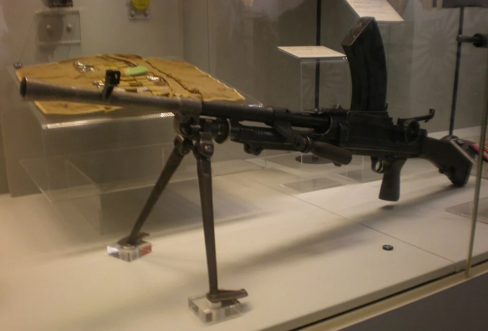

**Image credit:** [BrokenSphere; CC BY-SA 3.0; resized and converted](https://commons.wikimedia.org/wiki/File:Bren_gun_HKMCD.JPG)

**Image license:** [CC BY-SA 3.0](https://creativecommons.org/licenses/by-sa/3.0/)

- A. Sten submachine gun
- B. Bren light machine gun
- C. Mosin-Nagant rifle
- D. 75 mm pack howitzer

**Correct answer:** B

- **A · Incorrect:** The Sten is a compact submachine gun, not this supported light machine gun.
- **B · Correct:** The displayed Bren is a British light machine gun; its top-mounted curved magazine is visually distinctive.
- **C · Incorrect:** The Mosin-Nagant is a wooden-stocked rifle rather than this machine gun.
- **D · Incorrect:** The pack howitzer is a wheeled artillery piece.

**Source:** [Imperial War Museums — Bren Mk 2](https://www.iwm.org.uk/collections/item/object/30033628)

### WWII-N078 — Which WWII-era weapon is pictured?

**Topic:** Equipment — Weapons

**Image:** 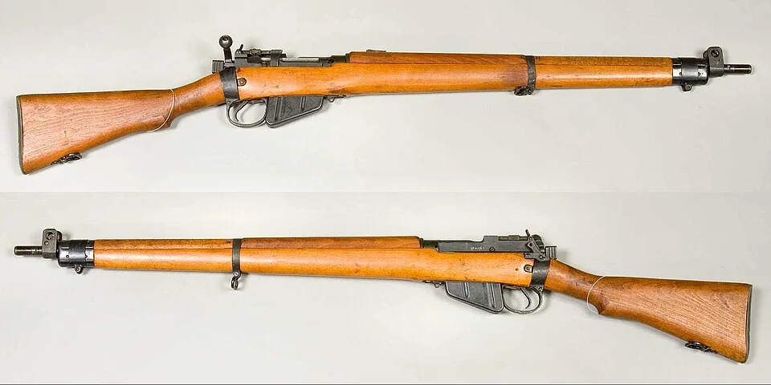

**Image credit:** [Swedish Army Museum; public domain](https://commons.wikimedia.org/wiki/File:Lee-Enfield_No_4_Mk_I_%281943%29_-_AM.032027.jpg)

- A. PPSh-41 submachine gun
- B. MG 42 machine gun
- C. Lee-Enfield No. 4 rifle
- D. 75 mm pack howitzer

**Correct answer:** C

- **A · Incorrect:** The PPSh-41 is a Soviet submachine gun, often shown with a round drum magazine.
- **B · Incorrect:** The MG 42 is a German machine gun, not the pictured rifle.
- **C · Correct:** The Swedish Army Museum identifies this rifle as a Lee-Enfield No. 4 Mk I made in 1943.
- **D · Incorrect:** The pack howitzer is a wheeled artillery piece, not a rifle.

**Source:** [Imperial War Museums — Rifle, No 4 Mk 1](https://www.iwm.org.uk/collections/item/object/30032154)

### WWII-N079 — Which WWII-era weapon is pictured?

**Topic:** Equipment — Weapons

**Image:** 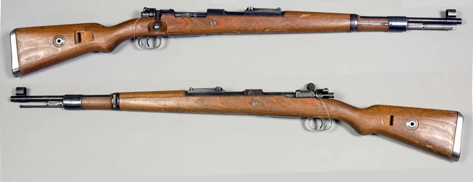

**Image credit:** [Swedish Army Museum; CC BY 4.0; resized and converted](https://commons.wikimedia.org/wiki/File:Karabiner_98_kurz.jpg)

**Image license:** [CC BY 4.0](https://creativecommons.org/licenses/by/4.0/)

- A. Karabiner 98k rifle
- B. Thompson submachine gun
- C. Bren light machine gun
- D. 75 mm pack howitzer

**Correct answer:** A

- **A · Correct:** The pictured Karabiner 98k was the standard German rifle during WWII.
- **B · Incorrect:** The Thompson is an American submachine gun, not this long German rifle.
- **C · Incorrect:** The Bren is a British light machine gun, not this rifle.
- **D · Incorrect:** The pack howitzer is a wheeled artillery piece.

**Source:** [Imperial War Museums — Karabiner 98k](https://www.iwm.org.uk/collections/item/object/30035947)

### WWII-N080 — Which WWII-era weapon is pictured?

**Topic:** Equipment — Weapons

**Image:** 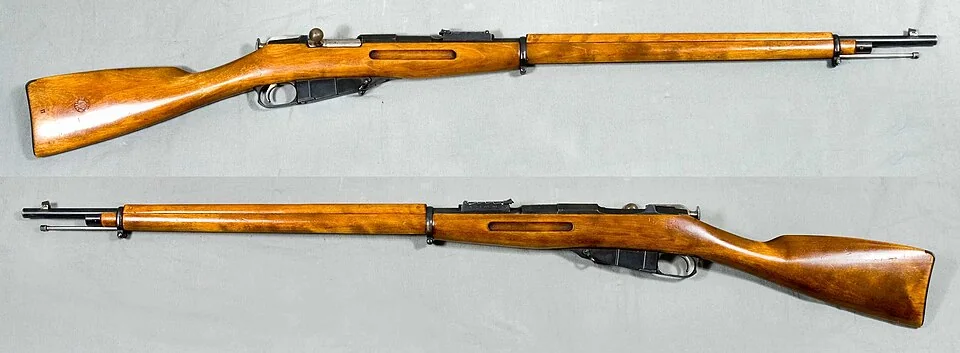

**Image credit:** [Swedish Army Museum; public domain](https://commons.wikimedia.org/wiki/File:Mosin-Nagant_M1891_-_Ryssland_-_AM.032971.jpg)

- A. MP 40 submachine gun
- B. 75 mm pack howitzer
- C. Bren light machine gun
- D. Mosin-Nagant rifle

**Correct answer:** D

- **A · Incorrect:** The MP 40 is a German submachine gun with a metal stock.
- **B · Incorrect:** The pack howitzer is a wheeled artillery piece.
- **C · Incorrect:** The Bren is a British light machine gun, not this long rifle.
- **D · Correct:** This museum specimen is a Mosin-Nagant Model 1891; the later M1891/30 version was the Red Army standard in WWII.

**Source:** [Imperial War Museums — Mosin-Nagant M1891/30](https://www.iwm.org.uk/collections/item/object/30029602)

### WWII-N081 — Which WWII-era weapon is pictured?

**Topic:** Equipment — Weapons

**Image:** 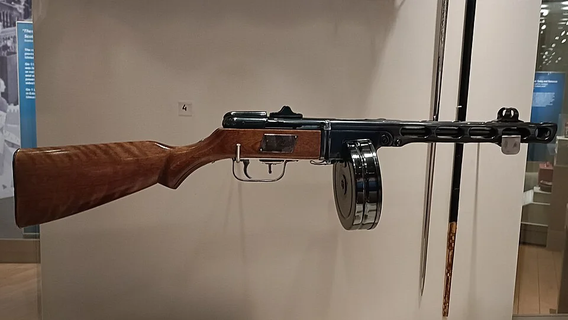

**Image credit:** [501ghost; CC0; resized and converted](https://commons.wikimedia.org/wiki/File:PPsh-41_at_the_National_Museum_of_Scotland.jpg)

- A. Karabiner 98k rifle
- B. PPSh-41 submachine gun
- C. 75 mm pack howitzer
- D. M1 Garand rifle

**Correct answer:** B

- **A · Incorrect:** The Karabiner 98k is a German rifle without the pictured drum.
- **B · Correct:** This PPSh-41 is a Soviet submachine gun; the pictured specimen has a distinctive round drum magazine.
- **C · Incorrect:** The pack howitzer is a wheeled artillery piece.
- **D · Incorrect:** The M1 Garand is an American rifle, not the pictured Soviet submachine gun.

**Source:** [Imperial War Museums — PPSh 41](https://www.iwm.org.uk/collections/item/object/30029315)

### WWII-N082 — Which WWII-era weapon is pictured?

**Topic:** Equipment — Weapons

**Image:** 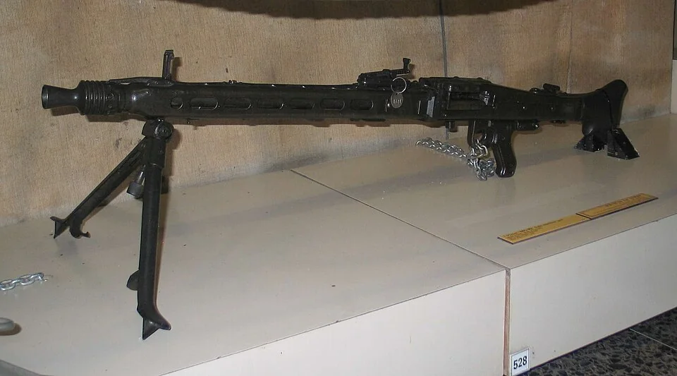

**Image credit:** [Bukvoed; CC BY 3.0; resized and converted](https://commons.wikimedia.org/wiki/File:MG42-machine-gun-batey-haosef-1.jpg)

**Image license:** [CC BY 3.0](https://creativecommons.org/licenses/by/3.0/)

- A. Lee-Enfield No. 4 rifle
- B. Thompson submachine gun
- C. MG 42 machine gun
- D. 75 mm pack howitzer

**Correct answer:** C

- **A · Incorrect:** The Lee-Enfield No. 4 is a British wooden-stocked rifle.
- **B · Incorrect:** The Thompson is a smaller American submachine gun.
- **C · Correct:** The museum display is identified as an MG 42, a German machine gun introduced during WWII.
- **D · Incorrect:** The pack howitzer is a wheeled artillery piece.

**Source:** [Imperial War Museums — MG42](https://www.iwm.org.uk/collections/item/object/30033064)

### WWII-N083 — Which WWII-era weapon is pictured?

**Topic:** Equipment — Weapons

**Image:** 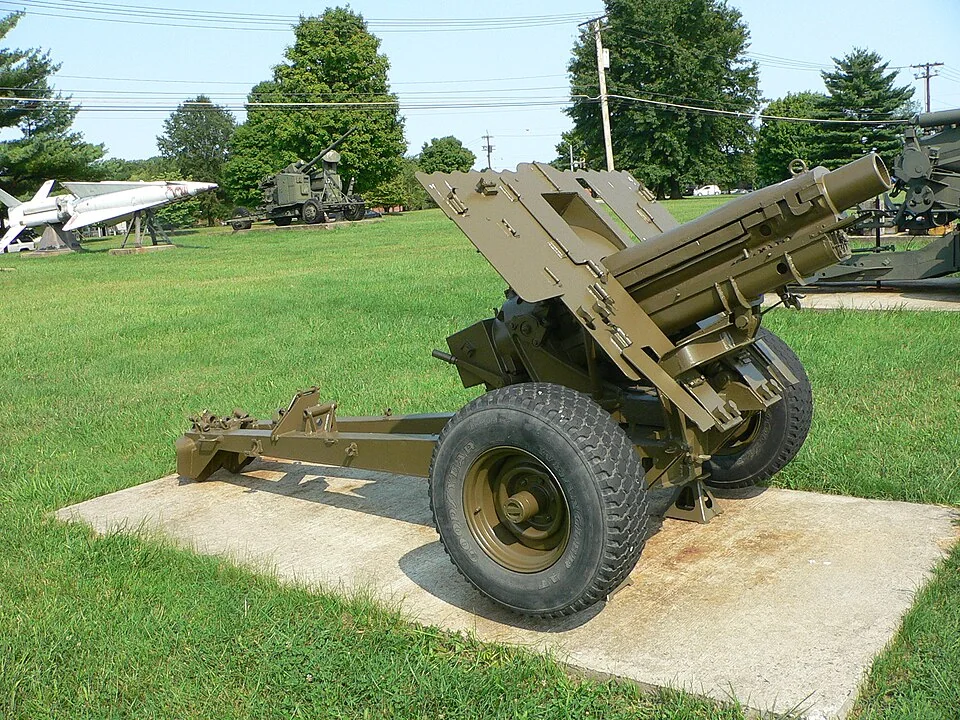

**Image credit:** [Mark Pellegrini; CC BY-SA 2.5; resized and converted](https://commons.wikimedia.org/wiki/File:US_75_mm_howitzer_1.jpg)

**Image license:** [CC BY-SA 2.5](https://creativecommons.org/licenses/by-sa/2.5/)

- A. MP 40 submachine gun
- B. Mosin-Nagant rifle
- C. M1 Garand rifle
- D. 75 mm pack howitzer

**Correct answer:** D

- **A · Incorrect:** The MP 40 is a handheld German submachine gun.
- **B · Incorrect:** The Mosin-Nagant is a handheld rifle.
- **C · Incorrect:** The M1 Garand is an American rifle, not an artillery piece.
- **D · Correct:** The photograph shows a US 75 mm pack howitzer, a light artillery type used during WWII.

**Source:** [U.S. Army — Artillery Museum rescues historic howitzer](https://www.army.mil/article/111769/no_1_gun_artillery_museum_rescues_historic_howitzer)

### WWII-N084 — Which submachine gun was nicknamed the Tommy gun?

**Topic:** Equipment — Weapons

- A. Thompson
- B. Sten
- C. Bren
- D. Lee-Enfield

**Correct answer:** A

- **A · Correct:** The Thompson submachine gun was known as the Tommy gun.
- **B · Incorrect:** The Sten was another submachine gun, not the Thompson Tommy gun.
- **C · Incorrect:** The Bren was a light machine gun, not the Tommy gun.
- **D · Incorrect:** The Lee-Enfield was a rifle, not the Tommy gun.

**Source:** [Imperial War Museums — Thompson submachine guns](https://www.iwm.org.uk/collections/item/object/205195518)

### WWII-N085 — What kind of bomb was Little Boy, dropped on Hiroshima?

**Topic:** Equipment — Weapons

- A. A depth charge
- B. A conventional incendiary bomb
- C. An atomic bomb
- D. A naval torpedo

**Correct answer:** C

- **A · Incorrect:** Depth charges were used against submarines; Little Boy was an atomic bomb.
- **B · Incorrect:** Conventional incendiaries start fires without a nuclear explosion; Little Boy was an atomic bomb.
- **C · Correct:** Little Boy was the atomic bomb dropped on Hiroshima by Enola Gay on August 6, 1945.
- **D · Incorrect:** A torpedo is an underwater weapon; Little Boy was an atomic bomb dropped from an aircraft.

**Source:** [Smithsonian National Air and Space Museum — Flight of the Enola Gay](https://airandspace.si.edu/stories/editorial/flight-enola-gay)

### WWII-N086 — What type of aircraft was Enola Gay, which dropped the atomic bomb on Hiroshima?

**Topic:** Equipment — Aircraft

- A. P-51 Mustang
- B. C-47 Skytrain
- C. B-29 Superfortress
- D. B-17 Flying Fortress

**Correct answer:** C

- **A · Incorrect:** Enola Gay was a B-29 bomber, not a P-51 fighter.
- **B · Incorrect:** Enola Gay was a B-29 bomber, not a C-47 transport.
- **C · Correct:** Enola Gay was a modified Boeing B-29 Superfortress.
- **D · Incorrect:** Enola Gay was a B-29, not the earlier B-17.

**Source:** [Smithsonian National Air and Space Museum — Enola Gay](https://airandspace.si.edu/stories/editorial/flight-enola-gay)

### WWII-N087 — What did the Tiger I tank fire from its main gun?

**Topic:** Equipment — Weapons

- A. Parachutes
- B. Shells
- C. Torpedoes
- D. Aircraft

**Correct answer:** B

- **A · Incorrect:** The Tiger’s main gun fired shells, not parachutes.
- **B · Correct:** The Tank Museum records a Tiger firing an 88 mm shell.
- **C · Incorrect:** Torpedoes are naval weapons; the Tiger fired shells from its gun.
- **D · Incorrect:** The Tiger was a tank, not an aircraft carrier; its gun fired shells.

**Source:** [The Tank Museum — capture of Tiger 131](https://tankmuseum.org/article/capture_of_tiger_131)

### WWII-N088 — What markings helped identify many Allied aircraft during the D-Day invasion?

**Topic:** Equipment — Aircraft

- A. Black-and-white stripes
- B. A painted red cross alone
- C. A solid yellow tail alone
- D. A large letter Z alone

**Correct answer:** A

- **A · Correct:** Invasion stripes on wings and fuselages helped identify Allied aircraft.
- **B · Incorrect:** The distinctive invasion markings were black-and-white stripes.
- **C · Incorrect:** The identifying invasion markings were black-and-white stripes.
- **D · Incorrect:** The D-Day identification markings were black-and-white stripes.

**Source:** [Smithsonian National Air and Space Museum — C-47 and D-Day](https://airandspace.si.edu/stories/editorial/d-day-and-douglas-c-47)

### WWII-N089 — In what part of France did the D-Day landings take place?

**Topic:** History — D-Day

- A. Sicily
- B. Bavaria
- C. Norway
- D. Normandy

**Correct answer:** D

- **A · Incorrect:** Sicily: an Italian island invaded by the Allies in 1943; it is not the answer described.
- **B · Incorrect:** Bavaria: a region of southern Germany; it is not the answer described.
- **C · Incorrect:** Norway: a Scandinavian country occupied by Germany; it is not the answer described.
- **D · Correct:** The Allied landings took place along the coast of Normandy.

**Source:** [Imperial War Museums — D-Day beaches](https://www.iwm.org.uk/history/second-world-war/d-day/what-you-need-to-know-about-the-d-day-beaches)

### WWII-N090 — How many named assault beaches were used on D-Day?

**Topic:** History — D-Day

- A. seven
- B. ten
- C. five
- D. three

**Correct answer:** C

- **A · Incorrect:** seven: a larger number than the five assault beaches; it is not the answer described.
- **B · Incorrect:** ten: twice the number of assault beaches; it is not the answer described.
- **C · Correct:** The beaches were Utah, Omaha, Gold, Juno, and Sword.
- **D · Incorrect:** three: a smaller number than the five assault beaches; it is not the answer described.

**Source:** [Imperial War Museums — D-Day beaches](https://www.iwm.org.uk/history/second-world-war/d-day/what-you-need-to-know-about-the-d-day-beaches)

### WWII-N091 — Which D-Day beach was assigned to the Canadian 3rd Division?

**Topic:** History — D-Day

- A. Gold
- B. Juno
- C. Omaha
- D. Utah

**Correct answer:** B

- **A · Incorrect:** Gold: a British landing beach; it is not the answer described.
- **B · Correct:** Canadian troops landed at Juno Beach.
- **C · Incorrect:** Omaha: an American landing beach; it is not the answer described.
- **D · Incorrect:** Utah: an American landing beach; it is not the answer described.

**Source:** [Imperial War Museums — D-Day beaches](https://www.iwm.org.uk/history/second-world-war/d-day/what-you-need-to-know-about-the-d-day-beaches)

### WWII-N092 — Which D-Day beach had the highest casualties of the five assault areas?

**Topic:** History — D-Day

- A. Omaha
- B. Juno
- C. Utah
- D. Gold

**Correct answer:** A

- **A · Correct:** Omaha was heavily defended and suffered the highest casualties of the assault beaches.
- **B · Incorrect:** Juno: the beach assigned to the Canadian 3rd Division; it is not the answer described.
- **C · Incorrect:** Utah: an American landing beach; it is not the answer described.
- **D · Incorrect:** Gold: a British landing beach; it is not the answer described.

**Source:** [Imperial War Museums — D-Day beaches](https://www.iwm.org.uk/history/second-world-war/d-day/what-you-need-to-know-about-the-d-day-beaches)

### WWII-N093 — Which British city was heavily bombed during the Blitz?

**Topic:** History — Home front

- A. Rome
- B. Tokyo
- C. Berlin
- D. London

**Correct answer:** D

- **A · Incorrect:** Rome is in Italy, not Britain.
- **B · Incorrect:** Tokyo is in Japan, not Britain.
- **C · Incorrect:** Berlin is in Germany, not Britain.
- **D · Correct:** London was bombed repeatedly during the German air raids known as the Blitz.

**Source:** [Imperial War Museums — London in the Second World War](https://www.iwm.org.uk/history/second-world-war/blitz/london-in-the-second-world-war)

### WWII-N094 — What work did Britain’s Women’s Land Army do during WWII?

**Topic:** History — Home Front

- A. Serving on naval warships
- B. Working as hospital nurses
- C. Farm work and food production
- D. Flying fighter aircraft

**Correct answer:** C

- **A · Incorrect:** The Land Army worked on Britain’s farms, rather than serving as a naval crew.
- **B · Incorrect:** The Land Army’s wartime role was agricultural work.
- **C · Correct:** Land Girls worked on farms and helped increase Britain’s food supply.
- **D · Incorrect:** The Women’s Land Army worked in British agriculture, not as fighter pilots.

**Source:** [Imperial War Museums — Women’s Land Army](https://www.iwm.org.uk/history/second-world-war/home-front/what-was-the-womens-land-army)

### WWII-N095 — What did Americans grow in wartime victory gardens?

**Topic:** History — Home Front

- A. Petrol
- B. Fruit and vegetables
- C. Rubber tyres
- D. Steel helmets

**Correct answer:** B

- **A · Incorrect:** Victory gardens produced food, not fuel.
- **B · Correct:** Victory gardens supplied home-grown produce and helped address food shortages.
- **C · Incorrect:** Victory gardens grew food; tyres were manufactured products.
- **D · Incorrect:** Gardens grew food, not manufactured helmets.

**Source:** [The National WWII Museum — victory gardens](https://www.nationalww2museum.org/war/articles/victory-gardens-world-war-ii)

### WWII-N096 — What was the codename for the Allied invasion of Normandy?

**Topic:** History — D-Day

- A. Operation Overlord
- B. Operation Torch
- C. Operation Barbarossa
- D. Operation Neptune

**Correct answer:** A

- **A · Correct:** Operation Overlord was the Allied invasion of Normandy.
- **B · Incorrect:** Operation Torch: the Allied landings in North Africa; it is not the answer described.
- **C · Incorrect:** Operation Barbarossa: the German invasion of the Soviet Union; it is not the answer described.
- **D · Incorrect:** Operation Neptune: the naval component of the Normandy invasion; it is not the answer described.

**Source:** [Imperial War Museums — D-Day explained](https://www.iwm.org.uk/history/second-world-war/d-day/d-day-explained)

### WWII-N097 — In which country were the WWII battles of El Alamein fought?

**Topic:** History — North Africa

- A. Japan
- B. France
- C. Norway
- D. Egypt

**Correct answer:** D

- **A · Incorrect:** Japan is in East Asia; El Alamein is in Egypt.
- **B · Incorrect:** France is in Europe; El Alamein is in Egypt.
- **C · Incorrect:** Norway is in Europe; El Alamein is in Egypt.
- **D · Correct:** The battles of El Alamein were fought in Egypt in 1942.

**Source:** [Encyclopaedia Britannica — Battles of El-Alamein](https://www.britannica.com/event/Battles-of-El-Alamein)

### WWII-N098 — How did radar help Britain’s air defences in the Battle of Britain?

**Topic:** History — Battle of Britain

- A. It transported troops across the Channel
- B. It decoded every German message
- C. It warned of incoming aircraft
- D. It produced food for rationing

**Correct answer:** C

- **A · Incorrect:** Radar detected aircraft; it was not a transport vessel.
- **B · Incorrect:** Radar tracked approaching aircraft; codebreaking was a separate activity.
- **C · Correct:** Radar detected approaching raids, giving fighter defences time to respond.
- **D · Incorrect:** Food supplies were a home-front concern; radar warned of air raids.

**Source:** [Imperial War Museums — radar and the Battle of Britain](https://www.iwm.org.uk/history/second-world-war/battle-of-britain/how-radar-gave-britain-the-edge)

### WWII-N099 — Who dropped behind the Normandy beaches before the seaborne landings?

**Topic:** History — D-Day

- A. shipyard welders
- B. paratroopers
- C. submariners
- D. firefighters

**Correct answer:** B

- **A · Incorrect:** shipyard welders: workers who join metal in shipyards; it is not the answer described.
- **B · Correct:** Allied airborne troops dropped behind the beaches to help secure the landings.
- **C · Incorrect:** submariners: people who serve aboard submarines; it is not the answer described.
- **D · Incorrect:** firefighters: people trained to fight fires; it is not the answer described.

**Source:** [Imperial War Museums — D-Day explained](https://www.iwm.org.uk/history/second-world-war/d-day/d-day-explained)

### WWII-N100 — Which Normandy cliff-top position was assaulted by U.S. Rangers on D-Day?

**Topic:** History — D-Day

- A. Pointe du Hoc
- B. Juno Beach
- C. Pearl Harbor
- D. Stalingrad

**Correct answer:** A

- **A · Correct:** U.S. Rangers attacked German gun positions at Pointe du Hoc.
- **B · Incorrect:** Juno Beach: the beach assigned to the Canadian 3rd Division; it is not the answer described.
- **C · Incorrect:** Pearl Harbor: a U.S. naval base in Hawaii; it is not the answer described.
- **D · Incorrect:** Stalingrad: a Soviet city that saw a major battle; it is not the answer described.

**Source:** [Imperial War Museums — D-Day beaches](https://www.iwm.org.uk/history/second-world-war/d-day/what-you-need-to-know-about-the-d-day-beaches)

### WWII-N101 — What were limited allocations of scarce food and goods called?

**Topic:** History — Home front

- A. passports
- B. ballots
- C. maps
- D. rations

**Correct answer:** D

- **A · Incorrect:** passports: documents used for international travel; it is not the answer described.
- **B · Incorrect:** ballots: papers used for voting; it is not the answer described.
- **C · Incorrect:** maps: documents used for navigation; it is not the answer described.
- **D · Correct:** Rationing controlled access to scarce goods during wartime.

**Source:** [Imperial War Museums — rationing](https://www.iwm.org.uk/history/second-world-war/home-front/rationing)

### WWII-N102 — What did Britain begin rationing in January 1940?

**Topic:** History — Home front

- A. library cards
- B. postage stamps
- C. food
- D. railway timetables

**Correct answer:** C

- **A · Incorrect:** library cards: documents used to borrow books; it is not the answer described.
- **B · Incorrect:** postage stamps: labels used to pay for mail; it is not the answer described.
- **C · Correct:** Food rationing began in Britain in January 1940.
- **D · Incorrect:** railway timetables: schedules showing train services; it is not the answer described.

**Source:** [Imperial War Museums — Britain during the Second World War](https://www.iwm.org.uk/history/second-world-war/home-front)

### WWII-N103 — What additional consumer good did Britain begin rationing in 1941?

**Topic:** History — Home front

- A. wedding invitations
- B. clothes
- C. school exams
- D. traffic lights

**Correct answer:** B

- **A · Incorrect:** wedding invitations: messages inviting guests; it is not the answer described.
- **B · Correct:** Clothes rationing began in Britain in 1941.
- **C · Incorrect:** school exams: assessments taken by pupils; it is not the answer described.
- **D · Incorrect:** traffic lights: signals used to control road traffic; it is not the answer described.

**Source:** [Imperial War Museums — Britain during the Second World War](https://www.iwm.org.uk/history/second-world-war/home-front)

### WWII-N104 — Where were many British children evacuated to escape bombing?

**Topic:** History — Home front

- A. countryside
- B. front lines
- C. submarines
- D. shipyards

**Correct answer:** A

- **A · Correct:** Many evacuees were sent from cities to rural areas considered safer.
- **B · Incorrect:** front lines: areas where opposing forces fight; it is not the answer described.
- **C · Incorrect:** submarines: naval vessels able to travel underwater; it is not the answer described.
- **D · Incorrect:** shipyards: places where vessels are built; it is not the answer described.

**Source:** [Imperial War Museums — wartime evacuation](https://www.iwm.org.uk/history/second-world-war/home-front/the-nation-at-a-standstill)

### WWII-N105 — What was the British campaign encouraging people to grow vegetables called?

**Topic:** History — Home Front

- A. Make Do and Mend
- B. Careless Talk Costs Lives
- C. Keep Calm and Carry On
- D. Dig for Victory

**Correct answer:** D

- **A · Incorrect:** This slogan concerned repairing and reusing clothing; vegetable growing was Dig for Victory.
- **B · Incorrect:** This warned against sharing sensitive information; the gardening campaign was Dig for Victory.
- **C · Incorrect:** This was a morale message; the gardening campaign was Dig for Victory.
- **D · Correct:** Britain encouraged people to grow vegetables under the Dig for Victory campaign.

**Source:** [Imperial War Museums — rationing](https://www.iwm.org.uk/history/second-world-war/home-front/rationing); [Make Do and Mend](https://www.iwm.org.uk/history/second-world-war/home-front/rationing/top-tips-for-winning-at-make-do-and-mend); [Careless Talk](https://www.iwm.org.uk/collections/item/object/9736); [Keep Calm](https://www.iwm.org.uk/history/second-world-war/home-front/truth-behind-keep-calm-and-carry-on)

### WWII-N106 — What was the wartime rule requiring British households to hide lights after dark called?

**Topic:** History — Home front

- A. evacuation
- B. conscription
- C. blackout
- D. rationing

**Correct answer:** C

- **A · Incorrect:** evacuation: moving people away from danger; it is not the answer described.
- **B · Incorrect:** conscription: compulsory recruitment for service; it is not the answer described.
- **C · Correct:** The blackout restricted visible lights at night.
- **D · Incorrect:** rationing: controls on access to scarce goods; it is not the answer described.

**Source:** [Imperial War Museums — wartime shutdown](https://www.iwm.org.uk/history/second-world-war/home-front/the-nation-at-a-standstill)

### WWII-N107 — Why did British blackout rules require lights to be hidden?

**Topic:** History — Home front

- A. To help enemy bombers locate towns
- B. To make towns harder for enemy bombers to locate
- C. To signal the end of an air raid
- D. To guide ships into harbours

**Correct answer:** B

- **A · Incorrect:** The aim was to conceal towns from enemy bombers, not help them.
- **B · Correct:** Hiding lights made towns harder for enemy aircraft to locate at night.
- **C · Incorrect:** Hiding lights was a continuing precaution, not the all-clear signal after a raid.
- **D · Incorrect:** The blackout was intended to conceal targets from the air, not guide ships.

**Source:** [Imperial War Museums — the Blitz in photographs](https://www.iwm.org.uk/history/second-world-war/blitz/the-blitz-in-photographs)

### WWII-N108 — What name is commonly given to the German bombing campaign against British cities?

**Topic:** History — Home front

- A. the Blitz
- B. the Battle of Midway
- C. the Winter War
- D. the Doolittle Raid

**Correct answer:** A

- **A · Correct:** The Blitz brought sustained bombing to London and other British cities.
- **B · Incorrect:** the Battle of Midway: a naval-air battle in the Pacific; it is not the answer described.
- **C · Incorrect:** the Winter War: a war between Finland and the Soviet Union; it is not the answer described.
- **D · Incorrect:** the Doolittle Raid: an American air raid on Japan; it is not the answer described.

**Source:** [Imperial War Museums — Britain during the Second World War](https://www.iwm.org.uk/history/second-world-war/home-front)

### WWII-N109 — Which figure became a U.S. symbol of women working in wartime industry?

**Topic:** History — Home front

- A. Anne Frank
- B. Winston Churchill
- C. Douglas MacArthur
- D. Rosie the Riveter

**Correct answer:** D

- **A · Incorrect:** Anne Frank: a Jewish diarist who hid from the Nazis; it is not the answer described.
- **B · Incorrect:** Winston Churchill: Britain’s prime minister later in the war; it is not the answer described.
- **C · Incorrect:** Douglas MacArthur: an American general; it is not the answer described.
- **D · Correct:** Rosie the Riveter became an icon of American women industrial workers.

**Source:** [National WWII Museum — the home front](https://www.nationalww2museum.org/war/articles/home-front)

### WWII-N110 — Where did millions of American women work to support wartime production?

**Topic:** History — Home front

- A. only the navy
- B. only overseas embassies
- C. factories
- D. only the front lines

**Correct answer:** C

- **A · Incorrect:** only the navy: one branch of the armed forces; it is not the answer described.
- **B · Incorrect:** only overseas embassies: diplomatic offices abroad; it is not the answer described.
- **C · Correct:** Millions of American women entered industrial work during the war.
- **D · Incorrect:** only the front lines: areas of direct military fighting; it is not the answer described.

**Source:** [National WWII Museum — the home front](https://www.nationalww2museum.org/war/articles/home-front)

### WWII-N111 — What did American households carefully manage with ration books?

**Topic:** History — Home front

- A. only railway maps
- B. food and supplies
- C. only military decorations
- D. only film tickets

**Correct answer:** B

- **A · Incorrect:** only railway maps: documents showing rail routes; it is not the answer described.
- **B · Correct:** Ration books helped households manage scarce goods during the war.
- **C · Incorrect:** only military decorations: awards for service; it is not the answer described.
- **D · Incorrect:** only film tickets: admission to entertainment; it is not the answer described.

**Source:** [National WWII Museum — the home front](https://www.nationalww2museum.org/war/articles/home-front)

### WWII-N112 — Which community was subjected to mass incarceration in the United States under wartime exclusion policies?

**Topic:** History — Home front

- A. Japanese Americans
- B. German prisoners of war
- C. British diplomats
- D. Canadian soldiers

**Correct answer:** A

- **A · Correct:** Japanese Americans were forcibly removed and incarcerated under wartime policies.
- **B · Incorrect:** German prisoners of war: captured German service members; it is not the answer described.
- **C · Incorrect:** British diplomats: officials representing Britain; it is not the answer described.
- **D · Incorrect:** Canadian soldiers: military personnel from Canada; it is not the answer described.

**Source:** [U.S. National Archives — Executive Order 9066](https://www.archives.gov/milestone-documents/executive-order-9066)

### WWII-N113 — Which U.S. president signed Executive Order 9066 in 1942?

**Topic:** History — Home front

- A. Harry S. Truman
- B. Dwight Eisenhower
- C. Winston Churchill
- D. Franklin D. Roosevelt

**Correct answer:** D

- **A · Incorrect:** Harry S. Truman: the U.S. president who took office in 1945; it is not the answer described.
- **B · Incorrect:** Dwight Eisenhower: an Allied general in Europe; it is not the answer described.
- **C · Incorrect:** Winston Churchill: Britain’s prime minister later in the war; it is not the answer described.
- **D · Correct:** Roosevelt issued Executive Order 9066 in February 1942.

**Source:** [U.S. National Archives — Executive Order 9066](https://www.archives.gov/milestone-documents/executive-order-9066)

### WWII-N114 — What did Executive Order 9066 authorize commanders to designate for civilian exclusion?

**Topic:** History — Home front

- A. national parks
- B. foreign embassies
- C. military areas
- D. Olympic stadiums

**Correct answer:** C

- **A · Incorrect:** national parks: areas protected for conservation; it is not the answer described.
- **B · Incorrect:** foreign embassies: diplomatic offices of other countries; it is not the answer described.
- **C · Correct:** The order authorized military commanders to exclude civilians from designated military areas.
- **D · Incorrect:** Olympic stadiums: venues for sport; it is not the answer described.

**Source:** [U.S. National Archives — Executive Order 9066](https://www.archives.gov/milestone-documents/executive-order-9066)

### WWII-N115 — Which U.S. service was created for women in the Army during World War II?

**Topic:** History — Home front

- A. the Japanese Imperial Navy
- B. the Women’s Army Corps
- C. the Royal Air Force
- D. the German Luftwaffe

**Correct answer:** B

- **A · Incorrect:** the Japanese Imperial Navy: Japan’s wartime naval service; it is not the answer described.
- **B · Correct:** The Women’s Army Corps was a U.S. military service for women.
- **C · Incorrect:** the Royal Air Force: Britain’s air force; it is not the answer described.
- **D · Incorrect:** the German Luftwaffe: Germany’s wartime air force; it is not the answer described.

**Source:** [National WWII Museum — women in World War II](https://www.nationalww2museum.org/students-teachers/student-resources/research-starters/women-wwii)

### WWII-N116 — What was a central purpose of British food rationing?

**Topic:** History — Home front

- A. fairer shares during shortages
- B. ending all farming
- C. replacing all shops
- D. closing all kitchens

**Correct answer:** A

- **A · Correct:** The scheme aimed to distribute scarce food fairly.
- **B · Incorrect:** ending all farming: not the aim of British rationing; it is not the answer described.
- **C · Incorrect:** replacing all shops: not the aim of British rationing; it is not the answer described.
- **D · Incorrect:** closing all kitchens: not the aim of British rationing; it is not the answer described.

**Source:** [Imperial War Museums — rationing](https://www.iwm.org.uk/history/second-world-war/home-front/rationing)

### WWII-N117 — Which broadcaster carried Neville Chamberlain's announcement that Britain was at war in 1939?

**Topic:** History — Home front

- A. NASA
- B. the United Nations
- C. the Red Cross
- D. the BBC

**Correct answer:** D

- **A · Incorrect:** NASA: the U.S. space agency founded after the war; it is not the answer described.
- **B · Incorrect:** the United Nations: an international organization founded in 1945; it is not the answer described.
- **C · Incorrect:** the Red Cross: a humanitarian organization; it is not the answer described.
- **D · Correct:** The announcement that Britain was at war was broadcast by the BBC.

**Source:** [Imperial War Museums — Britain during the Second World War](https://www.iwm.org.uk/history/second-world-war/home-front)

### WWII-N118 — Who announced Britain was at war with Germany on September 3, 1939?

**Topic:** History — Home front

- A. Harry S. Truman
- B. Joseph Stalin
- C. Neville Chamberlain
- D. Winston Churchill

**Correct answer:** C

- **A · Incorrect:** Harry S. Truman: the U.S. president who took office in 1945; it is not the answer described.
- **B · Incorrect:** Joseph Stalin: the Soviet leader; it is not the answer described.
- **C · Correct:** Prime Minister Neville Chamberlain made the announcement on September 3.
- **D · Incorrect:** Winston Churchill: Britain’s prime minister later in the war; it is not the answer described.

**Source:** [Imperial War Museums — Britain during the Second World War](https://www.iwm.org.uk/history/second-world-war/home-front)

### WWII-N119 — What name is given to the Nazi genocide of European Jews?

**Topic:** History — Holocaust and resistance

- A. D-Day
- B. the Holocaust
- C. the Blitz
- D. the Battle of Midway

**Correct answer:** B

- **A · Incorrect:** D-Day: the Allied landings in Normandy; it is not the answer described.
- **B · Correct:** The Holocaust was the Nazi regime’s systematic persecution and murder of European Jews.
- **C · Incorrect:** the Blitz: German bombing of British cities; it is not the answer described.
- **D · Incorrect:** the Battle of Midway: a Pacific naval-air battle; it is not the answer described.

**Source:** [U.S. Holocaust Memorial Museum — World War II and the Holocaust](https://www.ushmm.org/learn/holocaust/world-war-ii-and-the-holocaust-1939-1945)

### WWII-N120 — Approximately how many Jews were murdered in the Holocaust?

**Topic:** History — Holocaust and resistance

- A. Six million
- B. Two million
- C. Four million
- D. Eight million

**Correct answer:** A

- **A · Correct:** Approximately six million Jewish people were murdered in the Holocaust.
- **B · Incorrect:** Two million is far below the estimated Jewish death toll.
- **C · Incorrect:** Four million is below the estimated Jewish death toll.
- **D · Incorrect:** Eight million is above the estimated Jewish death toll.

**Source:** [U.S. Holocaust Memorial Museum — World War II and the Holocaust](https://www.ushmm.org/learn/holocaust/world-war-ii-and-the-holocaust-1939-1945)

### WWII-N121 — Which people were targeted by Nazi Germany for systematic annihilation?

**Topic:** History — Holocaust and resistance

- A. only military pilots
- B. only prisoners of war
- C. only factory owners
- D. Jewish people

**Correct answer:** D

- **A · Incorrect:** only military pilots: members of air forces, not the group targeted for genocide; it is not the answer described.
- **B · Incorrect:** only prisoners of war: captured military personnel, not the sole victims of Nazi persecution; it is not the answer described.
- **C · Incorrect:** only factory owners: an occupational group, not the population targeted for genocide; it is not the answer described.
- **D · Correct:** Nazi Germany sought to murder Europe’s Jews; it also persecuted and murdered other groups.

**Source:** [U.S. Holocaust Memorial Museum — World War II and the Holocaust](https://www.ushmm.org/learn/holocaust/world-war-ii-and-the-holocaust-1939-1945)

### WWII-N122 — What were the confined urban areas where Nazis separated many Jews from the rest of the population called?

**Topic:** History — Holocaust and resistance

- A. parliaments
- B. shipyards
- C. ghettos
- D. libraries

**Correct answer:** C

- **A · Incorrect:** parliaments: institutions that make laws; it is not the answer described.
- **B · Incorrect:** shipyards: places where ships are built; it is not the answer described.
- **C · Correct:** German authorities forced Jews into ghettos in occupied eastern Europe.
- **D · Incorrect:** libraries: places where books are kept; it is not the answer described.

**Source:** [U.S. Holocaust Memorial Museum — World War II and the Holocaust](https://www.ushmm.org/learn/holocaust/world-war-ii-and-the-holocaust-1939-1945)

### WWII-N123 — Which Nazi camp complex in occupied Poland included a killing center?

**Topic:** History — Holocaust and resistance

- A. Normandy
- B. Auschwitz-Birkenau
- C. Pearl Harbor
- D. Bletchley Park

**Correct answer:** B

- **A · Incorrect:** Normandy: a region of France; it is not the answer described.
- **B · Correct:** Auschwitz-Birkenau was the largest Nazi camp complex and included a killing center.
- **C · Incorrect:** Pearl Harbor: a U.S. naval base in Hawaii; it is not the answer described.
- **D · Incorrect:** Bletchley Park: a British wartime codebreaking center; it is not the answer described.

**Source:** [U.S. Holocaust Memorial Museum — World War II and the Holocaust](https://www.ushmm.org/learn/holocaust/world-war-ii-and-the-holocaust-1939-1945)

### WWII-N124 — What did Anne Frank keep while hiding from Nazi persecution?

**Topic:** History — Holocaust and resistance

- A. a diary
- B. a submarine manual
- C. a restaurant menu
- D. a naval treaty

**Correct answer:** A

- **A · Correct:** Anne recorded her experiences, fears, and hopes in a diary.
- **B · Incorrect:** a submarine manual: a document about operating a submarine; it is not the answer described.
- **C · Incorrect:** a restaurant menu: a list of food for sale; it is not the answer described.
- **D · Incorrect:** a naval treaty: an agreement involving naval powers; it is not the answer described.

**Source:** [U.S. Holocaust Memorial Museum — Anne Frank](https://encyclopedia.ushmm.org/content/en/article/anne-frank-biography)

### WWII-N125 — What did Anne Frank call her hiding place?

**Topic:** History — Holocaust and resistance

- A. the White House
- B. the Reichstag
- C. the Kremlin
- D. the Secret Annex

**Correct answer:** D

- **A · Incorrect:** the White House: the U.S. president’s residence; it is not the answer described.
- **B · Incorrect:** the Reichstag: the German parliament building; it is not the answer described.
- **C · Incorrect:** the Kremlin: a historic government complex in Moscow; it is not the answer described.
- **D · Correct:** Anne called the concealed apartment behind her father’s former office the Secret Annex.

**Source:** [U.S. Holocaust Memorial Museum — Anne Frank](https://encyclopedia.ushmm.org/content/en/article/anne-frank-biography)

### WWII-N126 — Who helped preserve Anne Frank’s writings after the family was arrested?

**Topic:** History — Holocaust and resistance

- A. Alan Turing
- B. Adolf Hitler
- C. Miep Gies
- D. Otto Frank

**Correct answer:** C

- **A · Incorrect:** Alan Turing: a British mathematician who worked on Enigma; it is not the answer described.
- **B · Incorrect:** Adolf Hitler: the dictator of Nazi Germany; it is not the answer described.
- **C · Correct:** Miep Gies preserved Anne’s papers and later gave them to Otto Frank.
- **D · Incorrect:** Otto Frank: Anne Frank’s father; it is not the answer described.

**Source:** [U.S. Holocaust Memorial Museum — Anne Frank’s diary](https://encyclopedia.ushmm.org/content/en/article/anne-frank-diary)

### WWII-N127 — Who was Anne Frank’s father and helped publish her diary?

**Topic:** History — Holocaust and resistance

- A. Winston Churchill
- B. Otto Frank
- C. Miep Gies
- D. Alan Turing

**Correct answer:** B

- **A · Incorrect:** Winston Churchill: Britain’s wartime prime minister; it is not the answer described.
- **B · Correct:** Otto Frank organized Anne’s papers and worked to publish her diary.
- **C · Incorrect:** Miep Gies: a Dutch helper who preserved Anne’s diary; it is not the answer described.
- **D · Incorrect:** Alan Turing: a British mathematician who worked on Enigma; it is not the answer described.

**Source:** [U.S. Holocaust Memorial Museum — Anne Frank’s diary](https://encyclopedia.ushmm.org/content/en/article/anne-frank-diary)

### WWII-N128 — What concealed the entrance to Anne Frank's hiding place?

**Topic:** History — Holocaust

- A. A revolving bookcase
- B. A railway carriage
- C. A garden shed
- D. A ship's cabin

**Correct answer:** A

- **A · Correct:** A revolving bookcase concealed the entrance to the Secret Annex.
- **B · Incorrect:** The entrance was concealed by a bookcase, not a railway carriage.
- **C · Incorrect:** The entrance was concealed by a bookcase, not a garden shed.
- **D · Incorrect:** The entrance was concealed by a bookcase, not a ship's cabin.

**Source:** [Anne Frank House — the bookcase](https://www.annefrank.org/en/museum/collection/anne-frank-collection/42/bookcase/)

### WWII-N129 — In which city did Jewish fighters rise against Nazi forces in a ghetto in 1943?

**Topic:** History — Holocaust and resistance

- A. Berlin
- B. Rome
- C. Tokyo
- D. Warsaw

**Correct answer:** D

- **A · Incorrect:** Berlin: the German capital; it is not the answer described.
- **B · Incorrect:** Rome: the Italian capital; it is not the answer described.
- **C · Incorrect:** Tokyo: the Japanese capital; it is not the answer described.
- **D · Correct:** Jewish insurgents resisted German deportations in the Warsaw ghetto.

**Source:** [U.S. Holocaust Memorial Museum — Warsaw Ghetto Uprising](https://encyclopedia.ushmm.org/content/en/article/warsaw-ghetto-uprising)

### WWII-N130 — Which people were forced to wear a yellow Star of David in Nazi Germany from 1941?

**Topic:** History — Holocaust

- A. All British civilians
- B. All Allied prisoners of war
- C. Jews aged six and over
- D. All German soldiers

**Correct answer:** C

- **A · Incorrect:** The decree targeted Jews in the Reich and some annexed territories, not all British civilians.
- **B · Incorrect:** The decree targeted Jews, not all Allied prisoners of war.
- **C · Correct:** Nazi authorities ordered Jews aged six and over in the Reich to wear the badge to identify and stigmatize them.
- **D · Incorrect:** The order targeted Jews; it was not a badge worn by all German soldiers.

**Source:** [United States Holocaust Memorial Museum — Jewish badge](https://encyclopedia.ushmm.org/content/en/article/jewish-badge-during-the-nazi-era)

### WWII-N131 — Who resisted deportations during the Warsaw Ghetto Uprising?

**Topic:** History — Holocaust and resistance

- A. British air-raid wardens
- B. Jewish resistance fighters
- C. German occupation police
- D. U.S. Marines

**Correct answer:** B

- **A · Incorrect:** British air-raid wardens: civilian-defense personnel in Britain; it is not the answer described.
- **B · Correct:** Jewish fighters resisted German troops and police in the ghetto.
- **C · Incorrect:** German occupation police: the Nazi forces that attempted deportations; it is not the answer described.
- **D · Incorrect:** U.S. Marines: American military personnel who fought in the Pacific; it is not the answer described.

**Source:** [U.S. Holocaust Memorial Museum — Warsaw Ghetto Uprising](https://encyclopedia.ushmm.org/content/en/article/warsaw-ghetto-uprising)

### WWII-N132 — What kind of vessels helped carry many Danish Jewish refugees to safety in 1943?

**Topic:** History — Holocaust and resistance

- A. fishing boats
- B. aircraft carriers
- C. tank columns
- D. railway locomotives

**Correct answer:** A

- **A · Correct:** Danish fishermen ferried refugees across the water to Sweden.
- **B · Incorrect:** aircraft carriers: large warships that operate aircraft; it is not the answer described.
- **C · Incorrect:** tank columns: formations of armoured vehicles; it is not the answer described.
- **D · Incorrect:** railway locomotives: vehicles used to pull trains; it is not the answer described.

**Source:** [U.S. Holocaust Memorial Museum — Rescue in Denmark](https://encyclopedia.ushmm.org/content/en/article/rescue-in-denmark)

### WWII-N133 — Where was the British center for breaking German wartime codes?

**Topic:** History — Intelligence and service

- A. Pearl Harbor
- B. the Secret Annex
- C. Omaha Beach
- D. Bletchley Park

**Correct answer:** D

- **A · Incorrect:** Pearl Harbor: a U.S. naval base in Hawaii; it is not the answer described.
- **B · Incorrect:** the Secret Annex: the Frank family’s hiding place; it is not the answer described.
- **C · Incorrect:** Omaha Beach: an American D-Day landing beach; it is not the answer described.
- **D · Correct:** Bletchley Park was the site of secret British codebreaking work.

**Source:** [Imperial War Museums — Alan Turing and Enigma](https://www.iwm.org.uk/history/second-world-war/intelligence/how-alan-turing-cracked-the-enigma-code)

### WWII-N134 — Which mathematician worked on Enigma at Bletchley Park?

**Topic:** History — Intelligence and service

- A. Douglas MacArthur
- B. Miep Gies
- C. Alan Turing
- D. Anne Frank

**Correct answer:** C

- **A · Incorrect:** Douglas MacArthur: an American general; it is not the answer described.
- **B · Incorrect:** Miep Gies: a Dutch helper who preserved Anne’s diary; it is not the answer described.
- **C · Correct:** Alan Turing worked on deciphering Enigma messages at Bletchley Park.
- **D · Incorrect:** Anne Frank: a Jewish diarist who hid from the Nazis; it is not the answer described.

**Source:** [Imperial War Museums — Alan Turing and Enigma](https://www.iwm.org.uk/history/second-world-war/intelligence/how-alan-turing-cracked-the-enigma-code)

### WWII-N135 — What was the German enciphering machine studied by Turing’s team called?

**Topic:** History — Intelligence and service

- A. Mulberry
- B. Enigma
- C. Overlord
- D. Rosie

**Correct answer:** B

- **A · Incorrect:** Mulberry: the name of artificial harbours used after D-Day; it is not the answer described.
- **B · Correct:** The German armed forces used Enigma machines to encipher messages.
- **C · Incorrect:** Overlord: the Allied invasion of Normandy; it is not the answer described.
- **D · Incorrect:** Rosie: a name associated with American women war workers; it is not the answer described.

**Source:** [Imperial War Museums — Alan Turing and Enigma](https://www.iwm.org.uk/history/second-world-war/intelligence/how-alan-turing-cracked-the-enigma-code)

### WWII-N136 — Mathematicians from which country shared earlier Enigma breakthroughs with Britain?

**Topic:** History — Intelligence and service

- A. Poland
- B. Brazil
- C. Australia
- D. Canada

**Correct answer:** A

- **A · Correct:** Polish mathematicians had worked out how to read Enigma and shared their knowledge.
- **B · Incorrect:** Brazil: a South American Allied country; it is not the answer described.
- **C · Incorrect:** Australia: an Allied country in the Pacific; it is not the answer described.
- **D · Incorrect:** Canada: an Allied country in North America; it is not the answer described.

**Source:** [Imperial War Museums — Alan Turing and Enigma](https://www.iwm.org.uk/history/second-world-war/intelligence/how-alan-turing-cracked-the-enigma-code)

### WWII-N137 — What kind of traffic did Turing’s Hut 8 team analyze?

**Topic:** History — Intelligence and service

- A. restaurant recipes
- B. weather jokes
- C. cinema reviews
- D. German naval messages

**Correct answer:** D

- **A · Incorrect:** restaurant recipes: instructions for preparing food; it is not the answer described.
- **B · Incorrect:** weather jokes: humorous remarks about weather; it is not the answer described.
- **C · Incorrect:** cinema reviews: commentary on films; it is not the answer described.
- **D · Correct:** Hut 8 worked on German naval Enigma signals.

**Source:** [Imperial War Museums — Alan Turing and Enigma](https://www.iwm.org.uk/history/second-world-war/intelligence/how-alan-turing-cracked-the-enigma-code)

### WWII-N138 — Which Indigenous language was used to develop a U.S. Marine Corps wartime code?

**Topic:** History — Intelligence and service

- A. Esperanto
- B. Morse code
- C. Navajo
- D. Latin

**Correct answer:** C

- **A · Incorrect:** Esperanto: a constructed international language; it is not the answer described.
- **B · Incorrect:** Morse code: a system of dots and dashes; it is not the answer described.
- **C · Correct:** Navajo speakers developed and used a military code based on their language.
- **D · Incorrect:** Latin: an ancient language; it is not the answer described.

**Source:** [National WWII Museum — American Indian Code Talkers](https://www.nationalww2museum.org/war/articles/american-indian-code-talkers)

### WWII-N139 — What did code talkers send using their military codes?

**Topic:** History — Intelligence and service

- A. movie subtitles
- B. secret military messages
- C. newspaper advertisements
- D. baseball scores

**Correct answer:** B

- **A · Incorrect:** movie subtitles: text displayed with films; it is not the answer described.
- **B · Correct:** Code talkers transmitted secret battlefield communications.
- **C · Incorrect:** newspaper advertisements: public announcements in print; it is not the answer described.
- **D · Incorrect:** baseball scores: results of sporting games; it is not the answer described.

**Source:** [National WWII Museum — American Indian Code Talkers](https://www.nationalww2museum.org/war/articles/american-indian-code-talkers)

### WWII-N140 — Which U.S. military branch trained the first group of Navajo code talkers in 1942?

**Topic:** History — Intelligence and service

- A. the U.S. Marine Corps
- B. the German navy
- C. the Italian air force
- D. the Japanese army

**Correct answer:** A

- **A · Correct:** The first class of 29 Navajo Marine recruits completed training in 1942.
- **B · Incorrect:** the German navy: a branch of Nazi Germany’s armed forces; it is not the answer described.
- **C · Incorrect:** the Italian air force: Italy’s air service; it is not the answer described.
- **D · Incorrect:** the Japanese army: Japan’s land forces; it is not the answer described.

**Source:** [National WWII Museum — American Indian Code Talkers](https://www.nationalww2museum.org/war/articles/american-indian-code-talkers)

### WWII-N141 — In which theater did Navajo code talkers notably serve?

**Topic:** History — Intelligence and service

- A. Antarctica
- B. the Moon
- C. the Sahara alone
- D. the Pacific

**Correct answer:** D

- **A · Incorrect:** Antarctica: the southern polar continent; it is not the answer described.
- **B · Incorrect:** the Moon: Earth’s natural satellite; it is not the answer described.
- **C · Incorrect:** the Sahara alone: a desert region, not their principal theater; it is not the answer described.
- **D · Correct:** Navajo code talkers transmitted messages in the Pacific theater.

**Source:** [National WWII Museum — American Indian Code Talkers](https://www.nationalww2museum.org/war/articles/american-indian-code-talkers)

### WWII-N142 — What name is given to the African American U.S. aviators trained at Tuskegee?

**Topic:** History — Intelligence and service

- A. Code Talkers
- B. Land Girls
- C. Tuskegee Airmen
- D. Flying Tigers

**Correct answer:** C

- **A · Incorrect:** Code Talkers: service members who used Indigenous-language codes; it is not the answer described.
- **B · Incorrect:** Land Girls: women who worked in British agriculture; it is not the answer described.
- **C · Correct:** The Tuskegee Airmen served in segregated American aviation units.
- **D · Incorrect:** Flying Tigers: American volunteers who fought for China; it is not the answer described.

**Source:** [National WWII Museum — Tuskegee Airmen](https://www.nationalww2museum.org/war/articles/louisianacorporal-albert-porche-99th-fighter-squadron)

### WWII-N143 — In which U.S. state was the Tuskegee Airmen training center?

**Topic:** History — Intelligence and service

- A. Maine
- B. Alabama
- C. Alaska
- D. Hawaii

**Correct answer:** B

- **A · Incorrect:** Maine: a U.S. state in New England; it is not the answer described.
- **B · Correct:** Tuskegee was selected as the center for African American pilot training in Alabama.
- **C · Incorrect:** Alaska: a U.S. state in the far northwest; it is not the answer described.
- **D · Incorrect:** Hawaii: an island group in the Pacific; it is not the answer described.

**Source:** [National WWII Museum — Tuskegee Airmen](https://www.nationalww2museum.org/war/articles/louisianacorporal-albert-porche-99th-fighter-squadron)

### WWII-N144 — What colour gave the Tuskegee fighter group its Red Tails nickname?

**Topic:** History — Intelligence and service

- A. red
- B. purple
- C. green
- D. yellow

**Correct answer:** A

- **A · Correct:** The nickname came from the red-painted tails of the group’s aircraft.
- **B · Incorrect:** purple: a colour not represented by the nickname Red Tails; it is not the answer described.
- **C · Incorrect:** green: a colour not represented by the nickname Red Tails; it is not the answer described.
- **D · Incorrect:** yellow: a colour not represented by the nickname Red Tails; it is not the answer described.

**Source:** [The National WWII Museum — Tuskegee Airmen teaching resource](https://www.nationalww2museum.org/sites/default/files/2017-07/tuskegee-airmen.pdf)

### WWII-N145 — What initials identified the Women Airforce Service Pilots?

**Topic:** History — Intelligence and service

- A. WAC
- B. RAF
- C. BBC
- D. WASP

**Correct answer:** D

- **A · Incorrect:** WAC: the Women’s Army Corps; it is not the answer described.
- **B · Incorrect:** RAF: the Royal Air Force; it is not the answer described.
- **C · Incorrect:** BBC: the British broadcaster; it is not the answer described.
- **D · Correct:** WASP stands for Women Airforce Service Pilots.

**Source:** [National WWII Museum — Women Airforce Service Pilots](https://www.nationalww2museum.org/war/articles/wasp-women-airforce-service-pilots)

### WWII-N146 — What was one noncombat job performed by the WASP?

**Topic:** History — Intelligence and service

- A. conduct the Nuremberg trials
- B. negotiate the German surrender
- C. ferry aircraft
- D. command Japanese fleets

**Correct answer:** C

- **A · Incorrect:** conduct the Nuremberg trials: a postwar judicial role; it is not the answer described.
- **B · Incorrect:** negotiate the German surrender: a diplomatic and military role; it is not the answer described.
- **C · Correct:** WASP pilots ferried military aircraft within the United States.
- **D · Incorrect:** command Japanese fleets: a naval command role; it is not the answer described.

**Source:** [National WWII Museum — Women Airforce Service Pilots](https://www.nationalww2museum.org/war/articles/wasp-women-airforce-service-pilots)

### WWII-N147 — Where did many Londoners shelter during German air raids?

**Topic:** History — Home Front

- A. On open beaches
- B. Underground railway stations
- C. On exposed rooftops
- D. In the middle of runways

**Correct answer:** B

- **A · Incorrect:** Underground stations provided shelter; open beaches did not.
- **B · Correct:** Some Underground stations became air-raid shelters during the Blitz.
- **C · Incorrect:** People sought shelter from raids; exposed rooftops offered no such protection.
- **D · Incorrect:** Londoners sheltered in places such as Underground stations, not exposed airfields.

**Source:** [Imperial War Museums — London during WWII](https://www.iwm.org.uk/history/second-world-war/blitz/london-in-the-second-world-war)

### WWII-N148 — Who did much of the vital ground support work for Tuskegee fighter units?

**Topic:** History — Intelligence and service

- A. Tuskegee Airmen
- B. Flying Tigers
- C. Code Talkers
- D. Land Girls

**Correct answer:** A

- **A · Correct:** The Tuskegee Airmen included support personnel as well as pilots.
- **B · Incorrect:** Flying Tigers: American volunteers who fought for China; it is not the answer described.
- **C · Incorrect:** Code Talkers: service members who used Indigenous-language codes; it is not the answer described.
- **D · Incorrect:** Land Girls: women who worked in British agriculture; it is not the answer described.

**Source:** [National WWII Museum — Tuskegee Airmen](https://www.nationalww2museum.org/war/articles/louisianacorporal-albert-porche-99th-fighter-squadron)

### WWII-N149 — Where was the U.S. naval base attacked at Pearl Harbor?

**Topic:** History — Pacific

- A. Alaska
- B. California
- C. Iceland
- D. Hawaii

**Correct answer:** D

- **A · Incorrect:** Alaska: a U.S. territory in the far northwest; it is not the answer described.
- **B · Incorrect:** California: a state on the U.S. West Coast; it is not the answer described.
- **C · Incorrect:** Iceland: an island country in the North Atlantic; it is not the answer described.
- **D · Correct:** Pearl Harbor was on Oahu in the U.S. territory of Hawaii.

**Source:** [National WWII Museum — Pearl Harbor](https://www.nationalww2museum.org/war/topics/pearl-harbor-december-7-1941)

### WWII-N150 — Which American naval force was the primary target of the Pearl Harbor attack?

**Topic:** History — Pacific

- A. German navy
- B. Italian merchant fleet
- C. U.S. Pacific Fleet
- D. Royal Navy’s Mediterranean Fleet

**Correct answer:** C

- **A · Incorrect:** German navy: Germany’s naval force; it is not the answer described.
- **B · Incorrect:** Italian merchant fleet: Italian commercial ships; it is not the answer described.
- **C · Correct:** Japanese aircraft attacked the U.S. Pacific Fleet and installations on Oahu.
- **D · Incorrect:** Royal Navy’s Mediterranean Fleet: a British naval force; it is not the answer described.

**Source:** [National WWII Museum — Pearl Harbor](https://www.nationalww2museum.org/war/topics/pearl-harbor-december-7-1941)

### WWII-N151 — How many Japanese aircraft carriers were lost at the Battle of Midway?

**Topic:** History — Pacific

- A. eight
- B. four
- C. one
- D. two

**Correct answer:** B

- **A · Incorrect:** eight: more than the four Japanese carriers lost; it is not the answer described.
- **B · Correct:** Japan lost four aircraft carriers at Midway.
- **C · Incorrect:** one: the number of U.S. carriers lost at Midway; it is not the answer described.
- **D · Incorrect:** two: fewer than the four Japanese carriers lost; it is not the answer described.

**Source:** [National WWII Museum — Battle of Midway](https://www.nationalww2museum.org/war/articles/battle-midway)

### WWII-N152 — Which Pacific atoll was the target of Japan’s June 1942 operation?

**Topic:** History — Pacific

- A. Midway
- B. Dunkirk
- C. El Alamein
- D. Stalingrad

**Correct answer:** A

- **A · Correct:** Japan planned to capture the American base at Midway.
- **B · Incorrect:** Dunkirk: a French port evacuated in 1940; it is not the answer described.
- **C · Incorrect:** El Alamein: a battle area in Egypt; it is not the answer described.
- **D · Incorrect:** Stalingrad: a Soviet city that saw a major battle; it is not the answer described.

**Source:** [National WWII Museum — Battle of Midway](https://www.nationalww2museum.org/war/articles/battle-midway)

### WWII-N153 — Who helped the U.S. Navy identify Japan’s planned target before Midway?

**Topic:** History — Pacific

- A. film actors
- B. sculptors
- C. shipyard cooks
- D. cryptanalysts

**Correct answer:** D

- **A · Incorrect:** film actors: performers in motion pictures; it is not the answer described.
- **B · Incorrect:** sculptors: artists who create three-dimensional works; it is not the answer described.
- **C · Incorrect:** shipyard cooks: workers who prepare food; it is not the answer described.
- **D · Correct:** American Navy codebreakers helped identify Midway as the target.

**Source:** [National WWII Museum — Battle of Midway](https://www.nationalww2museum.org/war/articles/battle-midway)

### WWII-N154 — What was the secret wartime project that developed the first atomic bombs called?

**Topic:** History — Science and War

- A. Enigma
- B. Operation Dynamo
- C. The Manhattan Project
- D. Operation Overlord

**Correct answer:** C

- **A · Incorrect:** Enigma was a German enciphering machine, not the Allied atomic-bomb project.
- **B · Incorrect:** Dynamo was the Dunkirk evacuation, not the atomic-bomb project.
- **C · Correct:** The U.S.-led Manhattan Project developed the first atomic weapons during WWII.
- **D · Incorrect:** Overlord was the Allied invasion of Normandy, not the atomic-bomb project.

**Source:** [National Park Service — Manhattan Project](https://www.nps.gov/mapr/learn/manhattan-project.htm); [Imperial War Museums — D-Day](https://www.iwm.org.uk/history/second-world-war/d-day/d-day-explained); [Enigma](https://www.iwm.org.uk/history/second-world-war/intelligence/how-alan-turing-cracked-the-enigma-code); [Dunkirk](https://www.iwm.org.uk/history/second-world-war/dunkirk/what-you-need-to-know-about-the-dunkirk-evacuations)

### WWII-N155 — Which island was the site of a major Allied offensive beginning in August 1942?

**Topic:** History — Pacific

- A. Crete
- B. Guadalcanal
- C. Iceland
- D. Sicily

**Correct answer:** B

- **A · Incorrect:** Crete: a Greek island fought over in 1941; it is not the answer described.
- **B · Correct:** U.S. forces landed on Guadalcanal in August 1942.
- **C · Incorrect:** Iceland: an island country in the North Atlantic; it is not the answer described.
- **D · Incorrect:** Sicily: an Italian island invaded by the Allies in 1943; it is not the answer described.

**Source:** [The National WWII Museum — Guadalcanal](https://www.nationalww2museum.org/war/articles/solomon-islands-campaign-guadalcanal)

### WWII-N156 — Which country’s mainland did the Allies invade in September 1943 after landing on Sicily?

**Topic:** History — Italian Campaign

- A. Italy
- B. France
- C. Germany
- D. Norway

**Correct answer:** A

- **A · Correct:** After invading Sicily in July 1943, Allied forces landed on mainland Italy in September.
- **B · Incorrect:** The 1943 landings followed the invasion of Sicily and targeted mainland Italy.
- **C · Incorrect:** The mainland targeted after Sicily was Italy, not Germany.
- **D · Incorrect:** The September 1943 landings were in mainland Italy, not Norway.

**Source:** [Imperial War Museums — Italian campaign](https://www.iwm.org.uk/history/second-world-war/italian-campaign)

### WWII-N157 — Which community made up the segregated U.S. 442nd Regimental Combat Team that fought in Europe?

**Topic:** History — Service and Sacrifice

- A. German prisoners of war
- B. British sailors
- C. Italian prisoners of war
- D. Japanese Americans

**Correct answer:** D

- **A · Incorrect:** The unit was made up of Japanese American soldiers serving the United States.
- **B · Incorrect:** The 442nd was a U.S. Army unit, not a British naval crew.
- **C · Incorrect:** The 442nd was a Japanese American U.S. Army unit, not a unit of Italian prisoners.
- **D · Correct:** The 442nd was a segregated Japanese American Army unit that fought in Italy and France.

**Source:** [National Park Service — Nisei military service](https://www.nps.gov/articles/000/nisei-military-service.htm); [The National WWII Museum — 442nd Regimental Combat Team](https://www.nationalww2museum.org/war/articles/442nd-regimental-combat-team)

### WWII-N158 — What height on Iwo Jima was the site of the famous U.S. flag-raising photograph?

**Topic:** History — Pacific

- A. Mount Everest
- B. Mount Etna
- C. Mount Suribachi
- D. Mount Fuji

**Correct answer:** C

- **A · Incorrect:** Mount Everest: a mountain in the Himalayas; it is not the answer described.
- **B · Incorrect:** Mount Etna: a volcano on Sicily; it is not the answer described.
- **C · Correct:** The second flag raising on Mount Suribachi was captured in the famous photograph.
- **D · Incorrect:** Mount Fuji: a mountain on Japan’s main island of Honshu; it is not the answer described.

**Source:** [National WWII Museum — Iwo Jima](https://www.nationalww2museum.org/war/articles/iwo-jima-and-okinawa-death-japans-doorstep)

### WWII-N159 — What did the Allied Pacific strategy known as “island hopping” involve?

**Topic:** History — Pacific

- A. Moving only by railway across Asia
- B. Bypassing some fortified islands and capturing others
- C. Attacking every Japanese-held island in order
- D. Fighting only in Europe

**Correct answer:** B

- **A · Incorrect:** The strategy involved capturing selected Pacific islands, not railway travel across Asia.
- **B · Correct:** Allied forces skipped some heavily defended islands and captured positions useful for the next advance.
- **C · Incorrect:** Island hopping deliberately bypassed some fortified positions.
- **D · Incorrect:** Island hopping was part of the Pacific campaign against Japan.

**Source:** [The National WWII Museum — Pacific strategy](https://www.nationalww2museum.org/war/articles/pacific-strategy-1941-1944)

### WWII-N160 — Which WWII campaign was fought to protect vital Allied sea supplies from German U-boats?

**Topic:** History — Atlantic

- A. The Battle of the Atlantic
- B. The Battle of Britain
- C. The Battle of Stalingrad
- D. The Battle of the Bulge

**Correct answer:** A

- **A · Correct:** Allied convoys and escorts defended sea routes against German submarines.
- **B · Incorrect:** This was primarily an air battle over Britain, not the Atlantic convoy campaign.
- **C · Incorrect:** This was a major land battle on the Eastern Front.
- **D · Incorrect:** This was a land battle in the Ardennes, not the Atlantic convoy campaign.

**Source:** [Imperial War Museums — Battle of the Atlantic](https://www.iwm.org.uk/history/second-world-war/battle-of-the-atlantic/what-you-need-to-know)

### WWII-N161 — Which Japanese city was struck by an atomic bomb on August 9, 1945?

**Topic:** History — Pacific

- A. Hiroshima
- B. Tokyo
- C. Kyoto
- D. Nagasaki

**Correct answer:** D

- **A · Incorrect:** Hiroshima: a Japanese city hit by an atomic bomb on August 6, 1945; it is not the answer described.
- **B · Incorrect:** Tokyo: Japan’s capital; it is not the answer described.
- **C · Incorrect:** Kyoto: a historic Japanese city; it is not the answer described.
- **D · Correct:** A second atomic bomb was dropped on Nagasaki on August 9.

**Source:** [National WWII Museum — the end of WWII](https://www.nationalww2museum.org/war/topics/end-world-war-ii-1945)

### WWII-N162 — Which Allied power declared war on Japan in August 1945 and invaded Manchuria?

**Topic:** History — Pacific

- A. Switzerland
- B. Portugal
- C. the Soviet Union
- D. Spain

**Correct answer:** C

- **A · Incorrect:** Switzerland: a neutral European country; it is not the answer described.
- **B · Incorrect:** Portugal: a neutral European country; it is not the answer described.
- **C · Correct:** The Soviet Union declared war on Japan and invaded Manchuria in August 1945.
- **D · Incorrect:** Spain: a country that did not join the Allies’ war against Japan; it is not the answer described.

**Source:** [National WWII Museum — the end of WWII](https://www.nationalww2museum.org/war/topics/end-world-war-ii-1945)

### WWII-N163 — What slowed an airborne soldier’s descent when jumping from an aircraft on D-Day?

**Topic:** History — D-Day

- A. A railway brake
- B. A parachute
- C. A ship’s anchor
- D. A tank turret

**Correct answer:** B

- **A · Incorrect:** A railway brake slows a train, not a soldier descending from an aircraft.
- **B · Correct:** Allied paratroopers landed in Normandy by parachute.
- **C · Incorrect:** An anchor holds a ship; it is not used to slow a parachute jump.
- **D · Incorrect:** A turret carries a tank’s gun; it is not used for a parachute landing.

**Source:** [Imperial War Museums — D-Day in the air](https://www.iwm.org.uk/history/second-world-war/d-day/how-d-day-was-fought-from-the-air)

### WWII-N164 — What was the codename for the 1940 evacuation from Dunkirk?

**Topic:** History — Dunkirk

- A. Operation Dynamo
- B. Operation Overlord
- C. Operation Barbarossa
- D. Operation Torch

**Correct answer:** A

- **A · Correct:** Operation Dynamo rescued Allied troops from Dunkirk.
- **B · Incorrect:** Operation Overlord: the Allied invasion of Normandy; it is not the answer described.
- **C · Incorrect:** Operation Barbarossa: the German invasion of the Soviet Union; it is not the answer described.
- **D · Incorrect:** Operation Torch: the Allied landings in North Africa; it is not the answer described.

**Source:** [Imperial War Museums — Dunkirk evacuation](https://www.iwm.org.uk/history/second-world-war/dunkirk/what-you-need-to-know-about-the-dunkirk-evacuations)

### WWII-N165 — What body of water did evacuated troops cross from Dunkirk to Britain?

**Topic:** History — Dunkirk

- A. the Pacific Ocean
- B. the Mediterranean Sea
- C. the Arctic Ocean
- D. the English Channel

**Correct answer:** D

- **A · Incorrect:** the Pacific Ocean: the ocean between Asia and the Americas; it is not the answer described.
- **B · Incorrect:** the Mediterranean Sea: the sea south of Europe; it is not the answer described.
- **C · Incorrect:** the Arctic Ocean: the ocean around the North Pole; it is not the answer described.
- **D · Correct:** Ships carried the evacuated troops across the English Channel.

**Source:** [Imperial War Museums — Dunkirk evacuation](https://www.iwm.org.uk/history/second-world-war/dunkirk/what-you-need-to-know-about-the-dunkirk-evacuations)

### WWII-N166 — What kinds of vessels joined the Dunkirk evacuation alongside naval ships?

**Topic:** History — Dunkirk

- A. only aircraft
- B. only trains
- C. small civilian boats
- D. only submarines

**Correct answer:** C

- **A · Incorrect:** only aircraft: flying machines, not the sole means of evacuation; it is not the answer described.
- **B · Incorrect:** only trains: railway vehicles, not the sole means of evacuation; it is not the answer described.
- **C · Correct:** Small civilian vessels, remembered as the little ships, helped the evacuation.
- **D · Incorrect:** only submarines: underwater vessels, not the sole means of evacuation; it is not the answer described.

**Source:** [Imperial War Museums — Dunkirk evacuation](https://www.iwm.org.uk/history/second-world-war/dunkirk/what-you-need-to-know-about-the-dunkirk-evacuations)

### WWII-N167 — Roughly how many Allied soldiers were rescued during Operation Dynamo?

**Topic:** History — Dunkirk

- A. over three million
- B. over 338,000
- C. about 3,000
- D. about 30,000

**Correct answer:** B

- **A · Incorrect:** over three million: far above the Dunkirk total; it is not the answer described.
- **B · Correct:** More than 338,000 Allied soldiers were rescued from Dunkirk.
- **C · Incorrect:** about 3,000: far below the Dunkirk total; it is not the answer described.
- **D · Incorrect:** about 30,000: far below the Dunkirk total; it is not the answer described.

**Source:** [Imperial War Museums — Dunkirk evacuation](https://www.iwm.org.uk/history/second-world-war/dunkirk/what-you-need-to-know-about-the-dunkirk-evacuations)

### WWII-N168 — In which German city did the major international trial of Nazi leaders begin in 1945?

**Topic:** History — Europe and aftermath

- A. Nuremberg
- B. Madrid
- C. Lisbon
- D. Stockholm

**Correct answer:** A

- **A · Correct:** The International Military Tribunal opened in Nuremberg in November 1945.
- **B · Incorrect:** Madrid: the capital of Spain; it is not the answer described.
- **C · Incorrect:** Lisbon: the capital of Portugal; it is not the answer described.
- **D · Incorrect:** Stockholm: the capital of Sweden; it is not the answer described.

**Source:** [U.S. Holocaust Memorial Museum — Nuremberg tribunal](https://encyclopedia.ushmm.org/content/en/article/international-military-tribunal-at-nuremberg)

### WWII-N169 — What kind of court tried leading German officials at Nuremberg?

**Topic:** History — Europe and aftermath

- A. a football league
- B. a commercial bank
- C. a music festival
- D. an international military tribunal

**Correct answer:** D

- **A · Incorrect:** a football league: an organization for sporting competition; it is not the answer described.
- **B · Incorrect:** a commercial bank: a financial institution; it is not the answer described.
- **C · Incorrect:** a music festival: an organized cultural event; it is not the answer described.
- **D · Correct:** The four major Allies established an International Military Tribunal at Nuremberg.

**Source:** [U.S. Holocaust Memorial Museum — Nuremberg tribunal](https://encyclopedia.ushmm.org/content/en/article/international-military-tribunal-at-nuremberg)

### WWII-N170 — Who were the defendants in the major Nuremberg trial?

**Topic:** History — Europe and aftermath

- A. only neutral diplomats
- B. only civilian evacuees
- C. Nazi leaders
- D. only Allied generals

**Correct answer:** C

- **A · Incorrect:** only neutral diplomats: diplomats from neutral states; it is not the answer described.
- **B · Incorrect:** only civilian evacuees: people moved away from danger; it is not the answer described.
- **C · Correct:** The defendants came from Germany’s Nazi political, military, economic, and diplomatic leadership.
- **D · Incorrect:** only Allied generals: military officers serving the Allies; it is not the answer described.

**Source:** [U.S. Holocaust Memorial Museum — Nuremberg tribunal](https://encyclopedia.ushmm.org/content/en/article/international-military-tribunal-at-nuremberg)

### WWII-N171 — Which international organization was founded in 1945 to support cooperation and peace?

**Topic:** History — Europe and aftermath

- A. the European Union
- B. the United Nations
- C. the League of Nations
- D. NATO

**Correct answer:** B

- **A · Incorrect:** the European Union: a later European political union; it is not the answer described.
- **B · Correct:** The United Nations was established with a charter in 1945.
- **C · Incorrect:** the League of Nations: an earlier international organization; it is not the answer described.
- **D · Incorrect:** NATO: a military alliance founded in 1949; it is not the answer described.

**Source:** [United Nations — Charter](https://www.un.org/en/about-us/un-charter/full-text)

### WWII-N172 — What is a central purpose of the United Nations Charter?

**Topic:** History — Europe and aftermath

- A. international peace and security
- B. organizing a world football league
- C. running all national governments
- D. ending all international trade

**Correct answer:** A

- **A · Correct:** The Charter begins by calling for the maintenance of international peace and security.
- **B · Incorrect:** organizing a world football league: a sporting activity; it is not the answer described.
- **C · Incorrect:** running all national governments: not the stated purpose of the United Nations; it is not the answer described.
- **D · Incorrect:** ending all international trade: not the stated purpose of the United Nations; it is not the answer described.

**Source:** [United Nations — Charter](https://www.un.org/en/about-us/un-charter/full-text)

### WWII-N173 — In what city was the United Nations Charter signed in 1945?

**Topic:** History — Europe and aftermath

- A. Berlin
- B. Tokyo
- C. Moscow
- D. San Francisco

**Correct answer:** D

- **A · Incorrect:** Berlin: the capital of Germany; it is not the answer described.
- **B · Incorrect:** Tokyo: Japan’s capital; it is not the answer described.
- **C · Incorrect:** Moscow: the capital of the Soviet Union; it is not the answer described.
- **D · Correct:** The UN Charter was signed at the San Francisco conference.

**Source:** [United Nations — Charter](https://www.un.org/en/about-us/un-charter/full-text)

### WWII-N174 — Which French capital was liberated by Free French and Allied forces in August 1944?

**Topic:** History — Europe and aftermath

- A. Berlin
- B. Warsaw
- C. Paris
- D. Rome

**Correct answer:** C

- **A · Incorrect:** Berlin: the capital of Germany; it is not the answer described.
- **B · Incorrect:** Warsaw: the Polish capital; it is not the answer described.
- **C · Correct:** Free French forces supported by Allied troops entered Paris in August 1944.
- **D · Incorrect:** Rome: the Italian capital liberated in June 1944; it is not the answer described.

**Source:** [U.S. Holocaust Memorial Museum — World War II timeline](https://encyclopedia.ushmm.org/content/en/article/world-war-ii-key-dates)

### WWII-N175 — Which city was the capital of the Soviet Union during WWII?

**Topic:** History — Eastern Front

- A. Rome
- B. Moscow
- C. Berlin
- D. Tokyo

**Correct answer:** B

- **A · Incorrect:** Rome was the capital of Italy.
- **B · Correct:** Moscow was the Soviet capital and was defended against German forces in 1941.
- **C · Incorrect:** Berlin was the capital of Germany.
- **D · Incorrect:** Tokyo was the capital of Japan.

**Source:** [World History Encyclopedia — Battle of Moscow](https://www.worldhistory.org/article/2686/battle-of-moscow-in-1941-2/)

### WWII-N176 — Which WWII aircraft model is pictured?

**Topic:** Equipment — Aircraft

**Image:** 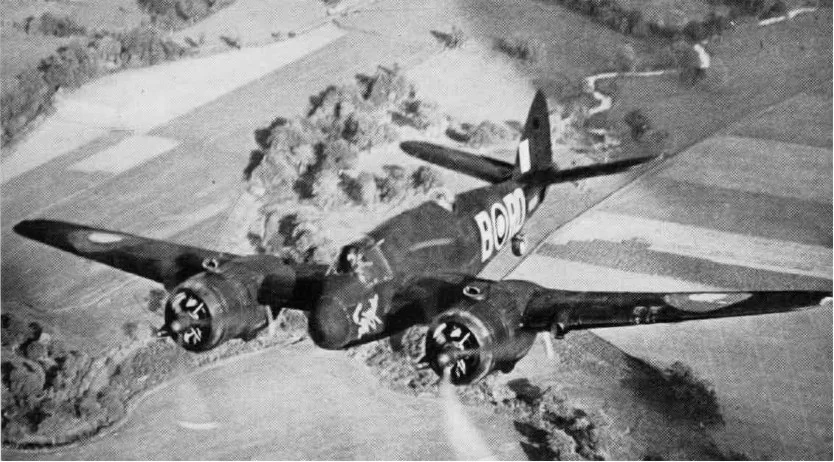

**Image credit:** [U.S. Navy, Naval Aviation News; public domain in the United States](https://commons.wikimedia.org/wiki/File:Bristol_Beaufighter_NAN15Dec43.jpg)

- A. Supermarine Spitfire
- B. North American P-51 Mustang
- C. Bristol Beaufighter
- D. Boeing B-17 Flying Fortress

**Correct answer:** C

- **A · Incorrect:** A British single-engine fighter.
- **B · Incorrect:** An American single-engine fighter.
- **C · Correct:** The U.S. Navy caption identifies this twin-engine RAF aircraft as a Beaufighter Mk IF.
- **D · Incorrect:** An American four-engine heavy bomber.

**Source:** [Photograph and original identification](https://commons.wikimedia.org/wiki/File:Bristol_Beaufighter_NAN15Dec43.jpg)

### WWII-N177 — Which WWII aircraft model is pictured?

**Topic:** Equipment — Aircraft

**Image:** 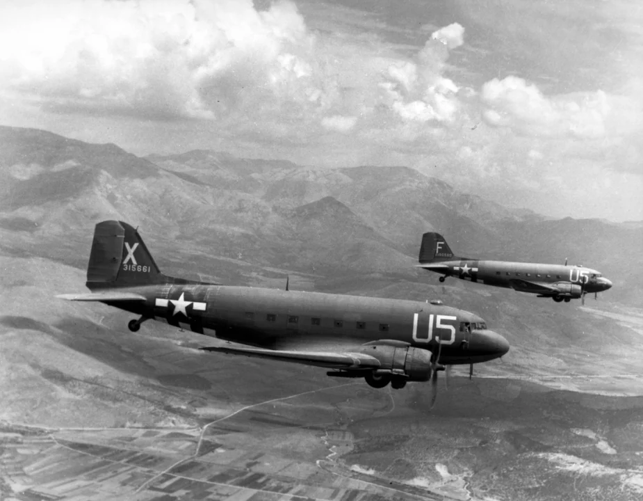

**Image credit:** [U.S. Air Force archive; public domain in the United States](https://commons.wikimedia.org/wiki/File:Two_USAAF_C-47A_Skytrains.jpg)

- A. Douglas C-47 Skytrain
- B. Douglas SBD Dauntless
- C. Lockheed P-38 Lightning
- D. Boeing B-17 Flying Fortress

**Correct answer:** A

- **A · Correct:** The U.S. Air Force identifies these transport aircraft as C-47s carrying paratroopers toward southern France in August 1944.
- **B · Incorrect:** A single-engine dive bomber.
- **C · Incorrect:** A twin-boom fighter.
- **D · Incorrect:** A four-engine bomber.

**Source:** [Photograph and original identification](https://commons.wikimedia.org/wiki/File:Two_USAAF_C-47A_Skytrains.jpg)

### WWII-N178 — Which WWII aircraft model is pictured?

**Topic:** Equipment — Aircraft

**Image:** 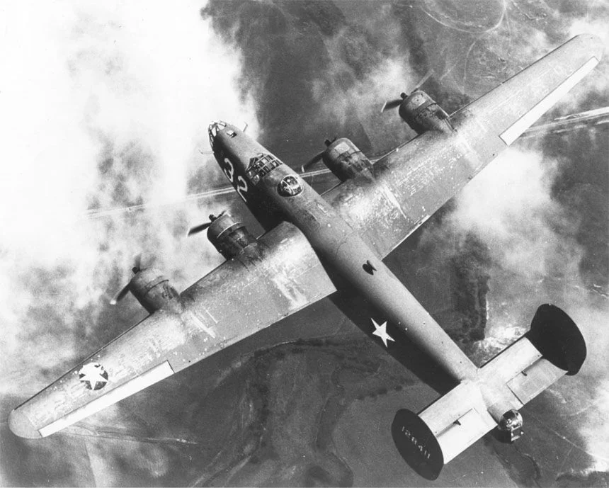

**Image credit:** [U.S. Air Force Historical Research Agency; public domain in the United States](https://commons.wikimedia.org/wiki/File:B-24_from_above.jpg)

- A. Boeing B-17 Flying Fortress
- B. Boeing B-29 Superfortress
- C. North American B-25 Mitchell
- D. Consolidated B-24 Liberator

**Correct answer:** D

- **A · Incorrect:** A heavy bomber with a single vertical tail.
- **B · Incorrect:** A heavy bomber with a single vertical tail and a rounded glazed nose.
- **C · Incorrect:** A medium bomber with two engines.
- **D · Correct:** The U.S. Air Force archive identifies this aircraft as a B-24E. Its four engines and twin tail fins are visible.

**Source:** [Photograph and original identification](https://commons.wikimedia.org/wiki/File:B-24_from_above.jpg)

### WWII-N179 — Which WWII tank model is pictured?

**Topic:** Equipment — Tanks

**Image:** 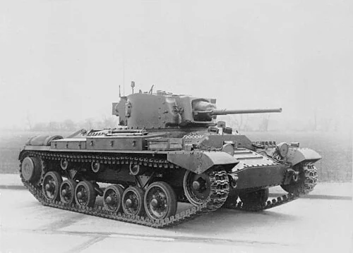

**Image credit:** [Imperial War Museums KID 863, British official photograph; UK Crown public domain](https://commons.wikimedia.org/wiki/File:IWM-KID-863-valentine-mkIII.jpg)

- A. M24 Chaffee
- B. Valentine
- C. M4 Sherman
- D. Panzer IV

**Correct answer:** B

- **A · Incorrect:** An American light tank.
- **B · Correct:** The official British photograph identifies this as a Valentine III infantry tank.
- **C · Incorrect:** An American medium tank.
- **D · Incorrect:** A German medium tank.

**Source:** [Photograph and original identification](https://commons.wikimedia.org/wiki/File:IWM-KID-863-valentine-mkIII.jpg)

### WWII-N180 — Which WWII tank model is pictured?

**Topic:** Equipment — Tanks

**Image:** 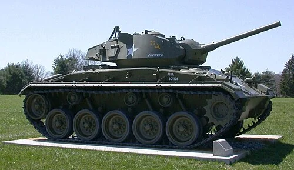

**Image credit:** [Greg Goebel; released into the public domain](https://commons.wikimedia.org/wiki/File:M24_chaffee_light_tank.jpg)

- A. M3 Lee
- B. Churchill
- C. M24 Chaffee
- D. IS-2

**Correct answer:** C

- **A · Incorrect:** A medium tank with its main gun mounted in the hull.
- **B · Incorrect:** A British infantry tank with tracks that rise around the hull.
- **C · Correct:** Greg Goebel’s photo shows a Chaffee, an American light tank.
- **D · Incorrect:** A Soviet heavy tank.

**Source:** [Photograph and original identification](https://commons.wikimedia.org/wiki/File:M24_chaffee_light_tank.jpg)

### WWII-N181 — Which WWII tank model is pictured?

**Topic:** Equipment — Tanks

**Image:** 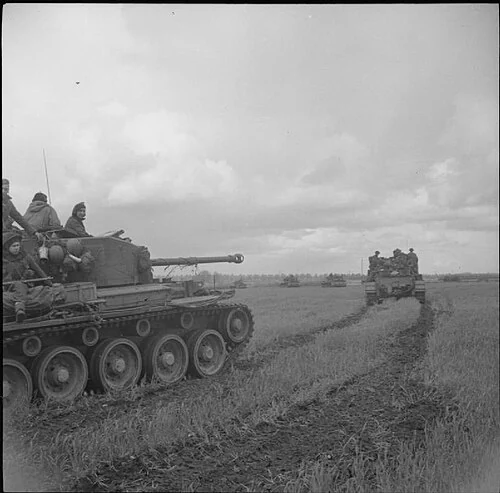

**Image credit:** [No. 5 Army Film and Photographic Unit, Imperial War Museums BU 4949; UK Crown public domain](https://commons.wikimedia.org/wiki/File:The_British_Army_in_North-west_Europe_1944-45_BU4949.jpg)

- A. A34 Comet
- B. Tiger I
- C. T-34
- D. Type 95 Ha-Go

**Correct answer:** A

- **A · Correct:** The British Army caption identifies the vehicles as Comets of the 2nd Fife and Forfar Yeomanry on May 1, 1945.
- **B · Incorrect:** A German heavy tank.
- **C · Incorrect:** A Soviet medium tank.
- **D · Incorrect:** A Japanese light tank.

**Source:** [Photograph and original identification](https://commons.wikimedia.org/wiki/File:The_British_Army_in_North-west_Europe_1944-45_BU4949.jpg)

### WWII-N182 — Which WWII military vehicle is pictured?

**Topic:** Equipment — Vehicles

**Image:** 

**Image credit:** [U.S. War Department, 1944; public domain in the United States](https://commons.wikimedia.org/wiki/File:M3_Halftrack.jpg)

- A. Willys MB Jeep
- B. DUKW amphibious truck
- C. M4 Sherman
- D. M3 half-track

**Correct answer:** D

- **A · Incorrect:** A light utility vehicle with four wheels.
- **B · Incorrect:** A six-wheeled transport with a boat-shaped hull.
- **C · Incorrect:** A fully tracked tank with a turret.
- **D · Correct:** The U.S. War Department’s photograph shows the M3, which has front wheels and rear tracks.

**Source:** [Photograph and original identification](https://commons.wikimedia.org/wiki/File:M3_Halftrack.jpg)

### WWII-N183 — Which WWII military vehicle is pictured?

**Topic:** Equipment — Vehicles

**Image:** 

**Image credit:** [U.S. Navy photograph 80-G-K-14065; public domain in the United States](https://commons.wikimedia.org/wiki/File:DUKWs_on_Anzio_beach_in_April_1944.jpg)

- A. M3 half-track
- B. DUKW amphibious truck
- C. Willys MB Jeep
- D. M24 Chaffee

**Correct answer:** B

- **A · Incorrect:** An armored vehicle with wheels in front and tracks at the rear.
- **B · Correct:** The U.S. Navy caption identifies these amphibious transports carrying supplies at Anzio in April 1944.
- **C · Incorrect:** A small four-wheel utility vehicle.
- **D · Incorrect:** A tracked light tank.

**Source:** [Photograph and original identification](https://commons.wikimedia.org/wiki/File:DUKWs_on_Anzio_beach_in_April_1944.jpg)

### WWII-N184 — Which WWII military vehicle is pictured?

**Topic:** Equipment — Vehicles

**Image:** 

**Image credit:** [Lars-Göran Lindgren Sweden; CC BY-SA 4.0; resized and converted to WebP](https://commons.wikimedia.org/wiki/File:Willys_MB_Jeep_1944.jpg)

**Image license:** [CC BY-SA 4.0](https://creativecommons.org/licenses/by-sa/4.0/)

- A. DUKW amphibious truck
- B. M3 half-track
- C. Willys MB Jeep
- D. M4 Sherman

**Correct answer:** C

- **A · Incorrect:** A larger six-wheel vehicle with a boat-shaped hull.
- **B · Incorrect:** An armored transport with rear tracks.
- **C · Correct:** The photo shows a restored 1944 Willys MB, a small Allied utility vehicle.
- **D · Incorrect:** A fully tracked medium tank.

**Source:** [Photograph and original identification](https://commons.wikimedia.org/wiki/File:Willys_MB_Jeep_1944.jpg)

### WWII-N185 — Who is the general wading ashore in this photograph?

**Topic:** History — People

**Image:** 

**Image credit:** [U.S. National Archives, record 531424 (public domain)](https://catalog.archives.gov/id/531424)

- A. Douglas MacArthur
- B. Dwight D. Eisenhower
- C. Bernard Montgomery
- D. George Patton

**Correct answer:** A

- **A · Correct:** MacArthur waded ashore at Leyte during the 1944 return to the Philippines.
- **B · Incorrect:** He led the Allied campaign in Western Europe.
- **C · Incorrect:** He commanded British-led ground forces in Europe and North Africa.
- **D · Incorrect:** He commanded U.S. ground forces in Europe.

**Source:** [National Archives archival caption](https://catalog.archives.gov/id/531424)

### WWII-N186 — Which U.S. president is shown signing the declaration of war against Japan?

**Topic:** History — People

**Image:** 

**Image credit:** [U.S. National Archives, record 520053 (public domain)](https://catalog.archives.gov/id/520053)

- A. Harry S. Truman
- B. Franklin D. Roosevelt
- C. Herbert Hoover
- D. Dwight D. Eisenhower

**Correct answer:** B

- **A · Incorrect:** Truman became president in April 1945.
- **B · Correct:** Roosevelt signed the declaration on December 8, 1941, the day after Pearl Harbor.
- **C · Incorrect:** Hoover’s presidency ended in 1933.
- **D · Incorrect:** Eisenhower was an Army officer during WWII and became president in 1953.

**Source:** [National Archives archival caption](https://catalog.archives.gov/id/520053)

### WWII-N187 — Which British prime minister is seated at the left of this photograph from Yalta?

**Topic:** History — People

**Image:** 

**Image credit:** [U.S. National Archives, record 531340 (public domain)](https://catalog.archives.gov/id/531340)

- A. Clement Attlee
- B. Neville Chamberlain
- C. Winston Churchill
- D. Anthony Eden

**Correct answer:** C

- **A · Incorrect:** Attlee became prime minister in July 1945.
- **B · Incorrect:** Chamberlain resigned as prime minister in May 1940.
- **C · Correct:** Churchill sat to Roosevelt’s right, on the viewer’s left, during the Yalta Conference in February 1945.
- **D · Incorrect:** Eden was foreign secretary at the time.

**Source:** [National Archives archival caption](https://catalog.archives.gov/id/531340)

### WWII-N188 — Which Soviet leader is standing behind the seated foreign minister in this photograph?

**Topic:** History — People

**Image:** 

**Image credit:** [U.S. National Archives, record 540196 (public domain)](https://catalog.archives.gov/id/540196)

- A. Nikita Khrushchev
- B. Leon Trotsky
- C. Mikhail Kalinin
- D. Joseph Stalin

**Correct answer:** D

- **A · Incorrect:** Khrushchev rose to national leadership after Stalin’s death.
- **B · Incorrect:** Trotsky was in exile by the time of this photograph.
- **C · Incorrect:** Kalinin served as the Soviet Union’s formal head of state, but the pictured standing leader is Stalin.
- **D · Correct:** Stalin is pictured standing behind Soviet foreign minister Vyacheslav Molotov.

**Source:** [National Archives archival caption](https://catalog.archives.gov/id/540196)

### WWII-N189 — Which U.S. president announced Japan’s surrender at this White House press conference?

**Topic:** History — People

**Image:** 

**Image credit:** [U.S. National Archives, record 520054 (public domain)](https://catalog.archives.gov/id/520054)

- A. Harry S. Truman
- B. Franklin D. Roosevelt
- C. Dwight D. Eisenhower
- D. Herbert Hoover

**Correct answer:** A

- **A · Correct:** Truman announced Japan’s acceptance of the surrender terms on August 14, 1945.
- **B · Incorrect:** Roosevelt died in April 1945, before Japan surrendered.
- **C · Incorrect:** Eisenhower led Allied forces in Europe during WWII.
- **D · Incorrect:** Hoover left office in 1933.

**Source:** [National Archives archival caption](https://catalog.archives.gov/id/520054)

### WWII-N190 — Which U.S. general is meeting Lieutenant Colonel Lyle Bernard in this photograph from Sicily?

**Topic:** History — People

**Image:** 

**Image credit:** [U.S. National Archives, record 531335 (public domain)](https://catalog.archives.gov/id/531335)

- A. Douglas MacArthur
- B. George S. Patton
- C. Chester W. Nimitz
- D. Mark W. Clark

**Correct answer:** B

- **A · Incorrect:** MacArthur commanded Allied forces in the Southwest Pacific.
- **B · Correct:** The photograph shows Patton discussing operations with Bernard near Brolo in 1943.
- **C · Incorrect:** Nimitz was a U.S. Navy admiral in the Pacific.
- **D · Incorrect:** Clark commanded the U.S. Fifth Army during the Italian campaign.

**Source:** [National Archives archival caption](https://catalog.archives.gov/id/531335)

### WWII-N191 — Which Italian dictator is sitting next to Adolf Hitler in this photograph?

**Topic:** History — People

**Image:** 

**Image credit:** [U.S. National Archives, record 540151 (public domain)](https://catalog.archives.gov/id/540151)

- A. Francisco Franco
- B. Hideki Tojo
- C. Benito Mussolini
- D. Pietro Badoglio

**Correct answer:** C

- **A · Incorrect:** Franco ruled Spain during the war.
- **B · Incorrect:** Tojo was a Japanese Army general and prime minister.
- **C · Correct:** Mussolini and Hitler were photographed together in Munich in 1940.
- **D · Incorrect:** Badoglio became Italian prime minister after Mussolini was removed in 1943.

**Source:** [National Archives archival caption](https://catalog.archives.gov/id/540151)

### WWII-N192 — What kind of artillery is shown in this photograph from Italy?

**Topic:** Equipment — Artillery

**Image:** 

**Image credit:** [U.S. National Archives, record 531176 (public domain)](https://catalog.archives.gov/id/531176)

- A. 88 mm anti-aircraft gun
- B. 60 mm infantry mortar
- C. Tank turret
- D. 240 mm howitzer

**Correct answer:** D

- **A · Incorrect:** The German 88 was a smaller-caliber gun on a different mounting.
- **B · Incorrect:** A 60 mm mortar is a much smaller, portable infantry weapon.
- **C · Incorrect:** The weapon is a field artillery piece on the ground.
- **D · Correct:** The archive identifies a 240 mm howitzer of the 697th Field Artillery Battalion near Mignano in January 1944.

**Source:** [National Archives archival caption](https://catalog.archives.gov/id/531176)

### WWII-N193 — What were the Victory ships being fitted out in this photograph designed to carry?

**Topic:** Equipment — Warships

**Image:** 

**Image credit:** [U.S. National Archives, record 535970 (public domain)](https://catalog.archives.gov/id/535970)

- A. Cargo and supplies
- B. Squadrons of combat aircraft
- C. Heavy guns for fleet battles
- D. Torpedoes for submerged attacks

**Correct answer:** A

- **A · Correct:** The ships were built to move supplies to overseas ports and bases.
- **B · Incorrect:** Aircraft carriers operated aircraft from a flight deck.
- **C · Incorrect:** Battleships carried large guns in armored turrets.
- **D · Incorrect:** Submarines launched underwater attacks.

**Source:** [National Archives archival caption](https://catalog.archives.gov/id/535970)

### WWII-N194 — Which entertainer is performing at this London canteen for Allied troops?

**Topic:** History — People

**Image:** 

**Image credit:** [U.S. National Archives, record 531210 (public domain)](https://catalog.archives.gov/id/531210)

- A. Bob Hope
- B. Bing Crosby
- C. Frank Sinatra
- D. Glenn Miller

**Correct answer:** B

- **A · Incorrect:** Hope also entertained troops, but the archive identifies Crosby here.
- **B · Correct:** The Army photograph identifies Crosby at the opening of the Stage Door Canteen in London.
- **C · Incorrect:** He was a singer and entertainer, but he is not the performer in this photograph.
- **D · Incorrect:** Miller led a military band rather than singing in this archival photo.

**Source:** [National Archives archival caption](https://catalog.archives.gov/id/531210)

### WWII-N195 — Which film star is visiting this wounded soldier?

**Topic:** History — People

**Image:** 

**Image credit:** [U.S. National Archives, record 531330 (public domain)](https://catalog.archives.gov/id/531330)

- A. Ingrid Bergman
- B. Greta Garbo
- C. Marlene Dietrich
- D. Hedy Lamarr

**Correct answer:** C

- **A · Incorrect:** Bergman was a film star of the period, but the visitor here is Dietrich.
- **B · Incorrect:** Garbo was another film star, but she is not pictured.
- **C · Correct:** The Army caption identifies Dietrich signing the cast of Tec 4 Earl McFarland.
- **D · Incorrect:** Lamarr was an actress and inventor. The archive names Dietrich in this image.

**Source:** [National Archives archival caption](https://catalog.archives.gov/id/531330)

### WWII-N196 — Which amphibious vehicle carried these Marines toward Tinian?

**Topic:** Equipment — Vehicles

**Image:** 

**Image credit:** [U.S. National Archives, record 513181 (public domain)](https://catalog.archives.gov/id/513181)

- A. M3 half-track
- B. DUKW amphibious truck
- C. M4 Sherman
- D. LVT Water Buffalo

**Correct answer:** D

- **A · Incorrect:** The M3 had front wheels and rear tracks and could not swim.
- **B · Incorrect:** The DUKW used six wheels instead of tracks.
- **C · Incorrect:** The Sherman was a medium tank. Its DD amphibious version used a flotation screen.
- **D · Correct:** The archive identifies the tracked amphibious landing vehicle as a Water Buffalo.

**Source:** [National Archives archival caption](https://catalog.archives.gov/id/513181)

### WWII-N197 — Which torpedo bomber is flying in formation in this photograph?

**Topic:** Equipment — Aircraft

**Image:** 

**Image credit:** [U.S. National Archives, record 520789 (public domain)](https://catalog.archives.gov/id/520789)

- A. Grumman TBF Avenger
- B. Douglas SBD Dauntless
- C. Vought F4U Corsair
- D. Douglas TBD Devastator

**Correct answer:** A

- **A · Correct:** The archive identifies this formation over Norfolk, Virginia, as TBF Avengers.
- **B · Incorrect:** The Dauntless was primarily a dive bomber.
- **C · Incorrect:** The Corsair was a fighter recognizable by its inverted gull wings.
- **D · Incorrect:** The Devastator was an earlier U.S. Navy torpedo bomber.

**Source:** [National Archives archival caption](https://catalog.archives.gov/id/520789)

### WWII-N198 — Who is talking to the paratroopers before the Normandy invasion?

**Topic:** History — People

**Image:** 

**Image credit:** [U.S. National Archives, record 531217 (public domain)](https://catalog.archives.gov/id/531217)

- A. Douglas MacArthur
- B. Dwight D. Eisenhower
- C. Chester W. Nimitz
- D. Omar Bradley

**Correct answer:** B

- **A · Incorrect:** MacArthur commanded in the Southwest Pacific.
- **B · Correct:** The Army caption identifies Eisenhower addressing paratroopers before their departure for Normandy.
- **C · Incorrect:** Nimitz commanded U.S. naval forces in the Pacific.
- **D · Incorrect:** Bradley helped lead U.S. ground forces in Normandy, but Eisenhower is the officer pictured.

**Source:** [National Archives archival caption](https://catalog.archives.gov/id/531217)

### WWII-N199 — What type of ship is firing its main guns in this photograph?

**Topic:** Equipment — Warships

**Image:** 

**Image credit:** [U.S. National Archives, record 520626 (public domain)](https://catalog.archives.gov/id/520626)

- A. Aircraft carrier
- B. Destroyer escort
- C. Battleship
- D. Troop transport

**Correct answer:** C

- **A · Incorrect:** Carriers are built around flight decks for aircraft.
- **B · Incorrect:** Destroyer escorts were smaller warships with much lighter guns.
- **C · Correct:** The archive identifies USS Iowa firing its 16-inch guns during a Pacific battle drill.
- **D · Incorrect:** Transports chiefly carried personnel.

**Source:** [National Archives archival caption](https://catalog.archives.gov/id/520626)

### WWII-N200 — Which battleship hosted Japan’s surrender ceremony on the day of this flyover?

**Topic:** Equipment — Warships

**Image:** 

**Image credit:** [U.S. National Archives, record 520775 (public domain)](https://catalog.archives.gov/id/520775)

- A. USS Arizona
- B. USS Texas
- C. HMS King George V
- D. USS Missouri

**Correct answer:** D

- **A · Incorrect:** Arizona sank at Pearl Harbor in 1941.
- **B · Incorrect:** Texas participated in the Normandy landings and later supported operations in the Pacific.
- **C · Incorrect:** The British battleship was present in Tokyo Bay, but Missouri hosted the signing.
- **D · Correct:** The archive identifies Missouri in the foreground during the surrender ceremonies on September 2, 1945.

**Source:** [National Archives archival caption](https://catalog.archives.gov/id/520775)

### WWII-N201 — Which military cargo truck is pictured on the Red Ball Express route?

**Topic:** Equipment — Vehicles

**Image:** 

**Image credit:** [U.S. military photograph (public domain)](https://commons.wikimedia.org/wiki/File:Red_Ball_Express_-_Truck_in_the_mud.jpg)

- A. GMC CCKW
- B. Willys MB Jeep
- C. M3 half-track
- D. Sd.Kfz. 251

**Correct answer:** A

- **A · Correct:** The Army’s 2½-ton six-wheel cargo truck was a workhorse of the Red Ball Express.
- **B · Incorrect:** The Jeep was a small four-wheel utility vehicle.
- **C · Incorrect:** The M3 used rear tracks and was primarily an armored personnel carrier.
- **D · Incorrect:** The Sd.Kfz. 251 was a German armored half-track.

**Source:** [U.S. Army Transportation Corps history](https://transportation.army.mil/history/studies/red_ball_express.html)

### WWII-N202 — Which bomber is taking off from USS Hornet during the Doolittle Raid?

**Topic:** Equipment — Aircraft

**Image:** 

**Image credit:** [U.S. National Archives, record 520603 (public domain)](https://catalog.archives.gov/id/520603)

- A. Boeing B-17 Flying Fortress
- B. North American B-25 Mitchell
- C. Douglas SBD Dauntless
- D. Martin B-26 Marauder

**Correct answer:** B

- **A · Incorrect:** The B-17 was a four-engine heavy bomber and did not fly in the raid.
- **B · Correct:** Army B-25 bombers took off from Hornet during the April 1942 raid on Japan.
- **C · Incorrect:** The Dauntless was a single-engine Navy dive bomber.
- **D · Incorrect:** The B-26 was a twin-engine bomber, but the Doolittle Raid used B-25s.

**Source:** [National Archives archival caption](https://catalog.archives.gov/id/520603)

### WWII-N203 — Which fighter is shown with the Flying Tigers’ shark-mouth paint scheme?

**Topic:** Equipment — Aircraft

**Image:** 

**Image credit:** [U.S. National Archives, record 535531 (public domain)](https://catalog.archives.gov/id/535531)

- A. North American P-51 Mustang
- B. Grumman F6F Hellcat
- C. Curtiss P-40 Warhawk
- D. Republic P-47 Thunderbolt

**Correct answer:** C

- **A · Incorrect:** The P-51 was a different American fighter used later in the war.
- **B · Incorrect:** The Hellcat was a U.S. Navy carrier fighter.
- **C · Correct:** The archive identifies the pictured aircraft in China as P-40s.
- **D · Incorrect:** The P-47 was a different fighter with a large radial engine.

**Source:** [National Archives archival caption](https://catalog.archives.gov/id/535531)

### WWII-N204 — Which German field marshal is signing the surrender document in Berlin?

**Topic:** History — People

**Image:** 

**Image credit:** [U.S. National Archives, record 531290 (public domain)](https://catalog.archives.gov/id/531290)

- A. Erwin Rommel
- B. Bernard Montgomery
- C. Hermann Göring
- D. Wilhelm Keitel

**Correct answer:** D

- **A · Incorrect:** Rommel died in October 1944.
- **B · Incorrect:** Montgomery was a British commander who accepted a separate surrender in northern Germany.
- **C · Incorrect:** Göring led the Luftwaffe and was not the signer shown.
- **D · Correct:** Keitel signed the ratified German surrender terms in Berlin in May 1945.

**Source:** [National Archives archival caption](https://catalog.archives.gov/id/531290)
